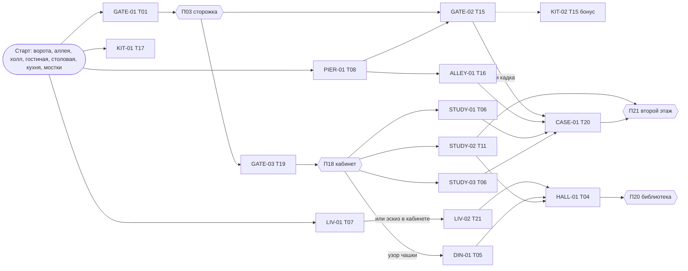
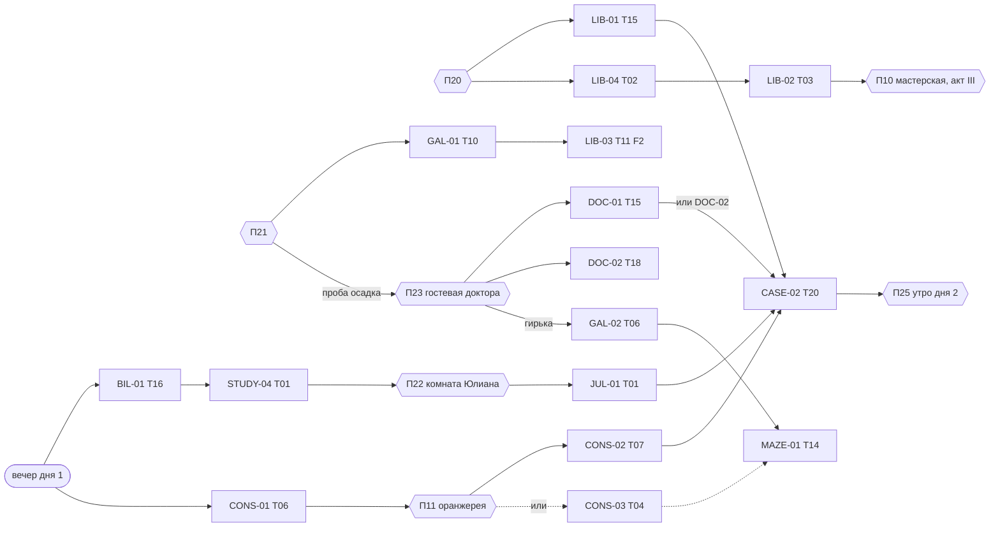
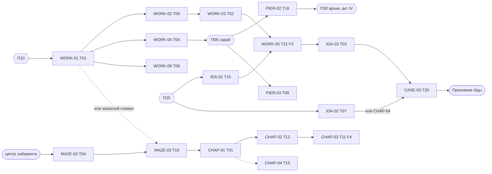
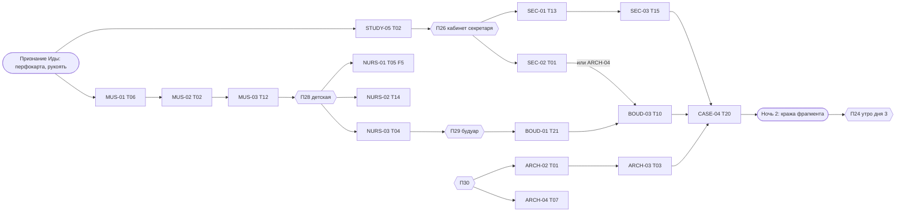
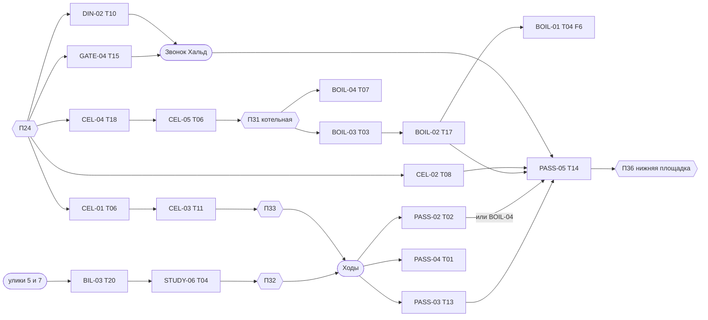

# Мастер-список головоломок «Совиный Холм»

Статус: черновик v1.1 (26.11.2026), левел-дизайн. Правки 26.11 после v1.1: `PIER-01` — цель «изнанка пальто подмокла снизу» вместо «сухих досок» (решение директора); `KIT-02` — знак «маятник в квадрате» вместо конвертов «В.»; `GATE-02` помечена к перестройке (журнал прошлых дней + лента самописца, сторожа нет). v1.1: правки по ответам сценариста (раздел 8): `CHAP-04` без расхождения дат и без намёка на вторую часть (улика `CL-WELD-BROOCH`); затёртое перо на «сложном» — F6 из котельной; `CL-BELL-HOUR` даёт реплика Тарна, а не `QUIET-02`. Полные карточки тестовой подборки акта I — `docs/levels/test-set-01.md`. Это сводная таблица и граф прогрессии, по которым пишутся полные карточки (шаблон — `docs/levels/puzzle-framework.md`, раздел 10). Значений (кодов, порядков, чисел) здесь нет: только механика. Тестовые значения появятся в карточках, релизные подбираются позже.

Опора: `docs/00-brief.md` (решения владельца 1–13), `docs/story/story-bible.md` v4 (карта, переходы П01–П39, улики 1–10, LL-1…LL-6, язык мира), `docs/levels/puzzle-framework.md` v2.1 (типы T01–T22, рейтинги, классы перевода, правила графа), `docs/marketing/puzzle-research.md` (что любят и не любят игроки), `docs/design/visual-and-ux.md` (визуальный язык головоломок).

**Итого: 104 головоломки** — I 16 / II 18 / III 19 / IV 19 / V 18 / VI 14.

---

## 0. Как читать

**Столбцы таблиц.**
- **ID** — `PZ-<LOC>-<nn>`; номер не равен порядку прохождения.
- **Тип** — T01–T22 по каркасу (раздел 2). Для многоэтапных в скобках указаны типы этапов.
- **Р** — рейтинг сложности 1–5 для нормального уровня (на лёгком ощущается примерно на 1 ниже, на сложном на 1 выше).
- **Даёт / открывает** — предмет (`IT-`), знание или улика (`CL-`, «улика N» по библии 6.4), переход (`П..` по библии 7.2), перо Совиного пути (`F1`–`F6`).
- **Требует** — ID головоломок, предметов, знаний и переходов. «А или Б» — развилка `any_of`.
- **Источник подсказки** — где игрок берёт данные для решения.
- **RU/EN** — класс перевода: A — числа, знаки, механика; B — информацию несёт текст, он пишется отдельно на RU и EN с тем же ответом; C — текст в графике, нужна локализованная картинка.
- **Обяз.** — «Да» обязательна на любом пути; «М\*» — обязательна одна из альтернатив развилки (см. раздел 5); «Нет» — необязательная (бонус, строки эпилога или альтернатива).
- **Суть** — механика одной фразой, без значений.

**Коды локаций** (номера по библии 7.4).

| LOC | Локация | LOC | Локация |
|---|---|---|---|
| GATE | 1 Ворота и сторожка | IDA | 15 Гостевая Иды |
| ALLEY | 2 Аллея и фонтан | MAZE | 16 Сад-лабиринт |
| HALL | 3 Главный холл | PIER | 17 Мостки и лодочный сарай |
| LIV | 4 Гостиная | CHAP | 18 Часовня |
| DIN | 5 Столовая | BOUD | 19 Будуар Вероники |
| KIT | 6 Кухня и людская | MUS | 20 Музыкальный салон |
| STUDY | 7 Кабинет Тарна | NURS | 21 Заброшенная детская |
| LIB | 8 Библиотека | SEC | 22 Кабинет секретаря |
| BIL | 9 Бильярдная | ARCH | 23 Архив в мансарде |
| JUL | 10 Комната Юлиана | CEL | 24 Винный погреб |
| GAL | 11 Портретная галерея | BOIL | 25 Котельная |
| DOC | 12 Гостевая доктора | PASS | 26 Потайные ходы |
| CONS | 13 Оранжерея | MECH | 27 Механизм башни |
| WORK | 14 Мастерская-флигель | QUIET | 28 Тихая камера |
| | | OBS | 29 Обсерватория |
| | | CASE | доска дела в блокноте (не локация: доски дедукции T20, собираются в любом месте) |

---

## 1. Сквозные системы

### 1.1. Язык мира в головоломках
- **«Знаки мастерской»** (библия 9.1): таблица собирается из трёх частей. Знаки 1–4 (Сова, Ключ, Шестерня, Луна) — изразцы камина `LIV-01` (или эскиз изразцов на столе Тарна); 5–7 (Перо, Маятник, Звезда) — портреты галереи `GAL-01`; 8 (Волна) — стена детской `NURS-01`. На лёгком таблица сразу полная. Решения никогда не опираются на название знака.
- **«Циферблатный шифр Тарна»** (библия 9.2): легенда — сам циферблат напольных часов холла (метки на 10, 11, 12 означают «0», «повтор», «конец»), `CL-HALL-DIAL`, видна после `HALL-01`. Шифр растёт по игре: одна стрелка (`LIB-04`) → двойная расшифровка (`WORK-03`) → две стрелки «знак + действие» (`STUDY-05`, `PASS-02`) → две стрелки с помехами (`QUIET-02`). Шесть головоломок T02 — это одна обучающая линия.
- **Цветные ноты** (библия 9.3): часы холла (источник LL-3), металлофон Юлиана, шкатулки и пианола, колокола башни. Цвет всегда с формой молоточка.

### 1.2. Совиный путь и перья
Тарн разложил по дому цепочку загадок, ведущую к завещанию. Каждый крупный шаг пути отдаёт **латунное перо** со знаком на лицевой стороне и циферблатной меткой на обороте. Перья — фрагменты метазагадки (раздел 4). Все шесть лежат на обязательном пути.

| Перо | Знак | Где | Головоломка | Акт |
|---|---|---|---|---|
| F1 | Ключ | корпус часов холла | `HALL-01` | I |
| F2 | Перо | тайная полка библиотеки | `LIB-03` | II |
| F3 | Шестерня | шкаф чертежей | `WORK-05` | III |
| F4 | Звезда | ниша под алтарём часовни | `CHAP-03` | III |
| F5 | Волна | сундук с игрушками в детской | `NURS-01` | IV |
| F6 | Луна | кожух щита передач | `BOIL-01` | V |

Для инвентаря: перья лежат в одном слоте «Совиный путь» (мешочек), чтобы не забивать сумку (лимит каркаса 8–10 предметов).

### 1.3. Ключевые предметы (где взять → где применить)
Ни один предмет не расходуется до последнего применения (каркас 7.4).

| Предмет | Откуда | Куда |
|---|---|---|
| IT-OWL заводная сова Клары | инвентарь со старта | `QUIET-01` (LL-1) |
| IT-TICKET билет и письмо Тарна | инвентарь со старта | `GATE-03` |
| IT-GLASSES очки Клары для чтения | инвентарь со старта (Клара надевает их при чтении мелкого текста: «почти лупа») | `OBS-01` |
| IT-HAND-MIRROR карманное зеркальце | гостиная, каминная полка | `STUDY-03` |
| IT-POKER кочерга | гостиная, камин | `CONS-01`, `WORK-06` |
| IT-JAR пустая баночка для специй | кухня | `STUDY-01` |
| IT-SEDIMENT-JAR проба осадка (улика 1) | `STUDY-01` | событие П23 (показать доктору) |
| IT-STUDY-KEY запасной ключ от кабинета | `GATE-03` | П18 |
| IT-CLOCK-KEY ключ завода | `DIN-01` | `HALL-01`, `WORK-02` |
| IT-PENDULUM-BOB груз маятника | `LIV-02` | `HALL-01` |
| IT-LIB-KEY, IT-CLOCK-CARD ключ от библиотеки, перфорированная карточка | `HALL-01` | П20; `LIB-04`, `LIB-02` |
| IT-OIL-CAN маслёнка | кладовая кухни, с вечера дня 1 | `CONS-01` |
| IT-IOU расписка Юлиана | `STUDY-04` | событие П22 |
| IT-DOC-WEIGHT гирька докторских весов | гостевая доктора, свободно | `GAL-02` (и этап `DOC-02`) |
| IT-ANCHOR-KEY ключ с якорем | `WORK-04` | П06 |
| IT-VALVE-KEY ключ-вентиль | `WORK-06` | `CEL-05` (П31) |
| IT-GNOMON гномон | `MAZE-02` или запасной на верстаке мастерской | `MAZE-03` |
| IT-BLUEPRINT-FRAG фрагмент чертежа с двумя метками | `WORK-05` | `IDA-03`, `ARCH-03`; украден в «Ночь 2», возвращается в `PASS-04` |
| IT-WELD-SEAL печатка Вельда (Маятник в квадрате) | `CHAP-03` | `OBS-05` |
| IT-HOOK-POLE шест с крюком | `PIER-02` | `ARCH-01` (П30), `MECH-02` |
| IT-PUNCH-CARD, IT-PHONO-CRANK перфокарта и рукоять фонографа | признание Иды (`CASE-03`) | `STUDY-05`, `MUS-01` |
| IT-KEY-PLATE ключ-пластина | `STUDY-05` | П26 |
| IT-NURSERY-KEY ключ от детской | `MUS-03` | П28 |
| IT-FLOUR мука | кладовая, событие П24 | `CEL-01` |
| IT-SIGNET перстень Тарна (Сова в круге) | Тарн в Тихой камере, после `QUIET-01` | `OBS-05` |

«Знакомый предмет — новое назначение» (приоритет владельца): ключ завода как рукоять шифратора, гирька весов как гиря кукушки, кочерга как рычаг и вороток тисков, зеркальце для промокашки, баночка для специй для пробы, мука против сквозняка, шест для люка и рычага башни, очки Клары как окуляр телескопа. Каждое применение подготовлено формой предмета или репликой при осмотре.

---

## 2. Таблицы по актам

### Акт I. Дом (день 1, утро) — 16

| ID | Название | Локация | Акт | Тип | Р | Даёт / открывает | Требует | Источник подсказки | RU/EN | Обяз. | Суть |
|---|---|---|---|---|---|---|---|---|---|---|---|
| PZ-GATE-01 | Замок сторожки | 1 Ворота | I | T01 | 1 | П03 (вход в сторожку) | — | знаки на столбах ворот (порядок); у каждой чаши фонтана свой знак и метки уровня воды | A | Да | Знаки на столбах задают порядок, уровень воды в чаше с тем же знаком даёт цифру; набрать цифры на барабанах. Обучение T01. |
| PZ-GATE-02 | Метеожурнал и пальто | 1 Сторожка | I | T15 | 1 | карточка CL-RAIN: «пальто положили после дождя» | П03; PIER-01 | **[ПЕРЕСТРОИТЬ]** журнал прошлых дней (почерк Тарна, переписан с ленты по вечерам; ночи 14–15 октября в нём нет) + лента погодного самописца за ночь (дождь 23:15–02:00); карточка CL-COAT-DRY «пальто сверху сухое, снизу подмокло от досок». Сторожа в усадьбе нет (библия 6.2, 12) | B | М\* (Ф-I-3) | **[ПЕРЕСТРОИТЬ: документы — журнал прошлых дней + лента самописца за ночь; сторожа нет]** Выбрать на ленте и в описании пальто два фрагмента, которые вместе доказывают, что пальто попало на мостки после дождя. Журнал прошлых дней — легенда к ленте и ложные фрагменты. Обучение T15. |
| PZ-GATE-03 | Ящик с ключами | 1 Сторожка | I | T19 | 2 | IT-STUDY-KEY → П18 | П03; IT-TICKET | бирка Тарна «для гостя с поезда»; на билете время отправления и время в пути | A | Да | Часовой замок ящика: вычислить по билету время прибытия поезда и выставить стрелки. Тарн настроил ящик для Клары. Обучение T19. |
| PZ-PIER-01 | Пальто на мостках | 17 Мостки | I | T08 | 1 | карточки CL-COAT-DRY, CL-HAT | — | сцена мостков, список-силуэты | A | Да | Найти по силуэтам вещи и следы на мостках: пальто, шляпу, подмокший снизу край пальто (верх сухой, доски мокрые), мокрое вокруг и другое. Обучение T08. |
| PZ-ALLEY-01 | Следы на гравии | 2 Аллея | I | T16 | 2 | карточка CL-PRINTS: «свежие следы к мосткам и обратно, дождь их не размыл» | PIER-01 (гравий становится активным после осмотра пальто) | крупный план гравия у развилки к озеру | A | Да | На крупном плане отметить цепочку неразмытых следов и направление шагов. Обучение T16. |
| PZ-KIT-01 | Звонок без звонившего | 6 Кухня | I | T17 | 2 | улика 2 (флажок «Гостиная» опущен, провод линии уходит в стену восточного крыла) | — | щит звонков; рассказ Марты о 20:50; шнур звонка в гостиной | A | Да | За щитом сорван контакт линии «Гостиная»: повернуть сегменты проводки, чтобы звонок снова работал; при проверке видно лишнее ответвление провода в стену. Обучение T17. |
| PZ-KIT-02 | Счета Марты | 6 Кухня | I | T15 | 4 | бонус: строка эпилога; CL-ENVELOPES (с сентября Тарн каждую неделю отправляет 50 крон ценным письмом; вместо имени в книге знак «маятник в квадрате» — ложный след: Ида) | GATE-02 (обучение T15 раньше) | расходные страницы хозяйственной книги, кошелёк на хозяйство, прейскурант лавки | B | Нет | Свести недельные расходы с кассой, найти единственную статью, которая не сходится, и понять, куда уходят деньги. «Задача для счетовода» — профессия Клары. |
| PZ-LIV-01 | Изразцы камина | 4 Гостиная | I | T07 | 1 | CL-SIGNS-1 (знаки 1–4: число, цвет, сторона) | — | выпавшие изразцы на полу и в корзине для дров | A | М\* (Ф-I-2) | Вставить выпавшие изразцы в рамку камина; собранное панно — первая часть таблицы знаков. Обучение T07. |
| PZ-LIV-02 | Шкатулка с секретным дном | 4 Гостиная | I | T21 (T11 + T01 + T16) | 3 | IT-PENDULUM-BOB | CL-SIGNS-1 (LIV-01 или эскиз изразцов в кабинете); фотоальбом семьи | стрелки инкрустации; таблица знаков; фото из альбома, где Тарн держит эту шкатулку | A | Да | 3 этапа: сдвинуть панели по стрелкам инкрустации; набрать на диске числа знаков с крышки; нажать на дне ту розетку, на которую указывает Тарн на старом фото. Каждый этап ≤ 2, вместе — 3. |
| PZ-LIV-03 | Две фотографии мастерской | 4 Гостиная | I | T09 | 2 | бонус: CL-WELD-CUT (с поздней копии снимка исчез второй мастер) | — | фотоальбом: снимок «Мастерская, 1901» и его копия в рамке | A | Нет | Найти различия между оригиналом и копией; значимое — человек у верстака, которого нет на копии. Ранний намёк на Вельда. Обучение T09. |
| PZ-DIN-01 | Буфет с кольцами | 5 Столовая | I | T05 | 2 | IT-CLOCK-KEY | CL-STUDY-CUP (личная чашка Тарна в кабинете) | кольца с фрагментами узоров сервиза; узор на чашке Тарна | A | Да | Повернуть три кольца замка, чтобы собрался личный узор Тарна, как на его чашке. Замок-«лабиринт» из библии заменён кольцами (владелец против лабиринтов). |
| PZ-STUDY-01 | Проба осадка | 7 Кабинет (или 6 Кухня) | I | T06 | 1 | IT-SEDIMENT-JAR (улика 1) | IT-JAR; чашка в кабинете или чайник на кухне (Ф-I-1) | реплика при осмотре: «пахнет горько»; баночка на кухонной полке | A | Да | Соскрести осадок со дна чашки или чайника в чистую баночку: проба пригодится доктору. Обучение T06. |
| PZ-STUDY-02 | Пробуждение «Полночи» | 7 Кабинет | I | T11 | 2 | CL-OWLPATH-1: «Совиный путь начинается с часов» (первое послание) → П21 | П18 | эскиз Тарна под стеклом стола: органы совы с номерами | A | Да | Завести и запустить сову-автомат: ключ, глаза, крылья, хвост — в порядке эскиза; «Полночь» отдаёт из клюва записку. Обучение T11. |
| PZ-STUDY-03 | Отпечаток на промокашке | 7 Кабинет | I | T06 | 1 | CL-NOTARY-NOTE: «завещание ждёт в конце Совиного пути» | П18; IT-HAND-MIRROR | бювар с зеркальными отпечатками; реплика «буквы задом наперёд» | C | Да | Приложить зеркальце к промокательной бумаге и прочесть отпечаток письма Тарна нотариусу. |
| PZ-HALL-01 | Сердце часов | 3 Холл | I | T04 (2 этапа) | 2 | П20: IT-LIB-KEY; IT-CLOCK-CARD; F1; мелодия боя (источник LL-3, автозапись); CL-HALL-DIAL | IT-PENDULUM-BOB, IT-CLOCK-KEY, CL-OWLPATH-1 | схема механизма на внутренней стороне дверцы корпуса | A | Да | Этап 1: подвесить груз и поставить анкер по схеме на дверце. Этап 2: завести и пустить — часы бьют мелодию, из корпуса выпадают ключ, карточка и перо. |
| PZ-CASE-01 | Ушёл ли Тарн сам? | доска дела | I | T20 | 2 | вместе с STUDY-02 — событие П21; цель блокнота «Похоже, это не прогулка» | CL-COAT-DRY, CL-RAIN (GATE-02 или кадка), CL-PRINTS, улика 1, CL-NOTARY-NOTE | карточки акта I | B | Да | Разложить карточки по слотам «что доказывает» и выбрать вывод из вариантов: Тарн ушёл не сам. Обучение T20. |

### Акт II. Гости (день 1, вечер) — 18

Начинается событием «вечер дня 1» (после `STUDY-02` и `HALL-01`): Юлиан уходит ужинать и освобождает бильярдную, Марта открывает кладовую (маслёнка).

| ID | Название | Локация | Акт | Тип | Р | Даёт / открывает | Требует | Источник подсказки | RU/EN | Обяз. | Суть |
|---|---|---|---|---|---|---|---|---|---|---|---|
| PZ-LIB-01 | Пустое место на полке | 8 Библиотека | II | T15 | 2 | улика 4: «Строительные планы» выдавались «Ф.Р.» в сентябре | П20 | шифры соседних томов; книга выдачи | B | Да | По шифрам соседей вычислить шифр пропавшего тома и найти его строку в книге выдачи. |
| PZ-LIB-04 | Оборот карточки | 8 Библиотека | II | T02 | 2 | CL-SHELF-NO (шкаф и полка) | IT-CLOCK-CARD; CL-HALL-DIAL | оборот карточки из часов; циферблат часов холла как легенда | A | Да | Расшифровать одностроечный циферблатный шифр: получить номер шкафа и полки. Обучение T02 и шифра Тарна. |
| PZ-LIB-02 | Трафарет из часов | 8 Библиотека | II | T03 | 2 | CL-WORKSHOP-SIGNS (знаки двери мастерской) → ворота П10 | IT-CLOCK-CARD; LIB-04 | корешки со знаками на найденной полке; сова-метка на карточке и на торце полки | A | Да | Наложить перфокарточку на ряд корешков и найти положение, в котором прорези открывают знаки подряд. Обучение T03. |
| PZ-LIB-03 | Тайная полка | 8 Библиотека | II | T11 | 3 | F2; записка Тарна о мастерской | П20; GAL-01 | годы жизни на табличках галереи; силуэты предков на корешках | A | Да | Выдвинуть тома с силуэтами предков в хронологическом порядке их жизни: полка-тайник отъезжает. |
| PZ-BIL-01 | Счёт, который не счёт | 9 Бильярдная | II | T16 | 3 | CL-SAFE-CODE | событие «вечер дня 1» | табло со счётом-бусинами; шары на столе; табличка правил клуба | A | Да | Сравнить счёт на табло с оставшимися шарами: такой счёт невозможен в партии, значит, бусины — чья-то запись; расхождение по строкам даёт код. |
| PZ-BIL-02 | Стойка для киёв | 9 Бильярдная | II | T05 | 1 | бонус: крапленая колода Юлиана (строка эпилога) | BIL-01 | номера незабитых шаров | A | Нет | Повернуть барабан стойки, чтобы против киёв встали номера незабитых шаров; в основании — тайник. |
| PZ-STUDY-04 | Сейф Тарна | 7 Кабинет | II | T01 | 1 | IT-IOU, CL-SAFE-EMPTY → событие П22 | CL-SAFE-CODE | — | A | Да | Ввести код с табло на диске сейфа: пустая денежная коробка и долговая расписка Юлиана. Короткая награда после BIL-01. |
| PZ-JUL-01 | Футляр скрипки | 10 Комната Юлиана | II | T01 | 3 | деньги из сейфа и записка Юлиана: «00:30 — кресло пустое, чай холодный» | П22 | ноты Юлиана: обведённые номера тактов, знаки повтора | A | Да | Код футляра — отмеченные такты в порядке исполнения с учётом знаков повтора. |
| PZ-JUL-02 | Мелодия на полях | 10 Комната Юлиана | II | T12 | 2 | бонус: черновик письма Юлиана к дяде | П22 | цветные пометки над нотами; детский металлофон с цветными пластинами | A | Нет | Сыграть на металлофоне фразу, отмеченную цветом на полях: в футляре металлофона звенит спрятанный листок. Обучение T12. |
| PZ-GAL-01 | Чей портрет? | 11 Галерея | II | T10 | 2 | CL-GAL-DATES; CL-SIGNS-2 (знаки 5–7) | П21; фотоальбом (гостиная) | 8 портретов с предметами-знаками; упавшие таблички; подписи в альбоме | B | Да | Таблички с именами и годами упали; по альбому и деталям портретов восстановить, чья какая. Первая логическая сетка (на Н половина табличек на месте, 4×4). |
| PZ-GAL-02 | Часы-кукушка | 11 Галерея | II | T06 | 2 | CL-MAZE-LEGEND (что значат знаки изгороди) | IT-DOC-WEIGHT | на цепи кукушки нет одной гири, крюк под гирю с ушком | A | М\* (Ф-II-1) | Повесить гирьку от докторских весов вместо пропавшей гири: часы идут, кукушка выносит свёрнутую «легенду» садовых знаков. |
| PZ-DOC-01 | Журнал дозировок | 12 Гостевая доктора | II | T15 | 3 | улика 3 | П23 | журнал доктора; шкала на пузырьке | B | М\* (Ф-II-2) | Сопоставить выданные по журналу капли с остатком в пузырьке: недостача совпадает с дозой «на крепкий сон». |
| PZ-DOC-02 | Аптечка на пропорции | 12 Гостевая доктора | II | T18 | 2 | улика 3 (альтернатива): мерный пузырёк с видимой недостачей | П23 | рецептурная таблица на крышке; гирьки | A | М\* (Ф-II-2) | Замок-коромысло открывается, когда гирьки стоят в пропорции из рецептурной таблицы. Обучение T18. |
| PZ-CONS-01 | Разбухшая дверь | 13 Оранжерея | II | T06 | 1 | П11 | IT-OIL-CAN, IT-POKER | реплика «дверь разбухла, петли сухие»; щель у притвора | A | Да | Смазать петли и поддеть створку кочергой как рычагом: два предмета из разных комнат. |
| PZ-CONS-02 | Записки в горшке | 13 Оранжерея | II | T07 | 3 | карточка «доктор и Вероника с 22 до 23 были в оранжерее» | П11 | обрывки в горшке с пальмой | C | Да | Собрать две разорванные и перемешанные записки (разные бумага и чернила): встреча и подпись. |
| PZ-CONS-03 | Полив по табличкам | 13 Оранжерея | II | T04 | 3 | CL-MAZE-LEGEND (альтернатива: блокнот садовника в тумбе насоса); бонус: письмо Вероники доктору | П11 | номера на табличках растений; схема труб на стене | A | Нет (альт. Ф-II-1) | Выставить вентили так, чтобы вода дошла только до растений из графика полива; насос открывает тумбу. |
| PZ-MAZE-01 | Путь по знакам изгороди | 16 Сад-лабиринт | II | T14 | 2 | центр лабиринта (солнечные часы, статуи) | CL-MAZE-LEGEND | план лабиринта на табличке у калитки; знаки на столбиках развилок | A | Да | На плане провести маршрут, читая знаки развилок по легенде; после верного маршрута Клара проходит его сама. Это чтение плана, а не блуждание по лабиринту. |
| PZ-CASE-02 | Юлиан и доктор | доска дела | II | T20 | 3 | событие «Ночь 1» → утро дня 2 (П25) | улики 1–4; карточки JUL-01 и CONS-02 | карточки акта II | B | Да | Связать улики со слотами «кто лжёт и о чём»: Юлиан взял деньги, но после ухода Тарна; доктор лжёт про сон, а капли мог взять любой, кто проходил через холл. |

### Акт III. Сад и флигель (день 2, утро — день) — 19

| ID | Название | Локация | Акт | Тип | Р | Даёт / открывает | Требует | Источник подсказки | RU/EN | Обяз. | Суть |
|---|---|---|---|---|---|---|---|---|---|---|---|
| PZ-WORK-01 | Дверь флигеля | 14 Мастерская | III | T01 | 1 | П10 | CL-WORKSHOP-SIGNS | знание из библиотеки | A | Да | Замок Тарна из знаковых дисков: ввести знаки, найденные трафаретом. Ворота акта, рейтинг ниже среднего. |
| PZ-WORK-02 | Рукоять шифратора | 14 Мастерская | III | T06 | 1 | шифратор работает | П10; IT-CLOCK-KEY | квадратный хвостовик вала того же размера, что у ключа завода | A | Да | Рукояти нет; ключ завода от часов холла садится на вал. |
| PZ-WORK-03 | Станок-шифратор | 14 Мастерская | III | T02 | 3 | CL-CABINET-CIPHER (кодовая строка шкафа чертежей) | WORK-02; CL-HALL-DIAL; таблица знаков | перфолента Тарна в станке | A | Да | Прогнать ленту: станок печатает циферблатные знаки, их перевести в числа, числа — в знаки мастерской по таблице (двойная расшифровка). |
| PZ-WORK-04 | Автомат-привратник | 14 Мастерская | III | T04 | 4 | IT-ANCHOR-KEY → П06 | П10 | чертёж привода на стене; лоток шестерён с лишними | A | Да | Собрать передачу недособранного автомата по чертежу; лишние шестерни не цепляют. Автомат поднимает руку и протягивает ключ с якорем. |
| PZ-WORK-05 | Шкаф чертежей | 14 Мастерская | III | T21 (T01 + T05 + T13) | 4 | IT-BLUEPRINT-FRAG; F3 | IDA-01; WORK-03 | каталог Иды; лента шифратора; световой стол | A | Да | 3 этапа: выбрать ящик по выводу из каталога; выставить его кодовые кольца по ленте шифратора; совместить два листа кальки на световом столе — проступают обе метки мастеров. |
| PZ-WORK-06 | Тиски | 14 Мастерская | III | T06 | 2 | IT-VALVE-KEY (нужен в акте V) | П10; IT-POKER | тиски без воротка; реплика «зажато намертво» | A | Да | Вставить кочергу вместо потерянного воротка и разжать губки: внутри ключ-вентиль с биркой «котельная». |
| PZ-IDA-01 | Рабочий каталог | 15 Гостевая Иды | III | T10 | 3 | CL-CABINET-DRAWER | П25 | записи каталога: автомат, год, механизм, ящик хранения (часть — косвенно) | B | Да | По неполным записям вывести, какой автомат собран по чертежу 1901 года и в каком ящике лежит его лист. |
| PZ-IDA-02 | Письма бабушки | 15 Гостевая Иды | III | T07 | 3 | CL-GRANDMA: письма о метке деда и обещании Тарна | П25 | обрывки в обложке каталога и в шкатулке для шитья | C | М\* (Ф-III-1) | Собрать два разорванных письма, обрывки перемешаны с черновиком Иды. |
| PZ-IDA-03 | Калька на фрагменте | 15 Гостевая Иды | III | T03 | 3 | CL-SAME-DESIGN: «чертёж в мастерской — работа Вельда» | П25; IT-BLUEPRINT-FRAG | калька Иды с контуром механизма деда | A | Да | Наложить фрагмент на кальку и найти поворот, при котором контуры и метка «Маятник в квадрате» совпадают. Сверка фрагмента — до «Ночи 2» (библия 7.3). |
| PZ-MAZE-02 | Статуи-стражи | 16 Центр лабиринта | III | T04 | 3 | IT-GNOMON | MAZE-01; таблица знаков (стороны) | знаки на постаментах; роза ветров на плитах | A | М\* (Ф-III-2) | Повернуть четыре статуи (под площадкой они сцеплены шестернями, поворот одной сдвигает соседку), чтобы каждая смотрела на сторону своего знака; чаша в центре открывается. |
| PZ-MAZE-03 | Солнечные часы | 16 Центр лабиринта | III | T19 | 4 | CL-CHAPEL-CODE | IT-GNOMON; таблица знаков | гравировка «где сова смотрит на север — там полдень»; тень гномона; знаки на кольце циферблата | A | Да | Поставить гномон, сориентировать циферблат по знаку Совы, прочесть время по тени и перевести его знаками кольца в код часовни. |
| PZ-CHAP-01 | Дверь часовни | 18 Часовня | III | T01 | 2 | П09 | CL-CHAPEL-CODE | — | A | Да | Кольцевой кодовый замок: ввести код от солнечных часов (на Н часть кода надо перевести знаками). |
| PZ-CHAP-02 | Витраж | 18 Часовня | III | T13 | 2 | CL-SLAB-ORDER; эхо LL-2 (та же сова и те же звёзды, что на картине холла) | П09 | витраж с совой и звёздами; поворотное зеркало на алтаре | A | Да | Поворачивать зеркало на алтаре, чтобы луч через глаз совы прошёл по витражу: цветные блики звёзд по очереди ложатся на плиты со знаками. Обучение T13. |
| PZ-CHAP-03 | Плиты пола | 18 Часовня | III | T11 | 2 | F4; IT-WELD-SEAL | CHAP-02 | порядок бликов | A | Да | Нажать плиты со знаками в порядке, в котором на них падали блики; под алтарём открывается ниша с печаткой Вельда и пером. |
| PZ-CHAP-04 | Памятная доска | 18 Часовня | III | T15 | 3 | CL-WELD-BROOCH (на фото 1901 г. у Вельда на лацкане брошь «Маятник в квадрате», как у Иды); альтернатива для CASE-03 | П09; некролог 1902 г. в папке Тарна (кабинет) | текст доски, некролог (рейсфедер в нагрудном кармане), групповое фото | C | Нет (альт. Ф-III-1) | Сравнить доску, некролог и групповое фото: по рейсфедеру из некролога узнать Вельда на фото и увидеть на его лацкане брошь «Маятник в квадрате», как у Иды. Даты на доске и в некрологе совпадают (библия 10). |
| PZ-PIER-02 | Подъёмник в сарае | 17 Лодочный сарай | III | T18 | 3 | IT-HOOK-POLE | П06 | противовесы с насечками; табличка грузов на балке | A | Да | Шест висит под стропилами на тали: подобрать противовесы (насечки — вес), чтобы опустить его. |
| PZ-PIER-03 | Где ночевало пальто | 17 Лодочный сарай | III | T08 | 2 | CL-COAT-SHED (пальто висело здесь ночью); эхо LL-5: калитка заржавела, паутина цела | П06 | список-силуэты | A | Да | Найти следы того, что пальто провисело в сарае ночь (сухой крюк, ворсинки, след в пыли), и осмотреть калитку к озеру. |
| PZ-PIER-04 | Карта глубин | 17 Лодочный сарай | III | T14 | 2 | бонус-карточка «у мостков мелко, лодки все на месте» | П06 | карта глубин; номера лодок и свай | A | Нет | Найти на карте точку мостков по ориентирам и прочесть глубину; сверить номера лодок. |
| PZ-CASE-03 | Кто такая Ида | доска дела | III | T20 | 3 | событие «Признание Иды» → IT-PUNCH-CARD, IT-PHONO-CRANK | IDA-03; IDA-02 или CHAP-04 | карточки акта III | B | Да | Связать фрагмент с двумя метками, кальку и письма (или доску) в вывод «Ида — внучка Вельда» и предъявить Иде. |

### Акт IV. Тайны семьи (день 2, вечер) — 19

| ID | Название | Локация | Акт | Тип | Р | Даёт / открывает | Требует | Источник подсказки | RU/EN | Обяз. | Суть |
|---|---|---|---|---|---|---|---|---|---|---|---|
| PZ-STUDY-05 | «Полночь» читает перфокарту | 7 Кабинет | IV | T02 | 3 | IT-KEY-PLATE → П26 | IT-PUNCH-CARD; CL-HALL-DIAL; таблица знаков | «Полночь» показывает пары положений двумя крыльями-стрелками | A | Да | Перфокарта запускает сову: крылья дают пары «знак + действие» (двухстрелочный шифр); по ним собрать ключ-пластину из гребёнок в ящике стола. |
| PZ-SEC-01 | Копирка | 22 Кабинет секретаря | IV | T13 | 4 | CL-TELEGRAM-COPY (текст телеграммы, отметка «ТФ», время) | П26 | лист копирки в корзине; шарнирная лампа | C | Да | Поворачивать лампу и лист, пока скользящий свет не проявит вдавленный след; следы двух телеграмм наложены, нужен угол, при котором читается нужная. |
| PZ-SEC-02 | Сейф Феликса | 22 Кабинет секретаря | IV | T01 | 4 | письма «Гримма» с суммами (улика 9) | П26 | настольный календарь с точками; правило в блокноте Феликса | A | М\* (Ф-IV-1) | Код — дни, отмеченные точками в календаре, в порядке из расписания Феликса; часть точек ложная (другие чернила). |
| PZ-SEC-03 | Телеграмма в 22:40 | 22 Кабинет секретаря | IV | T15 | 3 | улики 5 и 6 | SEC-01; справочник телеграфа (библиотека); счётчик на аппарате (эхо LL-4); книга Марты | копия телеграммы, справочник служебных отметок, счётчик, книга Марты | B | Да | Найти в справочнике значение отметки на копии и сопоставить время со счётчиком служебной линии: телеграмму продиктовали по телефону ночью. |
| PZ-ARCH-01 | Люк в потолке | 11 Галерея → 23 Архив | IV | T06 | 1 | П30 | IT-HOOK-POLE | кольцо люка, из щели сыплется пыль (lead) | A | Да | Зацепить кольцо крюком шеста и опустить лестницу. Может быть решена ещё в акте III. |
| PZ-ARCH-02 | Сундук с патентами | 23 Архив | IV | T01 | 2 | патентные бумаги 1901 г. | П30; номер патента (табличка «Полночи» или механизм часов холла, Ф-IV-2) | номер патента на изделиях фабрики | A | Да | Кодовый замок сундука — номер патента «Совиных часов». |
| PZ-ARCH-03 | Патент на просвет | 23 Архив | IV | T03 | 3 | CL-COAUTHOR: линии совпадают, вторая метка на патенте подчищена | ARCH-02; IT-BLUEPRINT-FRAG | слуховое окно как световой короб; реперные отверстия | A | Да | Наложить фрагмент на патентный лист у окна и совместить по реперам. Последняя головоломка с фрагментом, обязательна до «Ночи 2». |
| PZ-ARCH-04 | Счета в печке | 23 Архив | IV | T07 | 3 | CL-ALTERED-INVOICE (суммы переправлены с 1927 г.; альтернатива улике 9) | П30 | обгорелые клочки в чугунной печке; целый экземпляр в папке | C | М\* (Ф-IV-1) | Собрать обгоревший счёт (часть клочков от другого документа) и сверить с экземпляром в папке. |
| PZ-ARCH-05 | Ставень обсерватории | 23 Архив | IV | T09 | 2 | бонус-карточка «в башне кто-то бывает» | П30 | вид из слухового окна; старое фото башни из архива | A | Нет | Сравнить вид на башню со старым фото; значимое отличие — приоткрытый ставень обсерватории. |
| PZ-MUS-01 | Фонограф без ручки | 20 Музыкальный салон | IV | T06 | 2 | фонограф работает | IT-PHONO-CRANK | регулятор скорости с делениями; метка скорости на коробке валиков | A | Да | Вставить рукоять, которую Ида брала слушать валики, и выставить скорость по метке. |
| PZ-MUS-02 | Подписи на валиках | 20 Музыкальный салон | IV | T02 | 3 | выбран валик Тарна о шкатулках | MUS-01; CL-HALL-DIAL; год рождения Вероники (альбом или галерея) | циферблатные знаки на торцах валиков | A | Да | Расшифровать подписи валиков и выбрать тот, что записан в год рождения Вероники. |
| PZ-MUS-03 | Пианола и шкатулки | 20 Музыкальный салон | IV | T12 | 3 | IT-NURSERY-KEY → П28; эхо LL-3 (одна шкатулка играет мотив часов холла) | MUS-02 | голос Тарна на валике (порядок фраз); цветные молоточки на донцах шкатулок; обрывок ролика пианолы | B | Да | Восстановить порванный ролик: недостающие фразы взять с донцев шкатулок в порядке, названном Тарном, и сыграть на цветных клавишах; в ящике пианолы ключ от детской. Мотив часов здесь не ответ. |
| PZ-NURS-01 | Кубики | 21 Детская | IV | T05 | 3 | F5; CL-SIGNS-3 (Волна) | П28 | детский рисунок цветными мелками; таблица знаков на стене | A | Да | Повернуть кубики на оси, чтобы знаки сверху совпали с цветами рисунка по таблице; сундук с игрушками открывается. Рядом, не как головоломка, — башенка из кубиков (эхо LL-1). |
| PZ-NURS-02 | Кукольный домик | 21 Детская | IV | T14 | 4 | CL-DOLLHOUSE-MAP: ходы в стенах, дверь хода в бильярдной (эхо LL-6), схема рычага в погребе | П28 | домик-копия со съёмными стенками; план усадьбы в блокноте | A | Да | Снять стенки, сопоставить комнаты домика с планом усадьбы, найти пустоты в стенах и нанести ходы и их выходы на план. |
| PZ-NURS-03 | Заводной поезд | 21 Детская | IV | T04 | 2 | П29 (засов в будуар) | П28 | рельсы игрушечной дороги к рычагу засова; стрелки-переводы | A | Да | Перевести стрелки так, чтобы заводной паровоз доехал до рычага засова и толкнул его. |
| PZ-BOUD-01 | Секретер | 19 Будуар | IV | T21 (T11 + T18 + T01) | 4 | письма «Гримма» Веронике (1931) → событие «Признание Вероники» | П29; число из записки доктора (CONS-02) | инкрустация с порядком ящиков; перьевые ручки как грузики | A | Да | 3 этапа: выдвинуть ящики в порядке инкрустации; уравновесить внутренний лоток ручками; набрать на потайном замке число из записки доктора. |
| PZ-BOUD-02 | Шкатулка с балериной | 19 Будуар | IV | T11 | 3 | бонус: письмо доктора (строка эпилога о помолвке) | П29 | рисунки позиций на внутренней стороне крышки | A | Нет | Поворачивать балерину по позициям в порядке рисунков; открывается потайное дно. |
| PZ-BOUD-03 | Две утечки | 19 Будуар | IV | T10 | 4 | CL-TWO-LEAKS: «утечки шли с 1927 г., сделка Вероники — 1931 г.» | BOUD-01; SEC-02 или ARCH-04 | письма «Гримма», счета: даты, суммы, подписи, регистрационные номера | B | Да | Установить, какой корреспондент какие чертежи передавал в какие годы: у «Гримма» два источника, и первый — не Вероника. |
| PZ-CASE-04 | Утечки с 1927 года | доска дела | IV | T20 | 4 | событие «Ночь 2» (кража фрагмента) → утро дня 3 (П24) | улики 5, 6, 7, 9; BOUD-03; ARCH-03 | карточки актов I–IV | B | Да | Связать счётчик, телеграмму, самописец с калиткой и письма «Гримма» в вывод «кто-то, кто не уезжал, давно продаёт чертежи»; имени в слотах пока нет. |

### Акт V. Изнанка дома (день 3) — 18

Начинается событием П24 (утро дня 3): список для прачки (улика 8) в блокнот, пустая кладовая, ключ от погреба, мука.

| ID | Название | Локация | Акт | Тип | Р | Даёт / открывает | Требует | Источник подсказки | RU/EN | Обяз. | Суть |
|---|---|---|---|---|---|---|---|---|---|---|---|
| PZ-GATE-04 | Лента самописца, ещё раз | 1 Сторожка | V | T15 | 4 | карточка «Феликс не уезжал» — приёмник LL-5 | П24; PIER-03 (калитка); реплики Марты о 19:45 и Юлиана о 23:30 | лента самописца; расписание автобуса в холле | B | Да | Сопоставить ленту с заявленными уходом и возвращением Феликса и расписанием: должно быть ещё две отметки, калитка не открывалась, значит, он не покидал усадьбу. |
| PZ-DIN-02 | Кто мог выйти в 19:45 | 5 Столовая | V | T10 | 5 | карточка «к двери хода незаметно мог пройти только Феликс» — приёмник LL-6 | П24; карточки рассадки; CL-DOLLHOUSE-MAP | рассадка (старт), дверь хода на плане, показания гостей об ужине | B | Да | Сетка «гость × место × куда выходил × кто его видел»: найти единственного, кто дошёл до двери хода в бильярдной, не пройдя мимо других. |
| PZ-BIL-03 | Разговор с Юлианом | 9 Бильярдная | V | T20 | 3 | улика 10 (щель у шкафа, запах графитовой смазки) → доступен STUDY-06 — приёмник LL-4 | улики 5 и 7 | книга Марты, счётчик, самописец | B | М\* (Ф-V-1) | Предъявить Юлиану в двух слотах то, что ломает его молчание: ночной звонок со служебной линии и одну отметку ворот. |
| PZ-STUDY-06 | Шкаф-дверь | 7 Кабинет | V | T04 | 3 | П32 (вход в ходы из кабинета) | BIL-03 | следы смазки на петлях; видимые тяги | A | М\* (Ф-V-1) | Выставить три латунных упора-крючка так, чтобы задняя стенка шкафа сошла с защёлки. |
| PZ-CEL-01 | Мука на полу | 24 Погреб | V | T06 | 2 | CL-DRAFT: какой стеллаж — дверь | П24; IT-FLOUR | реплика «здесь сквозит, но откуда?»; дрожит огонёк свечи | A | М\* (Ф-V-1) | Рассыпать муку у стеллажей: сквозняк из щели сдувает её у одного из них. |
| PZ-CEL-02 | Ночные визиты | 24 Погреб | V | T08 | 2 | CL-CRUMBS: крошки, воск, мазок смазки, утоптанная пыль — начало маршрута | П24 | список-силуэты | A | Да | Найти в погребе следы ночных походов с хлебом. |
| PZ-CEL-03 | Рычаг стеллажа | 24 Погреб | V | T11 | 4 | П33 (вход в ходы из погреба) | CEL-01; CL-DOLLHOUSE-MAP | схема в погребе кукольного домика (домик зеркален, порядок отразить) | A | М\* (Ф-V-1) | Повернуть бутылки-рукояти в порядке со схемы домика, учтя, что домик зеркальный. |
| PZ-CEL-04 | Манометры у двери | 24 Погреб | V | T18 | 3 | давление сброшено, затвор двери котельной свободен | П24 | три манометра; табличка Тарна «дверь — при равном давлении» | A | Да | Перепускными кранами уравнять давление в трёх отводах (переливание «объёма» между баллонами). |
| PZ-CEL-05 | Ключ-вентиль | 24 → 25 Котельная | V | T06 | 1 | П31 | CEL-04; IT-VALVE-KEY | шток без маховика на двери | A | Да | Надеть ключ-вентиль на шток и открыть дверь. Передышка после манометров. |
| PZ-BOIL-03 | Кальки Тарна | 25 Котельная | V | T03 | 3 | CL-STEAM-ROUTE (какой паропровод ведёт к задвижке ходов и к башне) | П31 | три кальки в тубусе; схема котельной на стене | A | Да | Наложить кальки (дом, ходы, башня) на схему и совместить по реперам: проступает маршрут пара. |
| PZ-BOIL-02 | Паропроводы | 25 Котельная | V | T17 | 5 | пар к задвижке на развилке (П36) и к механизму башни (П38) | BOIL-03 | маршрут с калек; закреплённые секции | A | Да | Повернуть секции так, чтобы пар дошёл до двух потребителей одновременно, не уходя в линию дома; пересечения запрещены. |
| PZ-BOIL-01 | Щит передач | 25 Котельная | V | T04 | 5 | привод башни включён; F6 | BOIL-02 | схема передач на щите; стрелки направлений; лишние колёса | A | Да | Собрать передачу от паровой машины к валу башни с нужным направлением и скоростью; муфты связаны. За кожухом — перо. |
| PZ-BOIL-04 | Обгоревшие планы | 25 Котельная | V | T07 | 4 | CL-FELIX-PLAN: листы «Строительных планов» с пометками маршрута | П31 | клочки в топке; штамп библиотеки | C | М\* (Ф-V-2) | Собрать обгоревшие листы (часть клочков из другой бумаги): видны штамп, пометки и стрелки. |
| PZ-PASS-01 | Провод звонка | 26 Ходы | V | T16 | 2 | бонус-карточка «звонок из гостиной дёрнули из хода» (усиливает улику 2) | П32 или П33 | ответвление провода (KIT-01); глазок в гостиную | A | Нет | Найти провод со следами рывка и глазок, сопоставить с ответвлением за щитом на кухне. |
| PZ-PASS-02 | Метки на развилках | 26 Ходы | V | T02 | 4 | CL-FORK-ROUTE | П32 или П33; CL-HALL-DIAL | метки строителя у развилок | A | М\* (Ф-V-2) | Расшифровать двухстрелочные метки (сторона + поворот) и записать, какая ветка ведёт к башне. |
| PZ-PASS-03 | Перископ | 26 Ходы | V | T13 | 3 | CL-HIDDEN-FORK: развилка за решёткой и задвижка | П32 или П33 | поворотные зеркала в нишах; фонарь | A | Да | Повернуть зеркала, чтобы свет фонаря дошёл до тупика за решёткой: видна задвижка и метка ветки. |
| PZ-PASS-04 | Тайник Феликса | 26 Ходы | V | T01 | 4 | украденный фрагмент (со следами смазки), запас хлеба | П32 или П33; рег. номер переписки с «Гриммом» (SEC-02 или ARCH-04) | номер, который Феликс ставит на всех бумагах | A | Да | Код навесного замка ниши — регистрационный номер переписки с «Гриммом». |
| PZ-PASS-05 | Путь к башне | 26 Ходы | V | T14 | 3 | П36 → нижняя площадка башни (вход в акт VI) | BOIL-02; PASS-03; PASS-02 или BOIL-04; CEL-02; событие «звонок Хальд» | план ходов (NURS-02), метки, крошки | A | Да | Нанести на план ходов маршрут по меткам (или по пометкам Феликса) и крошкам; за открытой паром задвижкой выбрать ветку к башне. Ворота акта VI. |

### Акт VI. Башня (день 3, ночь) — 14

| ID | Название | Локация | Акт | Тип | Р | Даёт / открывает | Требует | Источник подсказки | RU/EN | Обяз. | Суть |
|---|---|---|---|---|---|---|---|---|---|---|---|
| PZ-QUIET-01 | Дверь Тихой камеры | 28 Тихая камера | VI | T01 | 3 | П37; Тарн; IT-SIGNET | П36; IT-OWL — приёмник LL-1 | донце совы Клары; запись в дневнике «Я дал тебе ключ задолго до этого дня»; кубики детской | A | Да | Замок из знаковых дисков; на двери гравировка совы в той же позе, что игрушка Клары. Знаки — с донца её совы. |
| PZ-QUIET-02 | Записки на стене | 28 Тихая камера | VI | T02 | 5 | CL-LOCK-MODE (как поставить механизм в режим «замок») | QUIET-01; CL-HALL-DIAL | надписи Тарна углём, часть стёрта, есть исправления | A | Да | Расшифровать двухстрелочный шифр пленника с повторами и пропусками; зачёркнутые варианты отбросить по правилу Тарна «повтор = подтверждение». |
| PZ-MECH-01 | Передача от котельной | 27 Механизм башни | VI | T04 | 4 | механизм движется | BOIL-01; BOIL-02 | схема на станине; стрелки вращения | A | Да | Перекинуть муфты и поставить недостающее колесо, чтобы привод из котельной пошёл на главный вал в нужную сторону. |
| PZ-MECH-02 | Высокий рычаг | 27 Механизм башни | VI | T06 | 1 | рычаг режима в рабочем положении | IT-HOOK-POLE | реплика «не дотянуться» | A | Да | Достать крюком шеста рычаг под колесом колоколов. Передышка. |
| PZ-MECH-03 | Режим «замок» | 27 Механизм башни | VI | T11 | 5 | решётка нижнего пролёта опустится за уходящим вниз (ловушка для Феликса) | MECH-01; MECH-02; CL-LOCK-MODE | записи Тарна | A | Да | Выполнить действия с рычагами и стопорами в порядке из записок; часть рычагов связана, порядок нужно скорректировать с учётом связки. |
| PZ-MECH-04 | Башенные часы | 27 Механизм башни | VI | T19 | 3 | колокольный механизм взведён | MECH-01; CL-BELL-HOUR (реплика Тарна в Тихой камере `DLG-QUIET-014…016`, после QUIET-01); газетная вырезка о найденной на ярмарке девочке `DOC-CLIP-001` (папка в кабинете, акт I) | реплика Тарна; вырезка с временем находки | B | Да | Выставить стрелки на время, когда Тарн нашёл Клару на ярмарке: правило говорит Тарн в Тихой камере, время — в старой вырезке (17:20 на 12-часовом циферблате = 5:20). На «сложном» напоминание о газете (`DLG-QUIET-016`) не звучит. |
| PZ-MECH-05 | Колокола | 27 Механизм башни | VI | T12 | 4 | П39 (решётка к обсерватории поднимается); точка невозврата | MECH-04; мелодия часов холла — приёмник LL-3 | мелодия боя (цвет + форма молоточков) в блокноте; шкатулки салона | A | Да | Сыграть на клавиатуре колоколов мелодию часов холла; на Н клавиши перепутаны местами, соответствие найти по форме молоточков. |
| PZ-OBS-01 | Окуляр | 29 Обсерватория | VI | T06 | 2 | телескоп пригоден | IT-GLASSES | пустое гнездо окуляра; прежние реплики Клары про очки | A | Да | Окуляр выкручен; вставить в гнездо линзу из очков для чтения Клары. |
| PZ-OBS-02 | Азимут и фаза | 29 Обсерватория | VI | T05 | 4 | телескоп наведён | OBS-01; картина «Сова над озером» — приёмник LL-2 (ч. 1) | взгляд совы на картине, высота луны над озером, фаза | A | Да | Три кольца телескопа: азимут (куда смотрит сова), высота (луна над линией озера), фазовый фильтр. |
| PZ-OBS-03 | Проекция на карту | 29 Обсерватория | VI | T13 | 5 | на звёздной карте проступают проколы-звёзды | OBS-02 | камера-обскура: шторка, зеркало-диагональ, цветные фильтры со знаками на оправах | A | Да | Направить изображение из телескопа на звёздную карту стены, совместить ориентиры; часть звёзд видна только через фильтр нужного цвета. |
| PZ-OBS-04 | Семь звёзд | 29 Обсерватория | VI | T16 | 4 | звёздные штифты на глобусе | OBS-03; картина (LL-2); витраж часовни (эхо LL-2, в «Снимках») | 7 звёзд картины и витража | A | Да | Выбрать на глобусе звёзды, которые есть и на картине, и на витраже; лишние, видимые только в телескоп, отбросить. Приёмник LL-2 (ч. 2). |
| PZ-OBS-05 | Крылья Совиного пути | 29 Обсерватория | VI | T22 | 5 | глобус открыт: завещание, признание, чертежи → сцена с Феликсом | F1–F6; IT-SIGNET; IT-WELD-SEAL; OBS-04 | правило на меридиане глобуса; страница «Метазагадка» | A | Да | Метазагадка (раздел 4): расставить восемь знаков по розе ветров глобуса и прочесть код по оборотам перьев. |
| PZ-CASE-05 | Обвинение | 29 Обсерватория | VI | T20 | 4 | финальная сцена, эпилог | улики 1–10 (верные наборы, например 5+6+7 или 7+8+9) | блокнот | B | Да | Выбрать обвиняемого и три улики, вместе доказывающие способ, возможность и мотив; ошибка — сцена-опровержение и повтор. |
| PZ-STUDY-07 | Подарок Тарна | 7 Кабинет | VI (эпилог) | T21 | 2 | бонус: подарок Кларе и строка эпилога | эпилог | надписи на шкатулке отсылают к шагам Совиного пути | A | Нет | Лёгкая «выпускная» шкатулка: 3 коротких этапа-кивка на пройденное (знак, мелодия, циферблатный шифр). |

---

## 3. Дальние связи

Правило библии 7.5 соблюдено: источники — в зонах старта или акта I, не закрываются и автоматически сохраняются в «Документах» или «Снимках»; эхо — в актах III–IV; приёмники — в актах V–VI. Ни один источник не является ответом другой головоломки до приёмника.

| LL | Источник (где, когда, как попадает в блокнот) | Эхо-напоминание | Применение (приёмник) | Что переносится |
|---|---|---|---|---|
| LL-1 | Сова Клары: донце с 4 знаками; вводная сцена, инвентарь со старта | `NURS-01` (детская, IV): башенка из кубиков с теми же знаками; запись в дневнике Тарна «Я дал тебе ключ задолго до этого дня» | `PZ-QUIET-01` (VI) | комбинация замка |
| LL-2 | Картина «Сова над озером», холл, старт (осмотр → «Снимки») | `PZ-CHAP-02` (часовня, III): витраж с той же совой и звёздами | `PZ-OBS-02` (азимут, фаза) и `PZ-OBS-04` (выбор звёзд), VI | направление, фаза луны, набор звёзд |
| LL-3 | Мелодия часов холла после `PZ-HALL-01` (I), автозапись цвета и формы молоточков | `PZ-MUS-03` (салон, IV): одна шкатулка играет тот же мотив (не ответ головоломки) | `PZ-MECH-05` (VI) → П39 | последовательность нот |
| LL-4 | Книга Марты «21:00 — счётчик…», кухня, старт; страница сохраняется при `PZ-KIT-01` | `PZ-SEC-03` (IV): счётчик на аппарате служебной линии | `PZ-BIL-03` (V, показания Юлиана) и `PZ-CASE-05` (VI, обвинение) | число |
| LL-5 | Самописец ворот, сторожка (I); лента сохраняется при осмотре сторожки во время `PZ-GATE-02` | `PZ-PIER-03` (III): калитка заржавела, паутина цела | `PZ-GATE-04` (V): слом алиби Феликса | смысл отметки переворачивается: не «Тарн ушёл в 23:10», а «Феликс не выходил» |
| LL-6 | Карточки рассадки, столовая, старт | `PZ-NURS-02` (IV): домик показывает дверь хода в бильярдной | `PZ-DIN-02` (V): кто мог выйти в 19:45 | схема рассадки |

Дополнительная короткая связь (не входит в шесть библейских): газетная вырезка о потерявшейся девочке `DOC-CLIP-001` (папка Тарна, акт I) → правило `CL-BELL-HOUR` в реплике Тарна в Тихой камере (`DLG-QUIET-014…016`, после `QUIET-01`) → `PZ-MECH-04`. Согласовано сценаристом (раздел 8, ответ 10; библия 7.5, строка «доп.»): эха нет, `QUIET-02` эту связь не несёт.

---

## 4. Метазагадка финала — `PZ-OBS-05` «Крылья Совиного пути» (T22)

**Части (8 фрагментов + 1 условие):**
1. Шесть латунных перьев F1–F6 (раздел 1.2), по одному за крупный шаг Совиного пути в актах I–V. На лицевой стороне знак мастерской, на обороте циферблатная метка.
2. Перстень-печатка Тарна (Сова в круге), `IT-SIGNET`: Тарн отдаёт его в Тихой камере.
3. Печатка Вельда (Маятник в квадрате), `IT-WELD-SEAL`: ниша в часовне, `CHAP-03`.
4. Условие: звёздные штифты глобуса выставлены (`OBS-04`), иначе венец глобуса не вращается. Так метазагадка замыкается на LL-2.

**Сборка.** Венец небесного глобуса — роза ветров на 8 гнёзд. Правило выгравировано на меридиане: каждый знак встаёт на свою сторону (таблица знаков: сторона), код читается по ходу солнца от Совы. Этап 1: расставить 8 фрагментов (две метки мастеров + шесть перьев). Этап 2: прочесть циферблатные метки на оборотах перьев по ходу солнца от гнезда Совы и набрать код на кольце меридиана. Глобус раскрывается: завещание, признание, оригинальные чертежи.
**Смысл для игрока:** две метки мастеров стоят рядом на одном венце, а перья пути — то, что Клара прошла по дому.
**Уровни:** Л — фрагменты сами встают на гнёзда, нужно только прочесть код по правилу; Н — фрагменты расставить, код прочесть; С — на пере F6 из котельной знак затёрт графитовой смазкой (котельной пользуется Феликс, библия 6.7), его сторону нужно вывести по месту, где перо было найдено.
**Страница «Метазагадка»** появляется в блокноте после F1 с восемью пустыми слотами-контурами (каркас, T22).

---

## 5. Граф прогрессии

Обозначения: `->` открывает; «или» — развилка `any_of`; «{…}» — фронт (задачи, доступные одновременно в разных местах; считаются обязательные и М\*).

### 5.1. Развилки (минимум 2 на акт, кроме финала)

| Акт | Развилка | Варианты |
|---|---|---|
| I | Ф-I-1 Проба осадка | чашка в кабинете или чайник на кухне (`STUDY-01`) |
| I | Ф-I-2 Знаки 1–4 | `LIV-01` (изразцы) или эскиз изразцов на столе Тарна (осмотр) |
| I | Ф-I-3 Доказательство дождя | `GATE-02` (метеожурнал) или переполненная кадка + запись Марты «вылила кадку в 20:00» (осмотр) |
| II | Ф-II-1 Легенда знаков изгороди | `GAL-02` (кукушка) или `CONS-03` (блокнот садовника) |
| II | Ф-II-2 Улика 3 | `DOC-01` (журнал) или `DOC-02` (аптечка) |
| III | Ф-III-1 Связь Иды с Вельдом для доски | `IDA-02` (письма) или `CHAP-04` (памятная доска) |
| III | Ф-III-2 Гномон | `MAZE-02` (статуи) или запасной гномон на верстаке мастерской |
| IV | Ф-IV-1 Улика 9 | `SEC-02` (письма «Гримма») или `ARCH-04` (переправленный счёт) |
| IV | Ф-IV-2 Номер патента | табличка «Полночи» (кабинет) или механизм часов холла |
| V | Ф-V-1 Вход в ходы (библия П32/П33) | `BIL-03` → `STUDY-06` (П32) или `CEL-01` → `CEL-03` (П33) |
| V | Ф-V-2 Маршрут к башне | `PASS-02` (метки) или `BOIL-04` (пометки Феликса) |
| VI | — | финальная последовательность линейна (каркас 7.2 допускает один фронт); вариативен только выбор улик в `CASE-05` |

### 5.2. Акт I



Фронты: старт {GATE-01, PIER-01, KIT-01, LIV-01} = 4 (цель блокнота «Осмотреть сторожку» задаёт направление) → после П03 {GATE-02, GATE-03, ALLEY-01, LIV-02} → после П18 {кабинет: STUDY-01/02/03; DIN-01; LIV-02 или CASE-01} = 3–4 → {HALL-01, CASE-01} = 2.

### 5.3. Акт II



Фронты: вход {библиотека, бильярдная, галерея, оранжерея} = 4 → середина {LIB-02/03, комната Юлиана, гостевая доктора, лабиринт} = 3–4 → конец {CASE-02 + незаконченные} = 2.

### 5.4. Акт III



Фронты: вход {мастерская, гостевая Иды, центр лабиринта} = 3 → середина {шкаф чертежей, сарай, часовня} = 3 → конец {CASE-03, сарай или часовня} = 2–3. Тяжёлые T10 (`IDA-01`) и T08 (`PIER-03`, рейтинг 2) могут быть открыты одновременно: T08 здесь лёгкий, правило передышки не нарушено.

### 5.5. Акт IV



(`ARCH-01` = П30, открывается шестом; может случиться ещё в акте III.)
Фронты: вход {кабинет «Полночи» → секретарь, салон, архив} = 3 → середина {секретарь, детская → будуар, архив} = 3 → конец {BOUD-03, CASE-04} = 2.

### 5.6. Акт V



Фронты: вход {сторожка, столовая, погреб, Юлиан} = 4 → середина {котельная, ходы, оставшееся из GATE-04/DIN-02} = 2–3 → конец {PASS-05} = 1 (вход в финал). Правило передышки: рядом с рейтингами 5 (`BOIL-01/02`, `DIN-02`) всегда открыты `CEL-02` (2) или `CEL-05` (1).

### 5.7. Акт VI (линейный финал)

`П36 → QUIET-01 (LL-1) → Тарн, перстень → QUIET-02 → {MECH-01, MECH-02, MECH-04 параллельно} → MECH-03 → MECH-05 (LL-3) → П39 (окно «всё ли собрано?») → OBS-01 → OBS-02 (LL-2) → OBS-03 → OBS-04 (LL-2) → OBS-05 (мета) → Феликс → CASE-05 → эпилог (STUDY-07, бонус)`

### 5.8. Проверка на тупики
1. **Предметы не теряются.** Расходуемых предметов нет. Многоразовые (ключ завода, кочерга, шест, зеркальце) остаются до последнего применения. Неверное применение ничего не тратит.
2. **Переходы не закрываются** (библия 7.2). Исключение — вариант экономии освещения в акте VI: снаружи к этому моменту нет обязательного контента, витраж для `OBS-04` хранится в «Снимках» на всех уровнях.
3. **Кража фрагмента.** Все головоломки с фрагментом (`IDA-03`, `ARCH-03`) стоят до «Ночи 2»: `ARCH-03` — прямое требование `CASE-04`, а `CASE-04` запускает «Ночь 2». После кражи фрагмент не нужен ни в одной головоломке и возвращается в `PASS-04`.
4. **Каждое М\*** имеет живую альтернативу в уже открытой зоне. Альтернативы не закрываются, если игрок выбрал другой путь.
5. **Источники знаний доступны до головоломки** на любом пути: таблица знаков (I/II/IV) — до первой головоломки, которой нужна соответствующая часть; легенда циферблатного шифра появляется в `HALL-01` раньше всех шести T02.
6. **Ворота актов** не самые трудные: `WORK-01` (1), `STUDY-05` (3), `PASS-05` (3), П24 и П25 — события.
7. **Скриптовая проверка.** Таблицы переносятся в `docs/levels/data/progression.yaml` (каркас 7.6) и прогоняются 10 000 случайными порядками: достижимость финала, размер фронта 2–4 (кроме старта и финала), правило передышки.

---

## 6. Статистика

### 6.1. По актам и рейтингам (Н)

| Акт | Всего | Р1 | Р2 | Р3 | Р4 | Р5 | Да | М\* | Нет |
|---|---|---|---|---|---|---|---|---|---|
| I | 16 | 6 | 8 | 1 | 1 | 0 | 12 | 2 | 2 |
| II | 18 | 3 | 8 | 7 | 0 | 0 | 12 | 3 | 3 |
| III | 19 | 2 | 6 | 8 | 3 | 0 | 15 | 2 | 2 |
| IV | 19 | 1 | 4 | 8 | 6 | 0 | 15 | 2 | 2 |
| V | 18 | 1 | 3 | 6 | 5 | 3 | 11 | 6 | 1 |
| VI | 14 | 1 | 2 | 2 | 5 | 4 | 13 | 0 | 1 |
| **Итого** | **104** | **14** | **31** | **32** | **20** | **7** | **78** | **15** | **11** |

Обязательных на любом пути: 78 + по одной ветке каждой развилки. Необязательных: 11 (бонусы и строки эпилога; 2 из них — альтернативные ветки).
Отклонение от плана каркаса 8.2 (15 / 26 / 31 / 21 / 11): больше «двоек» и меньше «пятёрок». Причины: правило «новый тип впервые — с рейтингом ≤ 2» и запрет делать ворота актов самыми трудными местами. Кандидаты на повышение до 5 после теста с владельцем: `WORK-05`, `NURS-02`, `BOUD-03`, `CEL-03`.

### 6.2. По типам

| Тип | I | II | III | IV | V | VI | Всего | План каркаса | Комментарий |
|---|---|---|---|---|---|---|---|---|---|
| T01 Кодовый замок | 1 | 2 | 2 | 2 | 1 | 1 | 9 | 10 | у каждого код выводится, «голых» замков подряд нет |
| T02 Символьный шифр | 0 | 1 | 1 | 2 | 1 | 1 | 6 | 6 | одна растущая линия шифра Тарна |
| T03 Трафарет | 0 | 1 | 1 | 1 | 1 | 0 | 4 | 4 | |
| T04 Механизм | 1 | 1 | 2 | 1 | 2 | 1 | 8 | 6 | +2: тактильные механизмы любимы, сильная сторона тачскрина |
| T05 Вращение (кольца) | 1 | 1 | 0 | 1 | 0 | 1 | 4 | 6 | −2: «пятнашки» не любят; все T05 — кольца или кубики, плиток нет |
| T06 Комбинирование | 2 | 2 | 2 | 2 | 2 | 2 | 12 | 10 | +2: любимый тип, «знакомый предмет — новое назначение» |
| T07 Сборка | 1 | 1 | 1 | 1 | 1 | 0 | 5 | 5 | |
| T08 Поиск в сцене | 1 | 0 | 1 | 0 | 1 | 0 | 3 | 6 | −3: не любят, оставлены только короткие сцены-улики |
| T09 Сравнение | 1 | 0 | 0 | 1 | 0 | 0 | 2 | 2 | оба необязательные |
| T10 Логическая сетка | 0 | 1 | 1 | 1 | 1 | 0 | 4 | 4 | |
| T11 Последовательность | 1 | 1 | 1 | 1 | 1 | 1 | 6 | 6 | |
| T12 Звук / музыка | 0 | 1 | 0 | 1 | 0 | 1 | 3 | 3 | |
| T13 Свет / цвет | 0 | 0 | 1 | 1 | 1 | 1 | 4 | 4 | |
| T14 Карта | 0 | 1 | 1 | 1 | 1 | 0 | 4 | 4 | лабиринт и ходы решаются на плане, без блуждания |
| T15 Анализ документов | 2 | 2 | 1 | 1 | 1 | 0 | 7 | 7 | |
| T16 Анализ изображений | 1 | 1 | 0 | 0 | 1 | 1 | 4 | 4 | |
| T17 Соединения | 1 | 0 | 0 | 0 | 1 | 0 | 2 | 3 | −1 |
| T18 Весы / измерения | 0 | 1 | 1 | 0 | 1 | 0 | 3 | 3 | |
| T19 Часы / время | 1 | 0 | 1 | 0 | 0 | 1 | 3 | 3 | |
| T20 Доска дедукции | 1 | 1 | 1 | 1 | 1 | 1 | 6 | 5 | +1: разговор с Юлианом (приёмник LL-4) |
| T21 Шкатулка многоэтапная | 1 | 0 | 1 | 1 | 0 | 1 | 4 | 2 | +2: многоэтапность — приоритет владельца |
| T22 Метазагадка | 0 | 0 | 0 | 0 | 0 | 1 | 1 | 1 | |
| **Итого** | **16** | **18** | **19** | **19** | **18** | **14** | **104** | **104** | |

Таймеров, реакции, лабиринтов-блужданий и плиточных «пятнашек» нет. Цели поиска (T08) не подсвечиваются ни на одном уровне (каркас).

### 6.3. Многоэтапность и связки
- **Многоэтапные на одном объекте** (10): `LIV-02`, `HALL-01`, `WORK-03`, `WORK-05`, `MUS-03`, `BOUD-01`, `QUIET-02`, `MECH-03`, `OBS-05`, `STUDY-07`.
- **Цепочки из нескольких головоломок** (одна большая задача, разбитая на сохраняемые части): библиотека `LIB-04 → LIB-02 → LIB-03`; шкаф чертежей `IDA-01 + WORK-02 → WORK-03 → WORK-05`; солнечные часы и часовня `MAZE-02 → MAZE-03 → CHAP-01 → CHAP-02 → CHAP-03`; салон `MUS-01 → MUS-02 → MUS-03`; котельная `CEL-04 → CEL-05 → BOIL-03 → BOIL-02 → BOIL-01`; обсерватория `OBS-01 → OBS-02 → OBS-03 → OBS-04 → OBS-05`.
- **«Взять подсказки вместе и вставить»** (данные из 2+ локаций): `GATE-01`, `LIV-02`, `DIN-01`, `HALL-01`, `LIB-03`, `GAL-01`, `WORK-05`, `MAZE-03`, `BOUD-01`, `SEC-03`, `DIN-02`, `PASS-05`, `MECH-04`, `OBS-04`, `OBS-05`.

---

## 7. Тестовая подборка акта I для владельца

Десять головоломок: десять разных типов, рейтинги 1–4, все из стартовой зоны и сторожки, кабинета, холла. Для отдельной тестовой сборки предусловия выдаются пресетом (предметы и флаги знаний), чтобы каждую можно было открыть сразу.

| # | ID | Название | Тип | Р | Что проверяем | Пресет теста |
|---|---|---|---|---|---|---|
| 1 | PZ-GATE-01 | Замок сторожки | T01 | 1 | «код из двух источников» на самом простом уровне | — |
| 2 | PZ-PIER-01 | Пальто на мостках | T08 | 1 | читаемость поиска без подсветки, размер целей | — |
| 3 | PZ-GATE-03 | Ящик с ключами | T19 | 2 | вычисление из предмета в инвентаре, жест стрелок | билет в инвентаре |
| 4 | PZ-KIT-01 | Звонок без звонившего | T17 | 2 | головоломка-механизм, которая одновременно даёт улику | — |
| 5 | PZ-DIN-01 | Буфет с кольцами | T05 | 2 | ощущение колец (вязкость, щелчок), узнавание узора | флаг CL-STUDY-CUP |
| 6 | PZ-STUDY-02 | Пробуждение «Полночи» | T11 | 2 | порядок по эскизу, обратная связь «сбилось» | доступ в кабинет |
| 7 | PZ-HALL-01 | Сердце часов | T04 | 2 | двухэтапный механизм, награда-мелодия (источник LL-3) | груз маятника, ключ завода, первое послание |
| 8 | PZ-CASE-01 | Ушёл ли Тарн сам? | T20 | 2 | доска дедукции: понятны ли слоты и вывод | карточки акта I |
| 9 | PZ-LIV-02 | Шкатулка с секретным дном | T21 | 3 | многоэтапность, сохранение между этапами | таблица знаков 1–4 |
| 10 | PZ-KIT-02 | Счета Марты | T15 | 4 | «трудно, но логично» на тексте, эквивалентность RU/EN | пройдена GATE-02 |

Резерв для замены: `PZ-STUDY-03` (T06, 1), `PZ-ALLEY-01` (T16, 2), `PZ-LIV-03` (T09, 2).

Полные карточки, порядок прохождения по графу и пресеты для текстового теста — `docs/levels/test-set-01.md` (там порядок уточнён: `KIT-01` до `GATE-03`, `STUDY-02` до `DIN-01`, `KIT-02` последней).

---

## 8. Вопросы к сценаристу

Библию не правлю. Здесь противоречия и предложения, которые нужно подтвердить.

1. **Улика 7 в доске акта IV и приёмник LL-5 в акте V.** По 6.4 улика 7 (самописец + калитка) нужна доске акта IV, а по 7.5 LL-5 применяется только в акте V. Предлагаю развести: в акте IV карточка значит «через калитку никто не выходил, ворота открывали один раз», а в акте V `GATE-04` прикладывает её к словам Феликса и расписанию автобуса и получает «Феликс не уезжал». Подходит?
   Ответ сценариста: принято. Улика 7 работает в два этапа: акт IV — «после 17:30 ворота открывали один раз, через калитку никто не ходил» (без имени); акт V, `GATE-04` — «Феликс не уезжал». На ленте видна ещё отметка 17:30 (машина доктора). Библия 6.4, 7.5.
2. **П21 (Вероника пускает наверх).** В библии — только первое послание. Предлагаю добавить доску `CASE-01` («Ушёл ли Тарн сам?»): Вероника соглашается, когда видит, что это не прогулка.
   Ответ сценариста: принято. П21 = первое послание + `CASE-01`; сцена `DLG-P21-001…005`. Библия 7.2, 13.2.
3. **Новая улика: следы на гравии** (`ALLEY-01`). Около 05:00 Феликс нёс пальто на мостки уже после дождя, значит, следы не размыты. Согласуется ли это с маршрутом Феликса? Откуда он шёл к мосткам (из хода? через кухню?) и не выдают ли следы его слишком рано? Предлагаю показывать только «к мосткам и обратно», без начала цепочки.
   Ответ сценариста: принято с уточнением маршрута. Около 05:00 Феликс выходит из хода в бильярдную, через парадную дверь (свой ключ) идёт к сараю и мосткам и обратно; ночные следы 23:10 смыл дождь. Показывать только тропу от развилки аллеи к мосткам: начало у дома утром затоптано, на гравии виден шаг и направление, но не подошва. Вывод карточки — «ушёл не сам», не «кто». Библия 6.2, 6.5.
4. **Буфет с «замком-лабиринтом»** (7.4, столовая) заменён замком из колец (`DIN-01`): владелец против лабиринтов.
   Ответ сценариста: принято. Три кольца собирают кайму личного узора Тарна, как на его чашке в кабинете; в ряду чашек буфета пустое место — подсказка, чья чашка нужна. Внутри ключ завода: Тарн спрятал его 7 октября, когда остановил часы холла. «Замок-лабиринт» из библии удалён. Библия 6.1, 7.4.
5. **Ящик с ключами** в сторожке открывается временем прибытия поезда: Тарн настроил его для Клары (`GATE-03`). Не противоречит ли реплике Феликса «код знал только он» (она про дверь сторожки)?
   Ответ сценариста: принято, противоречие снято. Реплика — о коде ящика, не о двери; разделена на `DLG-INTRO-025` и новую `DLG-INTRO-027` («Запасные — в ящике в сторожке. Но на днях хозяин сменил код ящика. Мне не сказал.»). 7 октября Тарн выставил ящик на время прибытия поезда Клары. Время прибытия убрано из письма и из кадра станции: игрок вычисляет его только по билету (отправление + время в пути, [ТЕСТ]). Дверь сторожки — старая загадка Тарна (столбы + фонтан). Библия 5, 6.1, 7.4.
6. **Содержимое часов холла:** кроме ключа от библиотеки — перфорированная карточка с циферблатным шифром и первое перо.
   Ответ сценариста: принято. 7 октября Тарн остановил часы (груз — в шкатулку гостиной, ключ завода — в буфет) и положил в потайной лоток корпуса ключ от библиотеки, карточку и F1 с запиской `DOC-PATH-001`. Всё выпадает после боя; тогда же на циферблате открываются окошки у 10, 11, 12 — легенда шифра (`CL-HALL-DIAL`). Хронология поправлена: 14-го в 21:00 часы уже стоят. Библия 6.1, 6.2, 6.7.
7. **Перья Совиного пути (F1–F6) и печатка Вельда** как части метазагадки глобуса. В библии глобус открывается телескопом (LL-2). Предлагаю: телескоп выставляет звёздные штифты, а сам глобус открывается венцом из 8 знаков (раздел 4). Перстень Тарн отдаёт в Тихой камере, печатка Вельда хранится в нише часовни. Нужны строки Тарна о перьях.
   Ответ сценариста: принято. Телескоп выставляет звёздные штифты (LL-2), глобус открывает венец из 8 разных знаков. Таблица перьев — библия 6.7, записка при F1 и строки Тарна `DLG-QUIET-010…013` — 13.1. На «сложном» затёртым пером лучше сделать F6: он лежит в котельной, которой пользуется Феликс (не «держал в руках»).
8. **Рукоять фонографа у Иды.** При признании Ида отдаёт не только перфокарту, но и рукоять: она тайком слушала валики Тарна о деде.
   Ответ сценариста: принято. Ида унесла рукоять, чтобы никто не услышал валики о 1901 годе раньше неё, и носит её в сумке с инструментами (в её комнате рукояти нет). Отдаёт вместе с перфокартой: `DLG-IDAC-010…012`. Библия 4, 7.4, 13.6.
9. **Очки Клары как окуляр** (`OBS-01`): нужны 2–3 реплики Клары в актах I–IV («очки для чтения — почти лупа»).
   Ответ сценариста: принято. `DLG-GLASS-001` (акт I, метеожурнал или бювар), `002` (акт II, книга выдачи), `003` (акт IV, патенты в архиве: «Отец заказал эти очки у часовщика. Линза — как у лупы»). Библия 13.5.
10. **Газетная вырезка о потерявшейся девочке** в папке Тарна (время находки) и правило в записках Тарна для башенных часов (`MECH-04`). Это дополнительная короткая дальняя связь сверх шести. Подходит ли она сюжету и какое время находки указать?
   Ответ сценариста: принято с изменением. Заметка `DOC-CLIP-001`: «найдена в 17:20 [ТЕСТ]» (на башенных часах — 5:20). Правило `CL-BELL-HOUR` даёт не шифр `QUIET-02` (шифр 9.2 не кодирует слова), а реплика Тарна в Тихой камере `DLG-QUIET-014…016`; `QUIET-02` даёт только `CL-LOCK-MODE`. На «сложном» `016` («газета в папке») не звучит. Связь без эха, строка «доп.» в библии 7.5, тексты — 13.1, 13.4.
11. **Звонок Хальд как условие П36.** Предлагаю, чтобы Клара входила в башню после звонка («Выезжаю утром»): звонок требует `SEC-03`, `GATE-04`, `DIN-02`. Так приёмники LL-5 и LL-6 становятся обязательными, а приезд Хальд в эпилоге получает причину.
   Ответ сценариста: принято с уточнением причины. Условие сюжетное: Клара не идёт за задвижку, пока никто не знает, где она (`DLG-P36-001`). Хальд: «ТФ» подтверждено, кондуктор Феликса не помнит, «выезжаю на рассвете» — `DLG-HALD5-001…007`. Библия 6.6, 7.2, 13.3.
12. **Распределение таблицы знаков:** камин — 1–4, галерея — 5–7, детская — 8 (Волна). Библия называет три места, но не части.
   Ответ сценариста: принято, внесено в библию 9.1. Ограничение: знак не нужен в решениях раньше своего акта — 5–7 не раньше акта II, Волна (8) не раньше акта IV; проверить `MAZE-02/03`, `WORK-03`, `CHAP-02/03`.
13. **Мелкие дополнения мира:** гирька докторских весов вместо гири кукушки; код сейфа на табло бильярдной (мнемоника Юлиана); конверты «В.» в книге Марты (`KIT-02`, Тарн с сентября помогает семье Вельда); снимок мастерской 1901 года с вырезанным Вельдом в альбоме (`LIV-03`); тайник Феликса в ходах с хлебом и фрагментом (`PASS-04`); обгоревшие «Строительные планы» в топке котельной (`BOIL-04`); маслёнка появляется в кладовой только вечером дня 1.
   Ответ сценариста: принято всё, с уточнениями: код на табло — давняя запись Тарна, которую Юлиан выучил ребёнком; конверты «В.» — вдове Вельда, с сентября; снимок без Вельда — ретушь 1911 года для буклета фабрики; планы Феликс сжигает в «Ночь 2», огонь гаснет; маслёнку Марта весь день носит с собой и ставит в кладовую к ужину. Добавлены ключи Феликса и его ночной маршрут через котельную. Библия 6.1, 6.2, 7.4.
14. **Памятная доска** (`CHAP-04`): расхождение даты смерти Вельда в некрологе и на доске — намёк на вторую часть. Не раскрывает ли это финальный ролик слишком рано? Альтернатива: расхождение только в месте смерти.
   Ответ сценариста: отклонены оба варианта — расхождения нет ни в дате, ни в месте. `CHAP-04` остаётся только альтернативой для `CASE-03`: по некрологу (рейсфедер в кармане) узнать Вельда на фото и увидеть на его лацкане брошь «Маятник в квадрате», как у Иды. Бонус-намёк снят; карточку предлагаю переименовать в `CL-WELD-BROOCH`. Намёк на вторую часть — только в финальном ролике. Библия 4, 10.
15. **Устаревшее после решения владельца №10** (для правки в библии): раздел 3 (три варианта героя и правило RU без родовых окончаний), пример 1 в разделе 8 («без родовых окончаний героя»), чек-лист 12, последний пункт («реплики не раскрывают пол»), раздел 5 «Голос — по озвучке ядра» (решение №11: в разработке только субтитры), раздел 8 «нормальный — 50 на 50, правило подберёт левел-дизайнер» (решение №13).
   Ответ сценариста: принято. Перечисленное уже убрано в библии v3. В v4 дочищено остальное: «замок-лабиринт» буфета, «таблица знаков из галереи» у П08 (теперь легенда садовых знаков), время поезда в письме. Библия теперь v4, ссылка «v2» в шапке этого файла устарела.

---

## 9. Для программиста: перенос в данные

Каждая строка таблиц — узел `kind: puzzle` графа из каркаса 7.6. Пример:

```yaml
- id: PZ-GATE-03
  kind: puzzle
  type: T19
  act: 1
  location: LOC-GATE
  rating: 2
  mandatory: true            # true | any_of:<fork-id> | false
  loc_class: A
  requires: { all_of: [GT-P03], items: [IT-TICKET] }
  unlocks: [IT-STUDY-KEY]
- id: PZ-CASE-02
  kind: puzzle
  type: T20
  act: 2
  location: CASE
  mandatory: true
  requires:
    all_of: [PZ-LIB-01, PZ-JUL-01, PZ-CONS-02, IT-SEDIMENT-JAR, CL-BELL]
    any_of: [[PZ-DOC-01], [PZ-DOC-02]]   # Ф-II-2
  unlocks: [EV-NIGHT-1, GT-P25]
```

Развилки — `any_of`, события — узлы `kind: event` (`EV-...`), перья — `IT-FEATHER-1…6` со слотом инвентаря `owl_path_pouch`. Формат и имена файлов нужно согласовать.
