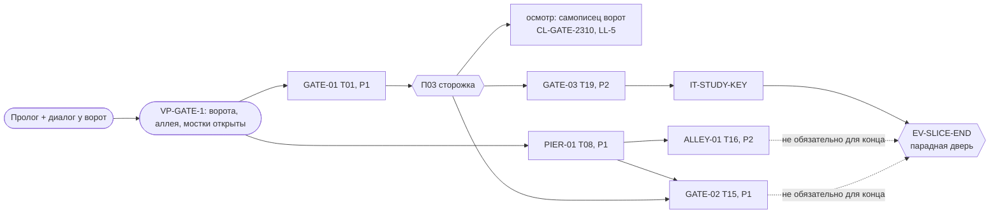

# Срез 01: первая играбельная локация «Ворота, сторожка, аллея и мостки»

Статус: черновик v1 (27.11.2026), левел-дизайн, тексты согласуются со сценаристом. Документ — техническое задание на вертикальный срез (решения владельца №14–15): одна полноценная локация как кусок готовой игры. Следующая локация (дом) видна, но закрыта до утверждения среза.

Опора: `docs/00-brief.md` (решения №1–15), `docs/story/story-bible.md` v5 (раздел 5 — вводная сцена, 6.2 — хронология, 6.8 — карточки, 7 — карта и переходы, 8 — подсказки, 13 — опорные реплики), `docs/levels/puzzle-framework.md` v2.1 (шаблон карточки — 10, подсказки — 3.5, навигация — 6, граф — 7.6), `docs/levels/puzzle-list.md` v1.1, `docs/levels/test-set-01.md` v1.2 (карточки `GATE-01`, `PIER-01`, `GATE-03`, `CASE-01`), `docs/design/visual-and-ux.md` v2 (навигация 2, экраны 3, портреты 4).

Пометки: **[ТЕСТ]** — тестовое значение, в релизе другое. **[НУЖЕН ТЕКСТ СЦЕНАРИСТА]** — текст нужен или мой текст только черновик-заглушка, его пишет или вычитывает сценарист. **[ВОПРОС СЦЕНАРИСТУ]** — нужен сюжетный ответ. **[LOC-IMG]** — текст в графике.

> **Владельцу:** разделы 5.x «Для ведущего» и раздел 8 (данные) содержат ответы головоломок.

---

## 0. Коротко

| Что | Итог |
|---|---|
| Рекомендуемые границы | **Вариант Б:** ворота + сторожка + аллея с фонтаном + тропа и мостки у озера, с прологом (письмо, станция, машина, ворота) |
| Точки обзора (панорамы 360°) | **4** (VP-GATE-1, VP-GATE-2, VP-ALLEY-1, VP-PIER-1); пятая VP-ALLEY-2 — запасная, если гравий не прочитается при плейтесте |
| Головоломки | **5**: `GATE-01` (T01), `PIER-01` (T08), `ALLEY-01` (T16), `GATE-02` (T15, перестроена), `GATE-03` (T19). Все рейтинга 1–2, пять разных типов |
| Конец среза | ключ от кабинета получен (`GATE-03`) и Клара идёт к парадной двери → экран «Продолжение следует» |
| Реплики с ID | **126**: пролог и ворота 29 (27 из библии + 2 новые), осмотр и границы 26, показ логики 5, реакции на ошибку 29, подсказки 37. Готовых текстов 68, черновиков и нужных 58. Плюс 26 строк интерфейса (обучение, цели, экран конца, шаблоны ошибок) |
| Ассеты | **46** (P1 — 36, P2 — 8, P3 — 2), из них 4 панорамы (+1 запасная), 6 кадров пролога, 3 портрета для диалога и наброски |
| Время (чистое + пролог + ходьба) | Л ~16 мин / Н ~25 мин / С ~35 мин — одна мобильная сессия или две с естественной точкой разрыва |

Что срез проверяет у владельца: панорамы и переходы, пролог и диалог с портретами, обучение жестам, пять разных типов головоломок, сумку, блокнот (улики, документы, снимки, коды, вопросы, карта), «Мысли» на трёх уровнях, первую «несходимость» сюжета (сухое пальто после ночного дождя) и источники двух дальних связей (LL-1, LL-5).

---

## 1. Границы среза

### 1.1. Варианты

**Вариант А — минимальный: «Ворота и аллея».** Пролог, ворота, сторожка, аллея с фонтаном. Тропа к озеру видна, но закрыта (граница среза).
- Головоломки: `GATE-01`, `GATE-03` и `GATE-02` в урезанном виде (только «прочитать ночь на ленте» → `CL-RAIN`, без вывода о пальто). `ALLEY-01` в срез не входит: по графу гравий становится активным только после пальто (`PIER-01`).
- Точки обзора: 3.

**Вариант Б — чуть шире: «Ворота, аллея и мостки»** (рекомендую). Вариант А плюс тропа к озеру и мостки (лодочный сарай виден, заперт).
- Головоломки: `GATE-01`, `PIER-01`, `ALLEY-01`, `GATE-02` (полная, перестроенная), `GATE-03`.
- Точки обзора: 4.

| Критерий | А. Ворота и аллея | Б. + мостки |
|---|---|---|
| Головоломок / типов | 3 / 3 (T01, T19, T15 без вывода) | 5 / 5 (T01, T08, T16, T15, T19) |
| Сюжетный крючок | нет: игрок видит запертый кабинет, но не видит, что «не сходится» | есть: пальто сухое после ночного дождя, следы свежие — первое «не сходится» акта I |
| Свобода порядка (фронты) | почти линейно: `GATE-01` → `GATE-03` | 2–3 фронта: сторожка и озеро в любом порядке |
| Что проверяется в интерфейсе | замок, часы, документ | + сцена поиска (самый рискованный по читаемости тип), анализ изображения, режим «сравнить» с выбором вывода |
| Честность по графу | `GATE-02` теряет смысл: её вывод требует пальто. `ALLEY-01` невозможна | все связи графа акта I для этой зоны целы |
| Граница | ложная: тропа к озеру в игре открыта со старта (П05), её придётся закрыть искусственно | естественная: дом и сад; сарай заперт по сюжету (П06) |
| Объём арта | 3 панорамы, ~31 ассет | 4 панорамы, ~46 ассетов (+сцена поиска на 3 уровня, +гравий) |
| Время на Н | ~15 мин | ~25 мин |
| Готовность карточек | 2 готовы, 1 урезать | 3 готовы, 2 новые (`GATE-02`, `ALLEY-01`) — в этом документе |

**Рекомендация: вариант Б.** Минимальный срез дешевле на четверть, но показывает владельцу коридор из двух замков, а не игру: нет ни крючка («сухое пальто»), ни свободы порядка, ни самого рискованного по графике типа (поиск в сцене). Мостки — часть стартовой зоны (П05 открыт со старта), так что граница по ним ложная. Вариант Б закрывает всю территорию перед домом целиком, и следующая локация начинается с парадной двери.

Не рекомендую на этом шаге «Б + кухня с Мартой» (`KIT-01`): это вход в дом, а решение №15 закрывает следующую локацию.

### 1.2. Что видно, но закрыто (граница среза)

Все выходы видны в панораме, у каждого реплика Клары. Сюжетные замки работают так же, как в полной игре; закрытия «только для среза» сделаны мыслью Клары (она сама решила начать с ворот, `DLG-INTRO-026`), а не фальшивым замком. В сборке для владельца у таких выходов дополнительно маленькая служебная плашка «[срез] закрыто до утверждения» (флаг `debug_label_boundary`).

| Выход | Где виден | Почему закрыт | В полной игре | Реплика в срезе |
|---|---|---|---|---|
| Парадная дверь в холл (П04) | VP-ALLEY-1, yaw 0° | граница среза; **после ключа от кабинета — точка конца среза** | открыт со старта | `DLG-ALLEY-005` (без ключа), `DLG-ALLEY-006/007` (с ключом) |
| Садовая калитка к лабиринту (П08) | VP-ALLEY-1, yaw 110° | граница среза | открыт со старта | `DLG-ALLEY-008` |
| Дверь башни (П13) | VP-ALLEY-1, yaw 55° | сюжет: засов изнутри до эпилога | заперт до эпилога | `DLG-ALLEY-004` + вопрос «Башня. Заперто изнутри?» |
| Лодочный сарай (П06) | VP-PIER-1, yaw 300° | сюжет: навесной замок, ключ с якорем в мастерской (акт III) | заперт до акта III | `DLG-PIER-002` |
| Стеклянная дверь террасы кабинета (П19) | VP-ALLEY-1, yaw 75° (опционально, P3) | сюжет: открывается только изнутри кабинета | заперт (короткий путь акта I) | `DLG-ALLEY-012` |
| Дорога назад к станции (П01) | VP-GATE-1, yaw 180° | сюжет: на станцию не вернуться | нет перехода | `DLG-GATE-003` |

---

## 2. Сценарий прохождения

### 2.1. Шаги

| # | Экран / место | Что происходит | Данные |
|---|---|---|---|
| 0 | Главное меню → «Новая игра» → выбор сложности | Три карточки-папки (дизайн 3.3), строка «Сложность нельзя изменить во время игры…». «Начать дело» | `difficulty: easy / normal / hard` в сохранении |
| 1 | Пролог, кадр П-1 «Контора "Атласа", дождь» | Письмо Тарна в режиме чтения (`DLG-INTRO-001`), мысль `002` | письмо → Документы (`DOC-LETTER`) |
| 2 | Кадр П-2 «Донце совы» | Крупно донце с 4 знаками, сова уходит в карман и «перелетает» в первый слот сумки | `IT-OWL`, `SNAP-OWL-BASE` (авто), вопрос `Q-OWL` |
| 3 | Кадр П-3 «Станция, туман» | Марта и Клара: `003…009` | карточка «Марта» в «Деле» |
| 4 | Кадр П-4 «В машине» | `010…016` и новая реплика о пальто `028…029` [НУЖЕН ТЕКСТ СЦЕНАРИСТА] | цель-побочка `S-01` «Пальто у озера» |
| 5 | Кадр П-5 «Дорога вдоль озера, вдали башня» | `017…018` | вопрос про башенные часы не создаётся (только реплика) |
| 6 | Кадр П-6 «Ворота» (установочный) → **экран диалога с портретами** поверх размытой VP-GATE-1 | Вероника и Феликс: `019…025`, `027`; затем мысль `026` | карточки «Вероника», «Феликс»; вопрос `Q-STUDY` «Кабинет заперт»; цель `G-01` «Осмотреть сторожку» |
| 7 | Растворение в панораму VP-GATE-1, рукава горчичного пальто в нижнем крае | Обучение: свайп → тап по объекту (столбы) → блокнот → метка перехода → (позже) сумка → «Мысли» | `UI-TUT-01…09`; автосохранение |
| 8 | Свободная игра (порядок любой) | Ветка «сторожка»: `GATE-01` → внутри самописец ворот (`CL-GATE-2310`) → `GATE-03` → ключ. Ветка «озеро»: `PIER-01` → `ALLEY-01` и `GATE-02` | см. граф 2.2 |
| 9 | Ключ от кабинета получен | Мысль `DLG-GATE-009`, цель `G-03` «Открыть кабинет Тарна», подсказка ведёт к парадной | `IT-STUDY-KEY` |
| 10 | Тап по парадной двери с ключом | Если не все 5 головоломок решены: мысль `DLG-ALLEY-007` и карточка «Войти в дом / Остаться». Иначе (или «Войти»): мысль `DLG-ALLEY-006`, анимация двери 0,6 с, затемнение | `EV-SLICE-END` |
| 11 | Экран конца среза | «Продолжение следует» + статистика + кнопки (2.5) | протокол прохождения |

### 2.2. Граф прогрессии среза



**Фронты** (задачи, доступные одновременно в разных местах):
- старт: {`GATE-01`, `PIER-01`} = 2; цель блокнота «Осмотреть сторожку» задаёт направление, мостки — побочная цель «Пальто у озера»;
- после `GATE-01`: {`GATE-03`, `PIER-01`} или, если мостки уже осмотрены, {`GATE-03`, `GATE-02`, `ALLEY-01`} = 2–3;
- после `GATE-03`: {конец среза, оставшиеся из `PIER-01` / `ALLEY-01` / `GATE-02`} = 1–3.
Больше трёх фронтов не бывает; один фронт — только в обучении и в самом конце (каркас 7.2).

**Нет тупиков:** все узлы достижимы из старта при любом порядке; ни один переход не закрывается; ни один предмет не тратится не туда (единственный расходуемый — билет, исчезает только после своего применения). Проверка скриптом по 7.6 — на сборке.

**Несколько путей:** порядок ветвей свободный. Развилка Ф-I-3 (доказательство дождя: `GATE-02` **или** кадка + запись Марты) в срезе доступна только первой ветвью: запись Марты — в доме. Для конца среза это не важно: `CASE-01` в срез не входит.

**Почему конец среза требует только ключ.** В полной игре мостки, гравий и метеожурнал не нужны для входа в дом — они нужны доске `CASE-01` внутри дома. Срез повторяет граф игры: кто ушёл в дом без них, просто вернётся позже. Чтобы владелец не пропустил половину среза случайно, у двери есть карточка-подтверждение (шаг 10) и счётчик на экране конца.

### 2.3. Цели блокнота (вкладка «Дело»)

| ID | Когда появляется | Когда закрывается | RU (черновик) | EN (черновик) |
|---|---|---|---|---|
| `G-01` | после `DLG-INTRO-026` | вход в сторожку | «Осмотреть сторожку» (библия 5) | "Search the gatehouse" |
| `G-02` | вход в сторожку | `GATE-03` | «Найти запасной ключ от кабинета» [НУЖЕН ТЕКСТ СЦЕНАРИСТА] | "Find the spare key to the study" |
| `G-03` | `GATE-03` | конец среза | «Открыть кабинет Тарна» [НУЖЕН ТЕКСТ СЦЕНАРИСТА] | "Open Tarn's study" |
| `S-01` | реплика о пальто в прологе (`028`) | `PIER-01` | «Пальто у озера» [НУЖЕН ТЕКСТ СЦЕНАРИСТА] | "The coat by the lake" |
| `S-02` | `PIER-01` | `GATE-02` | «Пальто сухое. Когда его принесли?» [НУЖЕН ТЕКСТ СЦЕНАРИСТА] | "The coat is dry. When was it brought?" |
| `S-03` | `PIER-01` | `ALLEY-01` | «Кто-то принёс пальто к озеру» [НУЖЕН ТЕКСТ СЦЕНАРИСТА]. Формулировка «кто ходил к озеру после дождя» не годится: она раскрывает вывод `ALLEY-01` | "Someone brought the coat to the lake" |

В «Деле» видна одна главная цель (`G-…`), побочные (`S-…`) — строкой ниже, мельче.

### 2.4. Темп и сессия

| Отрезок | Л | Н | С |
|---|---|---|---|
| Пролог и диалог у ворот (чтение ~2 000 знаков RU + письмо) | 4 | 4 | 4 |
| Обучение | 2 | 2 | 1 |
| `GATE-01` | 1 | 2 | 4 |
| `PIER-01` | 1 | 2 | 3 |
| `ALLEY-01` | 1 | 2 | 3 |
| `GATE-02` | 1 | 2 | 4 |
| `GATE-03` | 1 | 2 | 4 |
| Осмотр, ходьба (4 точки, ~14 переходов), чтение документов | 5 | 9 | 12 |
| **Итого, мин** | **~16** | **~25** | **~35** |

Ожидание подсказок на Н (5 мин [ТЕСТ]) не добавлено: игрок в это время играет.
Чередование: пролог (чтение) → обучение (движение) → замок (лёгкая логика) → поиск у озера (наблюдение) → гравий (изображение) → документы (размышление) → часы (счёт). Тяжёлых задач нет: рейтинг 1–2.
**Автосохранение:** после пролога (VP-GATE-1, yaw 0), после каждой головоломки, при каждом переходе между точками, при сворачивании. Естественные точки разрыва сессии: «сторожка открыта» и «пальто осмотрено». После паузы больше 10 мин — «Ранее в деле» (цель + 2 последние находки).

### 2.5. Экран конца среза

Строки интерфейса (черновик для дизайнера):
- Заголовок `UI-END-01`: «Продолжение следует» / "To be continued".
- Подзаголовок `UI-END-02`: «Дом и кабинет Тарна — следующая локация. Она на утверждении.» / "The house and Tarn's study are the next location, pending approval."
- Статистика `UI-END-03`: время в срезе; головоломки N из 5; улики N из 5 (`CL-GATE-2310`, `CL-COAT-DRY`, `CL-HAT`, `CL-PRINTS`, `CL-RAIN`); ошибок; подсказок взято (Л, Н); уровень сложности.
- Кнопки: `UI-END-04` «Вернуться в срез» (состояние до тапа по двери, ключ в сумке) / `UI-END-05` «Новая игра» (другая сложность) / `UI-END-06` «Главное меню». В сборке владельца — «Выгрузить протокол» (время, попытки, подсказки по каждой головоломке — как протокол текстового теста, `test-set-01.md` 0.5).
- Карточка-подтверждение у двери (шаг 10): мысль `DLG-ALLEY-007` + кнопки `UI-END-07` «Войти в дом» / `UI-END-08` «Остаться». На Л и Н под мыслью список неосмотренного по зонам («у озера», «в сторожке»), на С — без списка.

---

## 3. Точки обзора

### 3.1. Схема зоны (вид сверху)

```
                        [ДОМ: парадная П04 — граница/конец среза]      [восточное крыло]
                                     |                                   башня (дверь П13)
                         кадка ·  (VP-ALLEY-1)  ·· терраса кабинета П19
                                 фонтан с совой  ··· садовая калитка П08 → сад (граница)
              тропа к озеру ↙   развилка (гравий, ALLEY-01)
                              |
     [сарай П06]  (VP-PIER-1) мостки → пальто            аллея
                     озеро                                 |
                                         (VP-GATE-1) ворота, 4 столба — сторожка: (VP-GATE-2)
                                                 |
                                         дорога к станции (П01, возврата нет)
```

Все точки — день (одно состояние освещения). Ночные версии для этих экстерьеров в срезе не нужны (библия 7.3: экстерьеры ночью — только акт VI и эпилог).

### 3.2. VP-GATE-1 «У ворот» (стартовая точка)

| Поле | Значение |
|---|---|
| Локация | LOC-GATE |
| Где стоит Клара | на дороге перед воротами, лицом к ним; высота глаз 155 см |
| Вход | после пролога, `entry_yaw` 0° |
| Свет | пасмурное утро, туман; зона внимания — столбы и латунная пластина на двери сторожки |

| Сторона | Что видно |
|---|---|
| 0° (вперёд) | кованые ворота, створки распахнуты; четыре каменных столба с чугунными медальонами (yaw −40…+40°); за воротами аллея уходит в туман, силуэт фонтана и дома |
| ~30° (вперёд-вправо) | сторожка, кирпичный домик, окно закрыто ставнем; на двери латунная пластина кодового замка |
| 90° (вправо) | боковая стена сторожки, ограда, клёны |
| 180° (назад) | дорога вниз к станции, в тумане проблеск озера |
| 270° (влево) | ограда, старые дубы, палая кленовая листва |

| HS | Объект | yaw / pitch / размер | Действие | Lead |
|---|---|---|---|---|
| HS-GATE-PILLARS | медальоны на столбах | 0° / +5° / 70° | крупный план `CU-GATE-PILLARS`; `DLG-GATE-001` | сектор входа |
| HS-GATE-LOCK | замок двери сторожки | 30° / −5° / 14° | головоломка `PZ-GATE-01`; после решения — переход | латунь, сектор входа |
| HS-GATE-ROAD | дорога к станции | 180° / −10° / 40° | реплика `DLG-GATE-003` | — |

Переходы: → VP-ALLEY-1 (0°, метка «выход/дорога» на гравии в проёме ворот); → VP-GATE-2 (30°, метка «дверь»; до `GATE-01` тап открывает замок).

### 3.3. VP-GATE-2 «Сторожка» (внутри)

| Поле | Значение |
|---|---|
| Локация | LOC-GATE (в test-set-01 эта точка называлась VP-GATE-3; в срезе нумерация сплошная) |
| Вход | после `GATE-01`; `entry_yaw` 0° — на ящик с ключами; реплика входа `DLG-GATE-004` |
| Свет | окно над столом (ставень изнутри открыт): зона внимания — стол с самописцем и журналом; ящик с ключами под лампой у двери |

| Сторона | Что видно |
|---|---|
| 0° | дубовый ящик для ключей со стеклянной дверцей, латунный циферблат вместо скважины, белая бирка на ручке |
| 55–70° | стол у окна: погодный самописец под стеклянным колпаком (барабан, два пера) и раскрытый метеожурнал; табурет |
| 95° | (только С) ходики на стене |
| 150° | печка |
| 180° | дверь наружу |
| 310° | у двери, на тумбе — самописец ворот: барабан с бумажной лентой, одно перо |

| HS | Объект | yaw / pitch / размер | Действие | Lead |
|---|---|---|---|---|
| HS-GATE-KEYBOX | ящик с ключами | 0° / 0° / 18° | головоломка `PZ-GATE-03`; бирка → `DLG-GATE-008` | белая бирка на тёмном дубе |
| HS-GATE-WEATHERREC | погодный самописец | 55° / −15° / 14° | крупный план + `SNAP-WEATHER-TAPE` (авто); до `PIER-01` — `DLG-GATE-006`, после — `DLG-GATE-010` и вход в `PZ-GATE-02` | свет окна, тиканье с визуальной парой (перо подрагивает) |
| HS-GATE-WEATHERLOG | метеожурнал | 70° / −20° / 12° | документ `DOC-WEATHER-LOG`; `DLG-GATE-007` + `DLG-GLASS-001` (один раз) | свежая бумага в свету |
| HS-GATE-RECORDER | самописец ворот | 310° / −10° / 14° | крупный план ленты; `CL-GATE-2310`, `SNAP-GATE-TAPE` (авто, LL-5), вопрос `Q-GATE-2310`; `DLG-GATE-005` | латунь барабана; виден при развороте к двери |
| HS-GATE-WALLCLOCK | ходики (только С) | 95° / +15° / 10° | реплика `DLG-GATE-011` (ложное время для `GATE-03`) | маятник качается |

Переход: → VP-GATE-1 (180°, метка «дверь»).

### 3.4. VP-ALLEY-1 «Фонтан» (центр зоны)

| Поле | Значение |
|---|---|
| Локация | LOC-ALLEY |
| Вход | `entry_yaw` 0° — от ворот к дому; первая реплика `DLG-ALLEY-001` |
| Свет | рассеянный; зоны внимания — фонтан и парадная дверь под фонарём; холодный туман слева над озером |

| Сторона | Что видно |
|---|---|
| 0° | фонтан: каменная сова на постаменте, вокруг 4 чаши; за ним фасад дома, крыльцо, парадная дверь |
| 330° (−30°) | угол дома, водосточная труба, переполненная дождевая кадка |
| 55–75° | восточное крыло: пристроенная часовая башня с остановленными часами, внизу дверь башни без ручки; правее — стеклянная дверь террасы кабинета |
| 110° | дорожка направо, кованая садовая калитка, за ней живая изгородь |
| 180° | аллея к воротам |
| 255–265° | развилка: от аллеи вниз к озеру уходит гравийная тропа; по аллее поперёк развилки — свежие колеи от шин машины |

| HS | Объект | yaw / pitch / размер | Действие | Lead |
|---|---|---|---|---|
| HS-ALLEY-FOUNTAIN | фонтан и 4 чаши | 0° / −10° / 30° | крупный план сверху, тап по чаше — чаша крупно; `DLG-ALLEY-002`; источник `GATE-01` | сектор входа, центр композиции |
| HS-ALLEY-FRONTDOOR | парадная дверь | 0° / +8° / 12° | граница / конец среза (1.2, 2.1) | фонарь над крыльцом |
| HS-ALLEY-BARREL | дождевая кадка | 330° / −10° / 10° | крупный план; `DLG-ALLEY-003`; вопрос `Q-BARREL` | блик воды, переливается через край (движение) |
| HS-ALLEY-TOWERDOOR | дверь башни | 55° / 0° / 10° | `DLG-ALLEY-004`; вопрос `Q-TOWER` (библия 7.1) | вертикаль башни ведёт взгляд вниз |
| HS-ALLEY-TERRACE | стеклянная дверь террасы (P3, опционально) | 75° / 0° / 10° | крупный план «через стекло»; `DLG-ALLEY-012` | блик стекла |
| HS-ALLEY-GARDENGATE | садовая калитка | 110° / 0° / 10° | граница среза, `DLG-ALLEY-008` | — |
| HS-ALLEY-GRAVEL | гравий развилки | 255° / −25° / 30° | до `PIER-01` — `DLG-ALLEY-009`; после — головоломка `PZ-ALLEY-01`; видно также из VP-PIER-1 | колеи шин ведут взгляд к развилке; после `PIER-01` реплика `DLG-ALLEY-010` при возвращении |

Переходы: → VP-GATE-1 (180°, «дорога»); → VP-PIER-1 (265°, «выход/тропа», при первом переходе `DLG-ALLEY-011`). Парадная и калитка — метки «дверь» с поведением границы (1.2).
Плотность: в любом окне 90° не больше 3 активных объектов (0°: фонтан, дверь, кадка; 55–110°: башня, терраса, калитка).

### 3.5. VP-PIER-1 «Мостки»

| Поле | Значение |
|---|---|
| Локация | LOC-PIER |
| Вход | `entry_yaw` 0° — вдоль мостков к пальто; реплика `DLG-PIER-001` |
| Свет | холодный, туман над водой; пальто в правой трети кадра — светлое пятно ворса на тёмном настиле |

| Сторона | Что видно |
|---|---|
| 0° | мостки уходят в воду ~20 м, перила; в конце у последней сваи — сложенное пальто, на нём шляпа; чайка на свае |
| 300° (−60°) | лодочный сарай, дверь на навесном замке; под жёлобом его крыши — ведро у берегового конца мостков |
| 90° | озеро, туман, дальний берег |
| 175° | тропа вверх к развилке и фонтану |

| HS | Объект | yaw / pitch / размер | Действие | Lead |
|---|---|---|---|---|
| HS-PIER-SCENE | мостки целиком | 0° / −10° / 60° | сцена поиска `PZ-PIER-01` | сектор входа, пальто — светлое пятно |
| HS-PIER-SHED | замок сарая | 300° / −5° / 10° | `DLG-PIER-002`; вопрос `Q-SHED` | латунь замка |
| (HS-ALLEY-GRAVEL) | тропа вверх | 175° / −15° | ведёт в VP-ALLEY-1 и открывает гравий | — |

Переход: → VP-ALLEY-1 (175°, «тропа»).

### 3.6. Запасная точка VP-ALLEY-2 «Развилка» (P3)

Ставится, только если плейтест читаемости (каркас 6.4) покажет, что гравий из VP-ALLEY-1 не находят за 2 мин на С. Тогда HS-ALLEY-GRAVEL переезжает сюда (yaw 0°, pitch −35° с `lead` колей), а VP-ALLEY-1 и VP-PIER-1 ведут через неё. По умолчанию не делается.

---

## 4. Диалоги и реплики среза

Формат каждой записи (решение №11, дизайн 3.9): `line_id`, `speaker_id`, `emotion`, `text_ru`, `text_en`, `audio_ru`, `audio_en` (пусто), `style` (speech / thought / sound), `status`.
Статусы: **утв.** — текст из библии (RU утверждён), **тест** — текст из `test-set-01.md` (вычитан сценаристом при ответах на раздел 5), **черн.** — мой черновик-заглушка, [НУЖЕН ТЕКСТ СЦЕНАРИСТА].
**EN:** для `DLG-INTRO-001…027`, `HINT-WAIT/READY/SELF/EX` в библии только RU — [НУЖЕН ТЕКСТ СЦЕНАРИСТА: EN]. В данных `text_en: null` до получения перевода; в сборке на EN показывается RU с пометкой.

### 4.1. Пролог (кадры П-1…П-6)

Режим: экран диалога в режиме «кадр-фон» (дизайн 3.4): иллюстрация вместо панорамы, портреты не показываются, если говорящий в кадре; имя — на плашке. Мысли — курсив.

| ID | Кадр | Говорящий | Экран / портрет | Текст (кратко) | Статус |
|---|---|---|---|---|---|
| DLG-INTRO-001 | П-1 | ТАРН (письмо) | режим чтения документа, почерк Тарна; портрета нет | «Клара, помните ярмарку…» | утв. |
| DLG-INTRO-002 | П-1 | КЛАРА (мысли) | кадр-фон, курсив | «Двадцать шесть лет ни слова. И вдруг — билет.» | утв. |
| — | П-2 | — | крупный план донца совы, без реплики | сова в сумку | — |
| DLG-INTRO-003…009 | П-3 | МАРТА / КЛАРА | кадр-фон (обе в кадре) | станция, Тарн исчез, полиция | утв. |
| DLG-INTRO-010…016 | П-4 | КЛАРА / МАРТА; 013 — КЛАРА (мысли) | кадр-фон | газета со снимком, кто ночевал, Феликс и автобус | утв. |
| DLG-INTRO-028 | П-4 или П-5 | МАРТА | кадр-фон | **о пальто на мостках: что нашли утром и кто его видел** | [НУЖЕН ТЕКСТ СЦЕНАРИСТА], см. 11.1, вопрос 1 |
| DLG-INTRO-029 | там же | КЛАРА (мысли) или КЛАРА | кадр-фон | реакция Клары, без вывода (например, «Пальто. Значит, все решат, что он ушёл к воде.») | черн. [НУЖЕН ТЕКСТ СЦЕНАРИСТА] |
| DLG-INTRO-017…018 | П-5 | КЛАРА / МАРТА | кадр-фон, вдали башня | башенные часы стоят | утв. |

Нумерация 028–029 стоит вне порядка, как 027 (библия 5 объясняет, почему ID не перенумеровываются).

### 4.2. Разговор у ворот (после установочного кадра П-6)

**Рекомендация (согласовать с дизайнером):** кадр П-6 — установочная иллюстрация (Вероника и Феликс у ворот), затем разговор идёт на **обычном экране диалога с портретами** (дизайн 3.9) поверх размытой панорамы VP-GATE-1. Так срез показывает владельцу основной экран диалога: портреты, эмоции, журнал реплик. Запасной вариант — как в дизайне 3.4: весь разговор в режиме «кадр-фон».

| ID | Говорящий | Портрет слева (эмоция) | Портрет Клары справа | Текст RU | Статус |
|---|---|---|---|---|---|
| DLG-INTRO-019 | ВЕРОНИКА | Вероника — нейтральная, холодная | приглушён | «Марта сказала, вы из страховой. Отец не мог выбрать день удачнее.» | утв. |
| DLG-INTRO-020 | КЛАРА | Вероника приглушена | спокойная | «Он выбрал его неделю назад.» | утв. |
| DLG-INTRO-021 | ВЕРОНИКА | напряжённая | приглушён | «Полиция считает, что он гуляет. Мне хочется в это верить.» | утв. |
| DLG-INTRO-022 | КЛАРА | приглушена | спокойная | «Тогда помогу вам в этом убедиться. Или нет.» | утв. |
| DLG-INTRO-023 | ФЕЛИКС | Феликс — «услужливая улыбка» (смена собеседника растворением 0,2 с) | приглушён | «Феликс Ром, секретарь. Ключи, бумаги, расписание — всё ко мне.» | утв. |
| DLG-INTRO-024 | ФЕЛИКС | напряжённая / скрытная | приглушён | «Страховая проверка? Странно. Хозяин мне не говорил.» | утв. |
| DLG-INTRO-025 | ФЕЛИКС | услужливая улыбка | приглушён | «Кабинет, увы, заперт. Ключ хозяин носит с собой.» | утв. |
| DLG-INTRO-027 | ФЕЛИКС | услужливая улыбка | приглушён | «Запасные — в ящике в сторожке. Но на днях хозяин сменил код ящика. Мне не сказал.» | утв. |
| DLG-INTRO-026 | КЛАРА (мысли) | собеседников нет (ушли к дому) | задумчивая, курсив | «Ворота видят всех, кто уходит ночью. Начну отсюда.» | утв. |

После `026` — растворение в панораму (рукава пальто в нижнем крае), обучение. Вероника, Феликс и Марта в панорамах среза не стоят: они ушли в дом.

### 4.3. Реплики осмотра, границ и состояний

Все — КЛАРА (мысли), курсив, субтитр в панораме. Каждая звучит при первом осмотре (повтор — по долгому нажатию). Тексты — мои заглушки **[НУЖЕН ТЕКСТ СЦЕНАРИСТА]**, кроме отмеченных. Новых сюжетных фактов в них нет: только то, что игрок видит.

| ID | Где / когда | RU (черновик) | EN (черновик) |
|---|---|---|---|
| DLG-GATE-001 | VP-GATE-1, столбы | «Четыре столба, четыре знака. Ворота с характером.» | "Four pillars, four signs. A gate with character." |
| DLG-GATE-002 | замок, первый осмотр | «Барабаны с цифрами. Над ними — столбики с чашами.» | "Number drums. Above them, little pillars with bowls." |
| DLG-GATE-003 | дорога назад | «На станцию мне не нужно. Всё, что нужно, — здесь.» | "I've no business at the station. Everything I need is here." |
| DLG-GATE-004 | первый вход в сторожку | «Сторожа нет. Зато два самописца.» | "No gatekeeper. Two recorders instead." |
| DLG-GATE-005 | самописец ворот (`CL-GATE-2310`) | «Ворота открывали в 23:10. Ушёл?» — **тест** (test-set `GATE-03`) | "The gate opened at 23:10. Did he leave?" |
| DLG-GATE-006 | погодный самописец, до `PIER-01` | «Дождемер и флюгер. Лента тянется до самого утра.» | "A rain gauge and a vane. The tape runs right up to this morning." |
| DLG-GATE-007 | метеожурнал | «Почерк Тарна. Он переписывал сюда ленту — каждый вечер. Последний вечер — четырнадцатое.» | "Tarn's hand. He copied the tape here every evening. The last evening was the fourteenth." |
| DLG-GLASS-001 | метеожурнал, сразу после `007` | «Мелкий почерк. Хорошо, что очки при мне. Почти лупа.» — **утв.** (библия 13.5) | [EN нужен] |
| DLG-GATE-008 | бирка на ящике | «"Для гостя с поезда". Гость с поезда — это я.» | "'For the guest off the train.' That's me." |
| DLG-GATE-009 | ключ взят (`GATE-03`) | «Ключ с биркой "Кабинет". Тарн оставил его для меня.» | "A key tagged 'Study'. Tarn left it for me." |
| DLG-GATE-010 | погодный самописец после `PIER-01` | «Пальто сухое. А лента помнит ночь.» | "The coat is dry. The tape remembers the night." |
| DLG-GATE-011 | ходики (С) | «Ходики. Идут.» | "A wall clock. Still ticking." |
| DLG-ALLEY-001 | первый вход к фонтану | «Фонтан с совой. У каждой чаши свой знак.» | "A fountain with an owl. Each bowl has its own sign." |
| DLG-ALLEY-002 | чаша фонтана | «Вода стоит вровень со сливом. Дождь её не сбил.» | "The water sits level with the drain. The rain didn't change it." |
| DLG-ALLEY-003 | кадка | «Полна через край. Когда её вылили в последний раз?» | "Full to overflowing. When was it last emptied?" |
| DLG-ALLEY-004 | дверь башни | «Ни ручки, ни скважины. Заперто изнутри?» (вопрос — библия 7.1) | "No handle, no keyhole. Bolted from inside?" |
| DLG-ALLEY-005 | парадная, ключа нет | «Дом подождёт. Сначала — то, что видели ворота.» | "The house can wait. First, what the gate saw." |
| DLG-ALLEY-006 | парадная, ключ есть, всё осмотрено | «Ключ у меня. Теперь — кабинет.» | "I have the key. Now, the study." |
| DLG-ALLEY-007 | парадная, ключ есть, не всё осмотрено | «В доме меня ждут. Но снаружи я ещё не всё проверила.» | "They're waiting in the house. But I haven't checked everything out here." |
| DLG-ALLEY-008 | садовая калитка | «Сад потом. Сначала — ворота и озеро.» | "The garden later. First the gate and the lake." |
| DLG-ALLEY-009 | гравий до `PIER-01` | «Мокрый гравий. У самого дома всё затоптано.» | "Wet gravel. Trampled all over near the house." |
| DLG-ALLEY-010 | возвращение к фонтану после `PIER-01` | «Кто-то принёс пальто к озеру. Тропа должна это помнить.» | "Someone carried that coat to the lake. The path should remember." |
| DLG-ALLEY-011 | первый спуск к озеру | «Пойду по траве. Гравий пусть останется как есть.» | "I'll keep to the grass. Leave the gravel as it is." |
| DLG-ALLEY-012 | терраса (P3) | «Дверь кабинета на террасу. Заперто. Постель в алькове не тронута.» (факт — библия 6.2, 07:00) | "The study's terrace door. Locked. The bed in the alcove hasn't been slept in." |
| DLG-PIER-001 | вход на мостки | «Туман над водой. А в конце мостков — пальто.» | "Mist over the water. And a coat at the end of the pier." |
| DLG-PIER-002 | замок сарая | «Навесной замок. Ключа у меня нет.» | "A padlock. I don't have the key." |

`DLG-ALLEY-011` нужна не для атмосферы: она объясняет, почему на тропе нет следов самой Клары (`ALLEY-01`).

### 4.4. Показ логики и реакции на ошибку

Полные тексты — в карточках раздела 5. Сводка ID:

| Головоломка | `logic_line` | Реакции (ID) | Статус |
|---|---|---|---|
| `GATE-01` | LOGIC-GATE-01 | FB-GATE01-E1…E4 (Л), FB-GATE01-N1…N3 (Н) — 7 | тест; E2, N2 правятся (5.1), E4 новая |
| `PIER-01` | LOGIC-PIER-01 | FB-PIER01-E1…E5 (Л), FB-PIER01-N1 (Н, «Не то») — 6 | тест |
| `ALLEY-01` | LOGIC-ALLEY-01 | FB-ALLEY01-E1…E5 (Л) — 5 | черн. |
| `GATE-02` | LOGIC-GATE-02 | FB-GATE02-E1…E5 (Л) — 5 | черн. |
| `GATE-03` | LOGIC-GATE-03 | FB-GATE03-E1…E4 (Л), FB-GATE03-N1…N2 (Н) — 6 | тест |

На Н «Неверно. Верно N из M» — строка интерфейса (`UI-FB-COUNT`), не реплика. На С — только «Неверно» (`UI-FB-WRONG`) со звуком и анимацией.

### 4.5. Подсказки «Мысли»

Общие фразы нормального уровня — библия 8, **утв.** (RU): `HINT-WAIT-01`, `HINT-WAIT-02`, `HINT-WAIT-03`, `HINT-WAIT-BUSY`, `HINT-READY-01`, `HINT-SELF-01` (6 записей).
Навигационные фразы по узлам среза — раздел 7.3 (31 запись: `HINT-NAV-…`).

### 4.6. Строки интерфейса (не реплики, без аудио)

| ID | RU (черновик для дизайнера) | EN |
|---|---|---|
| UI-TUT-01 | «Проведите пальцем, чтобы осмотреться» | "Swipe to look around" |
| UI-TUT-02 | «Коснитесь предмета, чтобы рассмотреть» | "Tap an object to examine it" |
| UI-TUT-03 | «Всё найденное — в блокноте» | "Everything you find goes into the notebook" |
| UI-TUT-04 | «Коснитесь метки, чтобы пройти» | "Tap a mark to walk there" |
| UI-TUT-05 | «Проведите по барабану вверх или вниз» (первый экран `GATE-01`) | "Swipe a drum up or down" |
| UI-TUT-06 | «Сумка: коснитесь вещи дважды, чтобы рассмотреть» (у ящика с ключами, если билет ещё не осмотрен) | "Bag: tap an item twice to examine it" |
| UI-TUT-07 | «Застряли? Спросите Клару» (Л, Н) | "Stuck? Ask Clara" |
| UI-TUT-08 | «Мысль придёт через несколько минут. Пока можно искать самим» (Н) | "The thought will come in a few minutes. Keep looking meanwhile" |
| UI-TUT-09 | «Выберите два фрагмента и вывод» (первый экран «сравнить», `GATE-02`) | "Pick two fragments and a conclusion" |
| UI-FB-COUNT | «Неверно. Верно {n} из {m}» | "Not quite. {n} of {m} right" |
| UI-FB-WRONG | «Неверно» | "Wrong" |
| UI-END-01…08 | экран конца среза (2.5) | — |
| G-01…03, S-01…03 | цели (2.3) | — |
| UI-BOUNDARY | «[срез] закрыто до утверждения» (только сборка владельца) | "[slice] closed pending approval" |

Итого строк интерфейса: 9 (обучение) + 2 (шаблоны ошибок) + 8 (конец среза) + 6 (цели) + 1 (граница) = **26**.

### 4.7. Счёт реплик

| Группа | Записей | Утверждено (RU) | Черновик / нужен текст |
|---|---|---|---|
| Пролог и ворота | 29 | 27 | 2 (`028`, `029`) |
| Осмотр, границы, состояния | 26 | 1 (`GLASS-001`) + 1 из теста (`GATE-005`) | 24 |
| Показ логики | 5 | 3 (тест) | 2 |
| Реакции на ошибку | 29 | 18 (тест, 2 из них с правкой) | 11 |
| Подсказки | 37 | 18 (6 общих + 2 `HINT-EX` + 10 из теста) | 19 |
| **Итого** | **126** | **68** | **58** |

EN нет у 36 утверждённых записей библии (пролог 27, `DLG-GLASS-001`, 6 общих подсказок, 2 `HINT-EX`) — их пишет сценарист.

---

## 5. Головоломки среза

### 5.0. Сводка

| # | ID | Название | Тип | Р (Н) | Точка | Требует | Даёт | Л / Н / С, мин | Карточка |
|---|---|---|---|---|---|---|---|---|---|
| 1 | PZ-GATE-01 | Замок сторожки | T01 | 1 | VP-GATE-1 | — (источник — фонтан) | GT-P03 | 1 / 2 / 4 | test-set-01 + дельта 5.1 |
| 2 | PZ-PIER-01 | Пальто на мостках | T08 | 1 | VP-PIER-1 | — | CL-COAT-DRY, CL-HAT, DOC-PIER-NOTES; активирует 3 и 4 | 1 / 2 / 3 | test-set-01 + дельта 5.2 |
| 3 | PZ-ALLEY-01 | Следы на гравии | T16 | 2 | VP-ALLEY-1 | PIER-01 | CL-PRINTS | 1 / 2 / 3 | **полная, 5.3** |
| 4 | PZ-GATE-02 | Ночь на ленте | T15 | 1 | VP-GATE-2 | П03, PIER-01 | CL-RAIN | 1 / 2 / 4 | **полная, перестроена, 5.4** |
| 5 | PZ-GATE-03 | Ящик с ключами | T19 | 2 | VP-GATE-2 | П03, IT-TICKET | IT-STUDY-KEY | 1 / 2 / 4 | test-set-01 + дельта 5.5 |

**Почему три карточки даны дельтой.** Полные тексты `GATE-01`, `PIER-01`, `GATE-03` (брифинг игрока и «Для ведущего») уже лежат в `docs/levels/test-set-01.md` v1.2 и прошли сценариста. Копия здесь означала бы два источника правды, которые разойдутся при первой правке. Здесь — только шапка, всё, что в срезе меняется, тестовые значения и навигация. Решение, допустимые ответы, визуальное ТЗ и риски, не упомянутые ниже, — без изменений по test-set-01.

Новые типы в срезе впервые появляются с рейтингом ≤ 2 (каркас 8.2); у каждого первого экрана типа одна строка обучения (`UI-TUT-05`, `UI-TUT-06`, `UI-TUT-09`).

### 5.1. PZ-GATE-01. Замок сторожки (дельта к test-set-01)

| Поле | Значение |
|---|---|
| ID | PZ-GATE-01 |
| Акт / локация | Акт I / LOC-GATE; источник — LOC-ALLEY |
| Точка обзора | VP-GATE-1; yaw 30°, pitch −5°; lead: нет (сектор входа) |
| Объект | HS-GATE-LOCK; источники HS-GATE-PILLARS, HS-ALLEY-FOUNTAIN |
| Тип / рейтинг | T01 / 1 |
| Обязательная | да |
| Ворота | GT-P03 (вход в сторожку) |
| Класс перевода | A |
| Время | Л ~1 / Н ~2 / С ~4 мин |
| Статус | в тесте (test-set-01), дельта для среза |

**Изменения в срезе:**
1. **Автозапись на Л — источники, а не код.** В test-set-01 на Л код целиком пишется в «Коды и числа» после осмотра обоих источников. Это противоречит границе помощи (каркас 3.3: помощь не показывает ответ). Предлагаю: на Л автоматически записываются **значения источников** — «Столбы слева направо: [Луна] [Сова] [Шестерня]» (картинками) и «Вода: [Сова] 7, [Ключ] 6, [Шестерня] 5, [Луна] 3». Сопоставить их — дело игрока. Нужно подтверждение владельца или директора (вопрос 11.4.1).
2. **Реакции E2 / N2 про «изразцы».** Изразцы камина (`LIV-01`) — в доме, в срезе их нет. Номера знаков в срезе знает только игрок на Л (таблица знаков на Л полная сразу, библия 9.1). Новый текст: Л — «Таких уровней воды в чашах нет. Над барабанами нарисованы чаши, а не номера знаков»; Н — «Над барабанами нарисованы чаши. При чём тут номера знаков?». В полной игре текст тот же: он верен и после `LIV-01`.
3. **Новая реакция E4 (Л) на знаки с донца совы.** На донце совы три из четырёх знаков [ТЕСТ: Ключ, Луна, Сова] есть и на чашах. Игрок на Л может набрать «Ключ-Луна-Сова» = 637. Реакция: «Над барабанами — столбики с чашами. Порядок задают они.» На Н и С — общая реакция. Подробнее о риске — 10.2.
4. Реплики осмотра `DLG-GATE-001`, `002`, `DLG-ALLEY-001`, `002`; обучение `UI-TUT-05` на первом экране.

**Реакции (ID):** FB-GATE01-E1 «Цифры те, что в чашах. А порядок? Барабаны стоят в ряд, как что-то у ворот» (тест); E2 (правка, выше); E3 «Не все эти цифры есть в чашах фонтана» (тест); E4 (новая, выше); N1 «Цифры, кажется, правильные. Что-то с порядком» (тест); N2 (правка, выше); N3 «Не сходится с фонтаном» (тест).
**LOGIC-GATE-01** (тест): «Луна, Сова, Шестерня, Ключ — по столбам слева направо. В их чашах вода на трёх, семи, пяти и шести.» / "Moon, Owl, Gear, Key — the pillars, left to right. Their bowls hold water at three, seven, five and six." Шаблон с параметрами `{pillars}`, `{levels}`.

**Тестовые значения** — без изменений (Л 375, Н 3756, С 2946; test-set-01).

### 5.2. PZ-PIER-01. Пальто на мостках (дельта к test-set-01)

| Поле | Значение |
|---|---|
| ID | PZ-PIER-01 |
| Акт / локация | Акт I / LOC-PIER |
| Точка обзора | VP-PIER-1; сцена поиска на крупном плане; lead: пальто в секторе входа |
| Объект | HS-PIER-SCENE |
| Тип / рейтинг | T08 / 1 |
| Обязательная | да |
| Ворота | ничего; активирует `ALLEY-01` и `GATE-02` |
| Класс перевода | A (силуэты); на С две цели описанием — B |
| Время | Л ~1 / Н ~2 / С ~3 мин |
| Статус | в тесте, дельта для среза |

**Изменения в срезе:**
1. **Мотивация.** Брифинг test-set говорит «Марта сказала, что утром на мостках нашли пальто», но в репликах библии такой фразы нет. Нужна `DLG-INTRO-028` [НУЖЕН ТЕКСТ СЦЕНАРИСТА]. Без неё мостки — просто красивое место, а навигационная фраза «Марта говорила о пальто у озера» ссылается на несуществующую реплику.
2. **Новый документ `DOC-PIER-NOTES` «Записи с мостков»** (почерк Клары) создаётся при решении: по строке на каждую найденную цель. Он нужен как документ для `GATE-02` (режим «сравнить» работает с документами, а карточка `CL-COAT-DRY` одной строкой не даёт отделить сухой верх от подмокшего низа). Тексты строк — 5.4, документ 3. [НУЖЕН ТЕКСТ СЦЕНАРИСТА: вычитка.]
3. После решения: побочные цели `S-02`, `S-03`; HS-ALLEY-GRAVEL и HS-GATE-WEATHERREC меняют поведение (реплики `DLG-ALLEY-010`, `DLG-GATE-010`).
4. Пальто и шляпа остаются на мостках (улики, Клара их не забирает). Панорама после решения не меняется; в «Снимках» автоматически кадр сцены.

**Реакции:** FB-PIER01-E1…E5 — Л-тексты test-set («Круг, но без бугорка посередине. Не то», «Рукавов у брезента нет», «Брезент тёмный весь, а тут тёмная только полоса внизу», «Силуэт — не вся вещь, а только край ткани», «У пера нет лопастей»); FB-PIER01-N1 «Не то».
**LOGIC-PIER-01** (тест): «Сверху сухое, снизу подмокло. Его положили на мокрые доски, когда дождь уже кончился.» / "Dry on top, damp beneath. It was laid on wet boards after the rain had stopped."
Замечание: `logic_line` уже говорит «когда дождь кончился», хотя время дождя игрок узнает только в `GATE-02`. Это не подсказка ответа `GATE-02` (там нужно доказать это по ленте и выбрать фрагменты), но если владелец сочтёт, что фраза снимает интригу, запасной вариант: «Сверху сухое, снизу подмокло. Под дождём оно не лежало.» [на усмотрение сценариста].

**Тестовые значения** — без изменений (test-set-01, раздел 4).

### 5.3. PZ-ALLEY-01. Следы на гравии (полная карточка, новая)

| Поле | Значение |
|---|---|
| ID | PZ-ALLEY-01 |
| Название | Следы на гравии |
| Акт / локация | Акт I / LOC-ALLEY (2 Аллея и фонтан), развилка к озеру |
| Точка обзора | VP-ALLEY-1; yaw 255°, pitch −25°; видно также из VP-PIER-1 (yaw 175°); lead: колеи шин ведут взгляд к развилке; реплика `DLG-ALLEY-010` при возвращении от озера |
| Объект | HS-ALLEY-GRAVEL (гравий у развилки, крупный план сверху-вперёд) |
| Тип | T16 |
| Рейтинг (Н) | 2 |
| Обязательная | да (для `CASE-01`); в срезе не нужна для конца |
| Ворота | ничего; даёт CL-PRINTS (К4 доски `CASE-01`) |
| Класс перевода | A |
| Дальняя связь | нет |
| Ожидаемое время | Л ~1 / Н ~2 / С ~3 мин |
| Статус | черновик |

#### Брифинг игрока (Н)

**Для игрока.** Кто-то принёс пальто к озеру. Клара разглядывает гравий у развилки, откуда тропа спускается к мосткам. Сама она к озеру шла по траве.

**Что видно (крупный план).** Вид сверху-вперёд: тропа уходит вверх кадра — к озеру; низ кадра — главная аллея. Гравий мокрый и тёмный.
- Поперёк низа кадра по аллее идут **две колеи от шин**: края острые, гравий по бокам отжат в валики, воды в колеях нет. (Утром Марта ездила на машине на станцию и привезла Клару.)
- У самой аллеи гравий **истоптан**: отпечатки наложены друг на друга, ни одного целого.
- На тропе **шесть округлых ямок**: края оплыли, в каждой стоит вода; где пятка и где носок, не разобрать.
- На тропе **две цепочки отпечатков обуви**. Края острые, гравий у краёв отжат, воды внутри нет. У каждого отпечатка один конец узкий и закруглённый, вдавлен глубже; другой шире и мельче. Узора подошвы не видно.
  - Цепочка левее: широкий конец смотрит вверх, к озеру.
  - Цепочка правее, местами наступает на левую: широкий конец смотрит вниз, к аллее.

**Сумка:** сова, билет и письмо, очки (и ключ от кабинета, если взят). **Блокнот:** CL-COAT-DRY, CL-HAT, записи с мостков; реплики Марты о том, что утром машина ездила на станцию (пролог).

**Задание на экране:** «Отметьте следы человека, оставленные после дождя, и куда он шёл».
**Формат ответа (текстовый тест):** какие следы оставлены после дождя и в каком направлении шли по каждой цепочке.

**На лёгком:** ямок с водой три; цепочки идут раздельно, не пересекаются; отпечатки крупнее.
**На сложном:** ямок с водой десять; цепочки сильно перекрываются, у трёх отпечатков правой цепочки виден только широкий конец; через тропу наискосок идут свежие трёхпалые следы чайки; по кадру — слой тумана (контраст ниже, но не ниже требований 2.6 дизайна).

#### Для ведущего

**Механика.** T16. Тап по отпечатку отмечает всю его цепочку или группу (`select_mode: group`), повторный тап снимает. У отмеченной цепочки появляется стрелка-переключатель «к озеру / к аллее». Кнопка «Готово» проверяет ответ из двух частей: (а) какие группы отмечены, (б) направление каждой. Неверный ответ ничего не стоит.

**Что нужно для решения:**
| Что | Где | Как получено |
|---|---|---|
| Гравий развилки | LOC-ALLEY, VP-ALLEY-1, HS-ALLEY-GRAVEL | осмотр после `PIER-01` |
| Колеи шин — заведомо свежий след (эталон) | тот же кадр; пролог (машина ездила утром) | осмотр, `DLG-INTRO-*` |
| Время дождя | не нужно: достаточно сравнить «по этим следам прошёл дождь» и «по этим — нет» | — |

**Зависимости.**
- Требует: `PIER-01` (флаг `solved.PZ-PIER-01`): до этого тап по гравию даёт `DLG-ALLEY-009`.
- Открывает: **CL-PRINTS** «Свежие следы к мосткам и обратно» / "Fresh tracks to the pier and back" (текст К4, test-set `CASE-01`).
- Альтернатив нет.

**Решение (цепочка логики).**
1. Колеи шин: машина прошла утром, после дождя → так выглядит свежий след на мокром гравии: острые края, валики, воды нет.
2. Ямки с водой и оплывшими краями: по ним прошёл дождь → они старше дождя. Не отмечать.
3. Истоптанное у аллеи: целых отпечатков нет, направление не читается. Не отмечать.
4. Две цепочки выглядят как колеи → оставлены после дождя. Отметить обе.
5. Направление: узкий глубокий конец — пятка, широкий — носок. Левая цепочка — к озеру, правая — обратно, к аллее.
Итог: **левая — к озеру, правая — к аллее**. Кто-то сходил к мосткам после дождя и вернулся.
- Л: то же, без перекрытия.
- С: то же; следы чайки свежие, но это не человек (задание — «следы человека»); у трёх отпечатков без пятки направление берётся по остальным отпечаткам той же цепочки.
Единственность: проверено вручную. Групп-кандидатов три типа (свежие цепочки, ямки, истоптанное; на С + чайка); признак «свежий» однозначен по эталону колеи; направление однозначно по форме каждого целого отпечатка.

**Допустимые ответы:** «обе чёткие цепочки, одна к озеру, другая обратно»; порядок называния неважен. Ответ «одна цепочка туда и обратно» засчитывается, если названы оба направления.

**Показ логики — LOGIC-ALLEY-01.**
- RU: «Края острые, воды в отпечатках нет — как в утренней колее. Кто-то прошёл после дождя: к мосткам и обратно.»
- EN: "Sharp edges, no water in the prints — like this morning's tyre ruts. Someone walked here after the rain: to the pier and back."

**Обратная связь при ошибке.** Части: (а) отмеченные следы, (б) направление.
| Ситуация | Лёгкий | Нормальный | Сложный |
|---|---|---|---|
| Отмечены ямки с водой | FB-ALLEY01-E1 «В этих стоит вода, края оплыли. Дождь по ним прошёл.» | «Неверно. Верно {n} из 2» | «Неверно» |
| Отмечена колея шин | E2 «Это колея от шин. Мне нужны шаги.» | то же | «Неверно» |
| Отмечено истоптанное | E3 «Здесь всё истоптано. Ничего не разобрать.» | то же | «Неверно» |
| Отмечена одна цепочка | E4 «Отмечены не все свежие следы.» | то же | «Неверно» |
| Неверное направление | E5 «Следы верные. Где у них пятка, а где носок?» | то же | «Неверно» |
| С: следы чайки | — | — | «Неверно» |
Как игрок на С найдёт ошибку сам: эталон колеи в том же кадре; форма отпечатка видна на каждом целом следе.

**Тестовые значения.**
| Параметр | Л | Н | С |
|---|---|---|---|
| `chains` | A (лев.) к озеру, B (прав.) к аллее, по 6 отпечатков | то же, по 8 | то же, по 8; у B три без пятки |
| `overlap` | нет | частичное | сильное |
| `washed_pits` | 3 | 6 | 10 |
| `calibration` | колея шин | колея шин | колея шин |
| `extra_decoys` | — | — | следы чайки, туман |
| `answer` | fresh {A, B}; A → pier, B → alley | то же | то же |
**Релизные значения подбираются позже** (зеркальная раскладка цепочек, другое число ямок; механика та же).
Ограничения: ровно две свежие человеческие цепочки разного направления; эталон-колея в кадре на всех уровнях; ни один отпечаток не стоит на шве кадра.

**Уровни сложности.**
- Лёгкий: цепочки раздельно, мало ложных ямок, реакции объясняют, что не так.
- Нормальный: частичное перекрытие, 6 ямок, число верных частей.
- Сложный: сильное перекрытие, неполные отпечатки, свежий нечеловеческий след, туман, только «неверно».

**RU / EN.** Класс A: решение по форме и состоянию отпечатков. Текст задания — строка интерфейса. Локализуемой графики нет. Ответ одинаков.

**Навигационные подсказки** — 7.3 (`HINT-NAV-ALLEY01-*`).

**Визуальное ТЗ.**
- Крупный план 3200×1440, вид сверху-вперёд под ~50°, тропа вверх кадра. Свет пасмурный, без бликов на воде в ямках, кроме лёгкого блика (вода должна читаться формой и тоном).
- Отпечаток: силуэт ботинка без узора, пятка глубже (тень), носок шире; длина отпечатка ≥ 48 dp на экране, на Л ≥ 64 dp.
- Свежий отпечаток: тёмные острые края, светлые валики отжатого гравия. Ямка: размытый круг, внутри вода (холодный блик), края без валиков. Контраст «свежий / размытый» не меньше 25 % по яркости в ч/б.
- Колея шин: две полосы протектора без рисунка (узор шин не нужен), те же острые края — визуальная рифма со свежими следами.
- Отмеченная группа — чернильный контур пера; стрелка-переключатель 56 dp у верхнего отпечатка цепочки.
- Решено (≤ 2 с): чернильная линия проходит вдоль обеих цепочек к мосткам и обратно, карточка ложится в «Улики».
- Вариативная графика (слои): ямки по уровням, перекрытие цепочек, неполные отпечатки, чайка, туман; зеркальная раскладка для релиза.

**Связь с сюжетом.** Около 05:00, после дождя, Феликс вынес на мостки сухие пальто и шляпу и вернулся (библия 6.2). Ночные следы 23:10 смыл дождь. Начало цепочки у дома затоптано (Марта, Вероника, машина). По гравию видны шаг и направление, но не подошва: вывод «ушёл не сам», а не «кто» (библия 6.5).

**Риски застревания.**
- **Следы того, кто нашёл пальто.** Если утром кто-то из дома спускался к мосткам по гравию, его следы тоже свежие, и вывод «кто-то принёс пальто» рушится. Нужен ответ сценариста, кто и как увидел пальто (11.1, вопрос 1). Предложение: Марта увидела пальто с дороги вдоль озера, когда ехала на станцию, и не спускалась.
- **Следы Клары.** Сняты репликой `DLG-ALLEY-011`: Клара идёт по траве.
- Игрок не замечает, что гравий стал активным. Защита: `DLG-ALLEY-010` при возвращении; цель `S-03`; на Н — «Осмотреться», на Л — мерцание.
- На С путаница с чайкой. Защита: в задании «следы человека», трёхпалый след крупно.

### 5.4. PZ-GATE-02. Ночь на ленте (полная карточка, перестроена)

Перестройка по указанию владельца: сторожа нет; документы — **метеожурнал прошлых дней** (почерк Тарна, переписан с ленты по вечерам, ночи 14–15 октября в нём нет) и **лента погодного самописца**, где ночь есть. Журнал служит легендой к ленте и источником ложных фрагментов.

| Поле | Значение |
|---|---|
| ID | PZ-GATE-02 |
| Название | Ночь на ленте (рабочее прежнее: «Метеожурнал и пальто») |
| Акт / локация | Акт I / LOC-GATE (сторожка) |
| Точка обзора | VP-GATE-2; yaw 55°, pitch −15°; lead: свет окна на столе, тиканье барабана (перо подрагивает) |
| Объект | HS-GATE-WEATHERREC (погодный самописец), HS-GATE-WEATHERLOG (метеожурнал); экран решения — блокнот, режим «сравнить» |
| Тип | T15 |
| Рейтинг (Н) | 1 |
| Обязательная | М* (развилка Ф-I-3 для `CASE-01`); в срезе не нужна для конца |
| Ворота | ничего; даёт CL-RAIN «Дождь шёл с 23:15 до 02:00» (К1 доски `CASE-01`) |
| Класс перевода | B (журнал, записи с мостков, выводы); лента — A |
| Дальняя связь | нет. Рядом источник LL-5 (самописец **ворот**) — это другой прибор, в решении не участвует (на С — ложный документ) |
| Ожидаемое время | Л ~1 / Н ~2 / С ~4 мин |
| Статус | черновик |

#### Брифинг игрока (Н)

**Для игрока.** Пальто на мостках сухое сверху. Ночью, судя по кадке и мокрым мосткам, шёл дождь. Клара хочет понять, когда пальто оказалось на мостках. Сторожа в усадьбе нет, зато у Тарна есть погодный самописец.

**Документ 1. Лента погодного самописца** (Клара снимает её крупно; копия в «Снимках»). Бумажная лента в клетку, обёрнута вокруг барабана, который крутит часовой механизм. Лента идёт с **12 октября 00:00** до «сейчас» — **15 октября, около 10:00**. Вертикальные линии — каждый час, подписаны каждые 3 часа (0, 3, 6, … 21); у каждой полуночи напечатано число дня (12, 13, 14, 15). Два пера:
- **верхнее перо:** почти всё время чертит ровную тонкую линию внизу своей полосы. Дважды перо поднято и чертит частую зубчатую линию:
  - 12 октября, примерно с 14:00 до 16:30 — невысокие зубцы;
  - с 14 октября около 23:15 до 15 октября около 02:00 — высокие частые зубцы;
- **нижнее перо:** волнистая линия переходит между тремя полосами, на полях у полос значки: лодка, крыша, ворота.

**Документ 2. Метеожурнал** (почерк Тарна; черновик текста [НУЖЕН ТЕКСТ СЦЕНАРИСТА]):
```
Метеожурнал. Переписано с ленты.
12 окт.  Дождь с 14:00 до 16:30, небольшой. Ветер с озера.
13 окт.  Сухо. Ветер с дороги. Туман до полудня.
14 окт.  Сухо. Ветер с озера, к вечеру крепче.
```
Дальше страница пустая.

**Документ 3. Записи с мостков** (блокнот Клары, создан в `PIER-01`; черновик [НУЖЕН ТЕКСТ СЦЕНАРИСТА]):
```
1. Пальто сложено у последней сваи.
2. Шляпа лежит на пальто — сухая целиком.
3. Верх пальто сухой, ворс торчит.
4. По нижнему краю пальто — подмокшая полоса.
5. В выемке доски — лужица.
6. Листья по всему настилу мокрые.
7. Ведро под жёлобом сарая — полное до края.
```

**Вывод (выбрать один):**
- А. Пальто пролежало на мостках всю ночь.
- Б. Пальто принесли вечером, ещё до дождя.
- В. Пальто принесли, пока шёл ночной дождь.
- Г. Пальто принесли, когда ночной дождь уже кончился.

**Формат ответа:** назови **два фрагмента** (из любых документов), которые вместе доказывают вывод, и букву вывода.

**На лёгком:** документов два — лента и записи с мостков. Лента короче: с 13 октября 18:00 до 15 октября 10:00, на ней только ночной дождь. У верхнего пера на кронштейне выгравирована капля, такая же капля напечатана на поле ленты у верхней полосы. Записей с мостков пять (цели Л: пальто, шляпа, верх сухой, подмокший низ, лужица). Все фрагменты, которые можно выбрать, подчёркнуты тонкой линией (что можно выбирать, а не что верно). Журнал лежит на столе, но в сравнение не входит.
**На сложном:** документов четыре. Лента с 10 октября 00:00; подписи часов только каждые 6 часов (0, 6, 12, 18). Дожди на ленте: 10 октября 06:00–09:00, 12 октября 14:00–16:30, ночной. Ночной участок разбит на три фрагмента: «перо поднялось» (около 23:15), «перо высоко» (середина ночи), «перо опустилось» (около 02:00). Журнал с 10 по 14 октября; в записи за 14-е в конце строка «К ночи, похоже, польёт». Четвёртый документ — снимок ленты самописца ворот (отметки 17:30 и 23:10). Подчёркиваний нет.

#### Для ведущего

**Механика.** T15, режим «сравнить» в блокноте: два документа рядом, третий и четвёртый — вкладками; тап по фрагменту выделяет его пером (не больше двух), внизу — четыре карточки вывода. «Готово» активна, когда выбраны 2 фрагмента и вывод. Проверка: пара фрагментов из списка верных пар **и** верный вывод. Ошибка ничего не стоит (сброс выбора на Н и С, на Л верные части остаются выбранными).

**Что нужно для решения:**
| Что | Где | Как получено |
|---|---|---|
| Лента погодного самописца | LOC-GATE, VP-GATE-2, HS-GATE-WEATHERREC → `SNAP-WEATHER-TAPE` | осмотр (авто в «Снимки» на всех уровнях) |
| Метеожурнал (легенда) | HS-GATE-WEATHERLOG → `DOC-WEATHER-LOG` | осмотр (авто в «Документы») |
| Записи с мостков | `DOC-PIER-NOTES` | `PIER-01` |

**Зависимости.**
- Требует: GT-P03 (`GATE-01`), `PIER-01`. До `PIER-01` лента и журнал читаются и сохраняются, но вход в «сравнить» не появляется (реплика `DLG-GATE-006`).
- Открывает: **CL-RAIN** «Дождь шёл с 23:15 до 02:00» / "Rain fell from 23:15 to 02:00" (параметры `{rain_start}`, `{rain_end}`). Отдельной карточки «пальто положили после дождя» нет: этот вывод — слот С2 доски `CASE-01` в доме, иначе доска сводится к повтору. Вывод остаётся в блокноте во вкладке «Решённое» (`logic_line`).
- Альтернативный путь (Ф-I-3): переполненная кадка + запись Марты (в доме, вне среза).

**Решение (цепочка логики, Н).**
1. Журнал, 12 октября: «дождь с 14:00 до 16:30» ↔ на ленте в эти часы поднято **верхнее** перо → верхнее перо — дождь, ровная линия — сухо. (Нижнее перо совпадает с ветром: «с озера» — полоса с лодкой.)
2. Журнал кончается 14 октября (переписывал по вечерам), ночи в нём нет → ночь можно узнать только по ленте.
3. Лента: верхнее перо поднято с 14 октября 23:15 до 15 октября 02:00 → **ночной дождь, кончился около 02:00** (фрагмент ленты «ночной дождь»).
4. Записи с мостков: **«Верх пальто сухой»** (или «Шляпа — сухая целиком»): под дождём вещи не лежали.
5. Не А и не Б: пролежи пальто ночь или ляг до 23:15, верх промок бы. Не В: принесённое во время дождя тоже промокло бы сверху. Остаётся **Г**.
Итог: **фрагменты «ночной дождь на ленте» + «верх пальто сухой» (или «шляпа сухая целиком»); вывод Г**.
- Л: те же два фрагмента (на ленте он единственный дождевой), вывод Г.
- С: фрагмент ленты **«перо опустилось» (~02:00)** + «верх пальто сухой» или «шляпа сухая»; вывод Г. Фрагмент «перо поднялось» показывает только начало дождя и не доказывает, что дождь кончился, — для вывода Г нужен конец.

**Единственность (проверено вручную).**
- Почему не «подмокший низ»: он доказывает, что пальто легло на мокрые доски, то есть уже после начала дождя. Это совместимо и с В, и с Г; сухой верх нужен, чтобы исключить В.
- Почему не лужица, листья, ведро: доказывают, что дождь был, но не когда и не про пальто.
- Почему не журнал «14 окт. Сухо»: это день 14-го, записанный вечером; о ночи журнал молчит.
- Почему не дождь 12 октября: другой день.
- С: «К ночи, похоже, польёт» — прогноз Тарна, а не запись прибора; отметка ворот 23:10 — о воротах, а не о погоде; «перо поднялось» — только начало.
- Равноправная пара: «верх пальто сухой» и «шляпа сухая целиком» доказывают одно и то же (как К2/К3 в `CASE-01`), засчитывается любая.

**Допустимые ответы:** «лента ночью + верх пальто сухой, Г»; «ночной дождь по ленте + шляпа сухая, Г». Если игрок называет три фрагмента, где два верных, попросить выбрать два.

**Показ логики — LOGIC-GATE-02** (шаблон `{rain_end}`).
- RU: «Лента: ночной дождь кончился около двух. А верх пальто сухой — под дождём оно не лежало. Его принесли потом.»
- EN: "The tape: the night rain stopped around two. But the top of the coat is dry — it never lay in the rain. It was brought later."

**Обратная связь при ошибке.** Части: (1) фрагмент о дожде, (2) фрагмент о вещах, (3) вывод.
| Ситуация | Лёгкий | Нормальный | Сложный |
|---|---|---|---|
| Фрагмент ленты не тот (день 14-го на Л; 12-е на Н; «перо поднялось» на С) | FB-GATE02-E1 «Это не та часть ленты. Мне нужно, что было ночью.» | «Неверно. Верно {n} из 3» | «Неверно» |
| Журнал «14 окт. Сухо» (Н, С) | — | то же | «Неверно» |
| «Подмокший низ» вместо сухого верха | E2 «Подмокло от досок — значит, доски были мокрыми. А лежало ли оно под дождём?» | то же | «Неверно» |
| Лужица, листья, ведро | E3 «Это говорит, что дождь был. А про пальто?» | то же | «Неверно» |
| «Пальто сложено» | E4 «Сложено аккуратно. Но о дожде тут ничего.» | то же | «Неверно» |
| Верные фрагменты, неверный вывод | E5 «Фрагменты верные. Вывод с ними не сходится.» | «Неверно. Верно 2 из 3» | «Неверно» |
| С: прогноз «к ночи польёт», отметка ворот 23:10 | — | — | «Неверно» |
Как игрок на С найдёт ошибку сам: все документы в блокноте; конец дождя на ленте виден как место, где перо опустилось.

**Тестовые значения.**
| Параметр | Л | Н | С |
|---|---|---|---|
| `tape_span` | 13.10 18:00 → 15.10 10:00 | 12.10 00:00 → 15.10 10:00 | 10.10 00:00 → 15.10 10:00 |
| `hour_labels_every_h` | 3 | 3 | 6 |
| `rain_legend` | значок капли на приборе и ленте | журнал | журнал |
| `rain_segments` | ночь 14.10 23:15 – 15.10 02:00 | 12.10 14:00–16:30; ночь | 10.10 06:00–09:00; 12.10 14:00–16:30; ночь (3 фрагмента) |
| `journal_days` | — (вне сравнения) | 12–14 | 10–14 + прогноз |
| `notes_lines` | 5 | 7 | 7 |
| `extra_docs` | — | — | снимок ленты ворот |
| `fragments_marked` | да (все выбираемые) | нет | нет |
| `answer` | {ночь} + {верх сухой \| шляпа сухая}, Г | то же | {перо опустилось} + {верх сухой \| шляпа сухая}, Г |
Ночной дождь 23:15–02:00 — время из библии 6.2; на всех уровнях одно (сюжет одинаков). Дожди 10 и 12 октября — предложение левел-дизайна [ВОПРОС СЦЕНАРИСТУ, 11.1, вопрос 4].
**Релизные значения подбираются позже** вместе с хронологией библии 6.2 (время ночного дождя, дни ложных дождей).
Ограничения: ложные дожди не ночью 14–15; ни один ложный дождь не кончается в то же время, что ночной; прогноз в журнале не совпадает по времени с началом дождя.

**Уровни сложности.**
- Лёгкий: 2 документа, легенда значком, один дождь на ленте, выбираемые фрагменты подчёркнуты, реакция называет неверную часть.
- Нормальный: 3 документа, легенда из журнала, один ложный дождь, число верных частей.
- Сложный: 4 документа, два ложных дождя, прогноз, ложный прибор, ночь дробится, редкая сетка, только «неверно».

**RU / EN.**
- Класс B: журнал, записи с мостков и выводы пишутся отдельно для каждого языка; лента — изображение с цифрами (A). Время — 24 часа. Даты: «12 окт.» / "12 Oct".
- Значки нижнего пера (лодка, крыша, ворота) — картинки, без слов.
- EN (черновик): журнал — "Weather log. Copied from the tape. / 12 Oct. Rain 14:00 to 16:30, light. Wind off the lake. / 13 Oct. Dry. Wind from the road. Fog till noon. / 14 Oct. Dry. Wind off the lake, stronger by evening." (С: "Looks like rain by night."). Записи с мостков: "1. Coat folded by the last post. 2. Hat on the coat — completely dry. 3. Top of the coat dry, nap standing up. 4. A damp band along the bottom edge. 5. A puddle in a dip in the boards. 6. Wet leaves all over the decking. 7. Bucket under the boathouse gutter — full to the brim." Выводы: "A. The coat lay on the pier all night. B. The coat was brought in the evening, before the rain. C. The coat was brought while the night rain was falling. D. The coat was brought after the night rain had stopped."
- Ответ одинаков. Локализуемая графика: нет (текст накладывается движком, шрифт Caveat для Тарна, почерк Клары — для записей).
- Пометка переводчику: «верх» / "top" и «низ» / "bottom edge" — одна вещь, разные стороны; не "outside / inside".

**Навигационные подсказки** — 7.3 (`HINT-NAV-GATE02-*`).

**Визуальное ТЗ.**
- Прибор: латунный барабан под стеклянным колпаком на дубовом основании, два пера на кронштейнах (верхнее длиннее), чернила тёмно-синие. На Л — гравировка капли у верхнего пера (слой).
- Лента как документ: 1 сутки ≈ ширина экрана при 100 %, прокрутка по горизонтали; подписи часов и дат — движком (вариативно по уровню). Зубцы дождя: высота ∝ интенсивности; ночной дождь — заметно выше дневного.
- Фрагменты ленты — зоны касания вдоль оси времени ≥ 48 dp; выделение — подчёркивание пером снизу ленты.
- Журнал: страница в линейку, почерк Тарна (Caveat), строки как фрагменты.
- Решено (≤ 2 с): перо Клары обводит конец ночного дождя на ленте и строку записи, нить к выводу Г, карточка `CL-RAIN` ложится в «Улики».
- Вариативная графика: длина ленты, дни, дожди, сетка подписей, значок капли.

**Связь с сюжетом.** Тарн по вечерам переписывал ленту в журнал; вечером 14-го он переписал день, а ночь осталась только на ленте (библия 6.2, техусловия fair play). Дождь шёл с 23:15 до 02:00; сухие пальто и шляпу Феликс выложил около 05:00 (библия 6.2, 12). Первое доказательство, что «прогулка» не сходится. Реплика `DLG-GLASS-001` (очки как лупа) готовит `OBS-01` в акте VI.

**Риски застревания.**
- Игрок пытается решить до мостков. Защита: «сравнить» не открывается, реплика `DLG-GATE-006`, подсказка «не хватает» ведёт к озеру.
- Игрок выбирает «подмокший низ» как самое «мокрое». Это намеренная ловушка рейтинга 1; на Л реплика E2 объясняет без ответа.
- Игрок путает два самописца (ворот и погоды). Защита: разные приборы (один и два пера), разные места в сторожке; на С ленту ворот в сравнении нужно отбросить осознанно.
- Длинная лента на телефоне. Защита: прокрутка, даты у полуночи на всех уровнях, ночной дождь заметно выше прочих.
- Библия 8, `HINT-EX-03` говорит «метеожурнал… что он говорит о той ночи?», а ночи в журнале теперь нет. Нужна правка текста (11.1, вопрос 3).

### 5.5. PZ-GATE-03. Ящик с ключами (дельта к test-set-01)

| Поле | Значение |
|---|---|
| ID | PZ-GATE-03 |
| Акт / локация | Акт I / LOC-GATE (сторожка) |
| Точка обзора | **VP-GATE-2** (в test-set-01 — VP-GATE-3); yaw 0°, pitch 0°; lead: бирка |
| Объект | HS-GATE-KEYBOX |
| Тип / рейтинг | T19 / 2 |
| Обязательная | да; **в срезе — условие конца** |
| Ворота | GT-P18 через IT-STUDY-KEY (в срезе П18 за границей; ключ запускает конец) |
| Класс перевода | A |
| Время | Л ~1 / Н ~2 / С ~4 мин |
| Статус | в тесте, дельта для среза |

**Изменения в срезе:**
1. **`CL-GATE-2310` отвязана от `GATE-03`.** Карточка и снимок ленты ворот выдаются при осмотре HS-GATE-RECORDER в любой момент (на всех уровнях автоматически в «Снимки» — правило источника LL-5). В test-set-01 они шли «попутно при `GATE-03`», в `puzzle-list.md` LL-5 — «во время `GATE-02`». Отдельный объект проще и честнее: источник дальней связи не зависит от головоломки.
2. **Билет после решения уходит из сумки** в «Документы» (`DOC-TICKET`): больше нигде не применяется (каркас 7.4). Письмо и так лежит в «Документах».
3. Обучение `UI-TUT-06` (осмотр предмета в сумке двойным тапом) — при первом осмотре ящика, если билет ещё не осмотрен.
4. После решения: `DLG-GATE-009`, цель `G-03`, подсказки переключаются на парадную дверь.
5. **Остальные крючки ящика.** За стеклом «крючки с ключами, на крючках бирки» (test-set). Чьи это ключи, не сказано, а Феликс про ключ от сарая говорит «у хозяина в мастерской» (библия 6.2). Предложение: в ящике только ключ «Кабинет», остальные крючки пустые со старыми выцветшими бирками без надписей [ВОПРОС СЦЕНАРИСТУ, 11.1, вопрос 6].
6. На С ходики показывают 10:35: время среза (Клара приехала около 09:40) с этим сходится.

**Реакции** (тест): E1 «Это когда поезд ушёл. А гость с поезда появляется позже», E2 «Это сколько ехать, а не который час», E3 «Почти. Пересчитаю: отправление плюс дорога», E4 «Ящик ждал гостя с поезда, а не "сейчас"»; N1 «Гость с поезда… когда он здесь?», N2 «Пересчитаю ещё раз».
**LOGIC-GATE-03** (тест): «Без пяти семь и ещё два сорок пять в пути — поезд пришёл в девять сорок. Тарн ждал меня.» / "Six fifty-five plus two forty-five on the road — the train arrived at nine forty. Tarn was expecting me." Шаблон `{departure}`, `{duration}`, `{arrival}`.

**Тестовые значения** — без изменений (цель 09:40 на всех уровнях; test-set-01).

### 5.6. Тестовые значения среза (сводно)

| ID | Л | Н | С |
|---|---|---|---|
| GATE-01 | 375 | 3756 | 2946 |
| PIER-01 | 4 цели | 6 целей | 6 целей, 2 описанием |
| ALLEY-01 | A → озеро, B → аллея | то же | то же |
| GATE-02 | {ночь} + {верх сухой \| шляпа}, Г | то же | {перо опустилось} + {…}, Г |
| GATE-03 | 09:40 (шаг 10 мин) | 09:40 (шаг 5) | 09:40 (шаг 1) |

Коды среза не совпадают между собой. Релизные значения — отдельно (каркас 10.3).

---

## 6. Зацепки на будущее

Что в этой зоне понадобится позже и как оно представлено в срезе. Правило источников (библия 7.5): лежит в зоне старта или акта I, не закрывается, копия в блокноте.

| Зацепка | Где в срезе | Как представлена | В блокнот / сумку | Где понадобится |
|---|---|---|---|---|
| **LL-1** знаки на донце совы [ТЕСТ: Ключ, Луна, Сова, Волна] | сумка с первой минуты (кадр П-2) | крупный план донца без пояснений; осмотр в сумке, 4 стороны | `IT-OWL` (слот 1, навсегда); `SNAP-OWL-BASE` (авто); вопрос `Q-OWL` «Знаки на донце совы. Зачем Тарн просил взять её с собой?» (Л: + «может пригодиться») | эхо `NURS-01` (IV), приёмник `QUIET-01` (VI) |
| **LL-5** самописец ворот: 17:30 и 23:10 | VP-GATE-2, HS-GATE-RECORDER | лента крупно, мысль «Ворота открывали в 23:10. Ушёл?» | `CL-GATE-2310` (улика 7, этап I); `SNAP-GATE-TAPE` (авто на всех уровнях); вопрос `Q-GATE-2310` «Кто открывал ворота в 23:10?» (Л, Н) | `CASE-01` (лишняя К7), `CASE-04` (IV), приёмник `GATE-04` (V) вместе с расписанием автобуса (холл); эхо `PIER-03` (III) |
| Лента погоды и метеожурнал | VP-GATE-2 | `GATE-02` | `CL-RAIN`, `SNAP-WEATHER-TAPE`, `DOC-WEATHER-LOG` | К1 доски `CASE-01` (I, дом) |
| Очки как лупа | метеожурнал | `DLG-GLASS-001` | `IT-GLASSES` (с первой минуты) | `OBS-01` (VI) |
| Пальто и шляпа сухие | VP-PIER-1 | `PIER-01` | `CL-COAT-DRY`, `CL-HAT`, `DOC-PIER-NOTES` | `CASE-01` (С2), реплика `DLG-P21-002` |
| Свежие следы | VP-ALLEY-1 | `ALLEY-01` | `CL-PRINTS` | `CASE-01` (С3) |
| Переполненная кадка | VP-ALLEY-1 | осмотр | вопрос `Q-BARREL` (Л, Н) | альтернатива Ф-I-3 для `CASE-01` (с записью Марты в доме) |
| Дверь башни, засов изнутри | VP-ALLEY-1 | осмотр | вопрос `Q-TOWER` «Башня. Заперто изнутри?» (библия 7.1) | П13 — эпилог; в акте VI игрок входит снизу |
| Башенные часы стоят | VP-ALLEY-1 (вид), `DLG-INTRO-017/018` | только вид | — | `MECH-04` (VI). Стрелки с аллеи **не должны читаться** (туман, расстояние), иначе игрок примет их за данные [ВОПРОС СЦЕНАРИСТУ, 11.1, вопрос 7] |
| Знаки на столбах и чашах (Сова, Ключ, Шестерня, Луна) | VP-GATE-1, VP-ALLEY-1 | `GATE-01` | на Л — таблица знаков полная сразу | первое знакомство со знаками 1–4 (таблица — `LIV-01` в гостиной) |
| Лодочный сарай на замке | VP-PIER-1 | осмотр | вопрос `Q-SHED` (на всех уровнях: запертый объект) | П06 (III, ключ с якорем), `PIER-02/03/04` |
| Удочка и ведро Тарна | сцена `PIER-01` | часть сцены | — | контекст «по утрам он ходил на мостки» (библия 7.4) |
| Терраса кабинета (P3) | VP-ALLEY-1 | осмотр через стекло | — | П19 (короткий путь, I) |
| Садовая калитка | VP-ALLEY-1 | граница среза | — | П08 (II–III) |
| Кабинет заперт, ключ | реплики `025`, `027`; `GATE-03` | — | вопрос `Q-STUDY` (закрывается ключом); `IT-STUDY-KEY` | П18 — первая дверь следующей локации |
| Алиби Феликса | `DLG-INTRO-016` | реплика | «Дело» → «Марта» (факты) | `GATE-04` (V) |
| Снимок Клары в газете | `DLG-INTRO-013` | реплика | — | папка с вырезками (I, кабинет) |

LL-2, LL-3, LL-4, LL-6 — в доме (холл, кухня, столовая), в срез не входят.

---

## 7. Сумка, блокнот и подсказки в пределах среза

### 7.1. Сумка

| ID | Предмет | Откуда | Куда | Исчезает | Осмотр |
|---|---|---|---|---|---|
| IT-OWL | заводная сова Клары | пролог П-2 | `QUIET-01` (VI) | никогда (слот 1) | 4 стороны, донце с 4 знаками |
| IT-TICKET | билет и письмо Тарна | старт | `GATE-03` | после `GATE-03` → `DOC-TICKET` | текст билета по уровню (test-set `GATE-03`) |
| IT-GLASSES | очки для чтения на цепочке | старт | авто при мелком тексте; `OBS-01` (VI) | нет | 1 сторона |
| IT-STUDY-KEY | запасной ключ, бирка «Кабинет» | `GATE-03` | П18 (следующая локация) | после П18 | бирка — строка движком |

В срезе 3–4 предмета: сумка учит осмотру и применению, не перегружена.

### 7.2. Блокнот

| Вкладка | Л | Н | С |
|---|---|---|---|
| **Дело** | цель + побочные; «карточка следователя» Клары [НУЖЕН ТЕКСТ СЦЕНАРИСТА: 3 строки]; люди: Тарн (набросок, письмо), Марта, Вероника, Феликс — факты из реплик (`005`, `007`, `009`, `011`, `016`; `019`, `021`; `023`, `024`, `025`, `027`) | то же | то же |
| **Улики** | CL-GATE-2310, CL-COAT-DRY, CL-HAT, CL-PRINTS, CL-RAIN | то же | то же |
| **Документы** | DOC-LETTER, DOC-TICKET (после `GATE-03`), DOC-WEATHER-LOG, DOC-PIER-NOTES | то же | то же |
| **Снимки** | авто: донце совы, лента ворот, лента погоды, сцена мостков, **столбы и фонтан** | авто: донце совы, лента ворот, лента погоды, сцена мостков; остальное — кнопкой «Снимок» | то же, что Н |
| **Коды и числа** | авто: порядок столбов, уровни воды по знакам (не код — 5.1), отправление и время в пути с билета; ключевые фрагменты выделены | по выделению игрока | по выделению игрока |
| **Вопросы** | авто, с пометкой «может пригодиться» у Q-OWL, Q-GATE-2310: Q-OWL, Q-STUDY, Q-GATE-2310, Q-TOWER, Q-BARREL, Q-SHED | авто, без пометки | только запертые: Q-STUDY, Q-TOWER, Q-SHED |
| **Карта** | страница «Сад и озеро»: ворота, сторожка, аллея, фонтан, мостки, сарай (заштрихован, замок); дом и сад — пунктир с «?»; кружки с точкой у мест с нерешённым | без кружков, значки у запертых объектов | только план |
| **Знаки** | полная таблица (библия 9.1) | вкладки нет до `LIV-01` | то же |
| **Мысли** | журнал подсказок | журнал подсказок | вкладки нет |
| **Решённое** | `logic_line` каждой решённой | то же | то же |
| **Мои заметки** | да | да | да |
| Метазагадка | нет (перо F1 — в доме) | нет | нет |

Тексты вопросов (черновик [НУЖЕН ТЕКСТ СЦЕНАРИСТА], кроме Q-TOWER): Q-OWL «Знаки на донце совы. Зачем Тарн просил взять её с собой?» / "Signs on the base of the owl. Why did Tarn ask me to bring it?"; Q-STUDY «Кабинет Тарна заперт» / "Tarn's study is locked"; Q-GATE-2310 «Кто открывал ворота в 23:10?» / "Who opened the gate at 23:10?"; Q-TOWER «Башня. Заперто изнутри?» / "The tower. Bolted from inside?"; Q-BARREL «Кадка полна. Когда её вылили в последний раз?» / "The rain barrel is full. When was it last emptied?"; Q-SHED «Лодочный сарай на замке» / "The boathouse is padlocked".
Q-OWL оформлен как наблюдение, а не как замок (каркас 9.2, п. 5).

### 7.3. Подсказки «Мысли»

Правила — библия 8, каркас 3.5, дизайн 3.11. Л — сразу, по первому нажатию «область», по второму (та же цель) — «точно» и метка локации на карте. Н — по запросу с ожиданием 5 мин [ТЕСТ], одна мысль — одна ступень, текст выбирается в момент открытия. С — кнопки нет.

**Узлы среза и приоритет выбора** (каркас 3.5, п. 3): брошенная головоломка → готовые обязательные (`GATE-01`, `GATE-03`, затем `PIER-01`, `ALLEY-01`, `GATE-02` как обязательные для акта I) → источники недостающего → новые локации → конец среза (`SLICE-END`), когда ключ получен и остальное решено. Если ключ получен, а `PIER-01` / `ALLEY-01` / `GATE-02` не решены, первая мысль — о них, вторая — о двери (порядок очереди).

| Узел | Ступень | ID | RU | EN | Статус |
|---|---|---|---|---|---|
| GATE-01 | область 1 | HINT-EX-01 | «Ворота видят всех, кто уходит ночью. Сначала осмотрю сторожку.» | [EN нужен] | утв. |
| | область 2 | HINT-NAV-GATE01-A2 | «Ворота видят всех. Сначала — сторожка.» | "The gate sees everyone. The gatehouse first." | тест |
| | точно 1 | HINT-NAV-GATE01-P1 | «Дверь сторожки на кодовом замке. Надо понять, откуда цифры.» | "The gatehouse has a combination lock. Where do its numbers come from?" | тест |
| | точно 2 | HINT-NAV-GATE01-P2 | «Сторожка заперта на код. Тарн любил загадки для гостей.» | "The gatehouse is locked with a code. Tarn liked puzzles for his guests." | черн. |
| | готовность | HINT-NAV-GATE01-R | «Для этого замка у меня всё есть. Подумаю ещё раз.» | "I have all I need for this lock. Think again." | тест |
| | не хватает | HINT-NAV-GATE01-M | «Мне чего-то не хватает. Я ещё не всё осмотрела у ворот и на аллее.» | "Something's missing. I haven't looked around the gate and the drive yet." | тест |
| GATE-03 | область 1 | HINT-EX-02 | «Кабинет заперт. А запасные ключи обычно держат там, где сторожат ворота.» | [EN нужен] | утв. |
| | область 2 | HINT-NAV-GATE03-A2 | «Запасной ключ где-то есть. Феликс говорил про ящик.» | "There's a spare key somewhere. Felix mentioned a box." | черн. |
| | точно 1 | HINT-NAV-GATE03-P1 | «Ящик с ключами в сторожке. Какое время он ждёт?» | "The key box in the gatehouse. What time is it waiting for?" | тест |
| | точно 2 | HINT-NAV-GATE03-P2 | «Часовой замок на ящике. Для кого Тарн его настроил?» | "A clock lock on the box. Who did Tarn set it for?" | черн. |
| | готовность | HINT-NAV-GATE03-R | «Всё, что нужно, у меня с собой. Подумаю ещё.» | "I've got everything with me. Think again." | тест |
| | не хватает | HINT-NAV-GATE03-M | «Сначала надо попасть в сторожку.» | "First I need to get into the gatehouse." | тест |
| PIER-01 | область 1 | HINT-NAV-PIER01-A1 | «Марта говорила о пальто у озера.» (зависит от `DLG-INTRO-028`) | "Martha mentioned a coat by the lake." | тест |
| | область 2 | HINT-NAV-PIER01-A2 | «У озера я ещё не была.» | "I haven't been down to the lake yet." | черн. |
| | точно 1 | HINT-NAV-PIER01-P1 | «Мостки. Надо осмотреть всё, что там лежит.» | "The pier. I should check everything lying there." | тест |
| | точно 2 | HINT-NAV-PIER01-P2 | «Пальто на мостках. Осмотреть его и всё вокруг.» | "The coat on the pier. Check it and everything around it." | черн. |
| | готовность | HINT-NAV-PIER01-R | «Я ещё не всё отметила на мостках.» | "I haven't marked everything on the pier yet." | тест |
| ALLEY-01 | область 1 | HINT-NAV-ALLEY01-A1 | «Кто-то принёс пальто к озеру. Не по воздуху же.» | "Someone brought the coat to the lake. Not through the air." | черн. |
| | область 2 | HINT-NAV-ALLEY01-A2 | «Тропа к озеру. Гравий мог что-то сохранить.» | "The path to the lake. The gravel may have kept something." | черн. |
| | точно 1 | HINT-NAV-ALLEY01-P1 | «Гравий у развилки к озеру. Что на нём осталось?» | "The gravel at the fork to the lake. What's left on it?" | черн. |
| | точно 2 | HINT-NAV-ALLEY01-P2 | «Развилка у фонтана. Посмотреть на гравий внимательно.» | "The fork by the fountain. A closer look at the gravel." | черн. |
| | готовность | HINT-NAV-ALLEY01-R | «Всё, что нужно, — на этом гравии.» | "Everything I need is in this gravel." | черн. |
| | не хватает | HINT-NAV-ALLEY01-M | «Сначала — пальто на мостках.» | "The coat on the pier first." | черн. |
| GATE-02 | область 1 | HINT-NAV-GATE02-A1 | «Пальто сухое. А какой была ночь? Тарн записывал погоду.» | "The coat is dry. And what was the night like? Tarn kept a record of the weather." | черн. |
| | область 2 | HINT-NAV-GATE02-A2 | «В сторожке есть самописец погоды. Что он помнит о той ночи?» | "There's a weather recorder in the gatehouse. What does it remember of that night?" | черн. |
| | точно 1 | HINT-NAV-GATE02-P1 | «Самописец погоды в сторожке. Когда пальто попало на мостки?» | "The weather recorder in the gatehouse. When did the coat get to the pier?" | черн. |
| | точно 2 | HINT-NAV-GATE02-P2 | «Лента в сторожке помнит ночь. А пальто — когда его положили?» | "The tape remembers the night. And the coat — when was it put there?" | черн. |
| | готовность | HINT-NAV-GATE02-R | «Всё нужное у меня в блокноте. Подумаю ещё раз.» | "Everything I need is in my notebook. Think again." | черн. |
| | не хватает | HINT-NAV-GATE02-M | «Сначала надо взглянуть на пальто у озера.» | "First I should look at the coat by the lake." | черн. |
| SLICE-END | область | HINT-NAV-END-A1 | «Ключ от кабинета у меня. Пора в дом.» | "I have the key to the study. Time to go in." | черн. |
| | точно | HINT-NAV-END-P1 | «Парадная дверь у фонтана. Кабинет Тарна ждёт.» | "The front door by the fountain. Tarn's study is waiting." | черн. |

Проверка: ни одна фраза не называет столбы и чаши, цифры, билет и сложение, цель поиска, «пятку и носок» или нужный фрагмент ленты.
Подсказки 2 ступеней × 2 формулировки — по библии 8; «готовность» и «не хватает» — по каркасу 3.5.
Общие фразы Н: `HINT-WAIT-01…03`, `HINT-WAIT-BUSY`, `HINT-READY-01`, `HINT-SELF-01` (библия 8). Если цель закрылась за время ожидания — `HINT-SELF-01` первой строкой и пересчёт на новую цель (предложение дизайна 7.10, принимаю).

---

## 8. Данные для программиста

Предложение формата (согласовать с программистом, каркас 13.1). Авторинг — YAML, по одному файлу на тип сущности; при сборке — конвертация в JSON один к одному и проверки (граф 7.6, уникальность кодов, наличие всех `line_id`, наличие ассетов). Ниже — данные именно этого среза, сведённые в один пример. Тексты реплик — в `lines/*.yaml`, в остальных файлах только ключи.

```
data/
  slices/slice_01.yaml        # границы среза, старт, конец
  world/locations.yaml        # LOC-…
  world/viewpoints.yaml       # VP-…
  world/hotspots.yaml         # HS-…
  world/items.yaml            # IT-…
  world/notebook.yaml         # CL- (улики), DOC-, SNAP-, Q-, G-/S- (цели)
  world/gates.yaml            # GT-…
  world/events.yaml           # EV-…
  progression.yaml            # узлы-головоломки и связи (каркас 7.6)
  lines/lines_ru_en.yaml      # все реплики, мысли, подсказки, logic_line, feedback
  ui/strings.yaml             # UI-…
  values/test.yaml            # тестовые значения (уровни)
  values/release.yaml         # те же ключи, значения позже
  difficulty_profile.yaml     # каркас 10.2
```

```yaml
# ---------- slices/slice_01.yaml ----------
slice:
  id: SLICE-01
  title_key: slice.01.title
  start: { event: EV-INTRO, then: { vp: VP-GATE-1, yaw: 0 }, autosave: true }
  locations: [LOC-GATE, LOC-ALLEY, LOC-PIER]
  boundary_exits:                       # в полной игре этих блокировок нет
    - { hotspot: HS-ALLEY-FRONTDOOR,  full_game_gate: GT-P04, line: DLG-ALLEY-005, end_trigger: EV-SLICE-END }
    - { hotspot: HS-ALLEY-GARDENGATE, full_game_gate: GT-P08, line: DLG-ALLEY-008 }
  end:
    event: EV-SLICE-END
    requires: { items: [IT-STUDY-KEY] }
    trigger: { tap: HS-ALLEY-FRONTDOOR }
    confirm_if_unsolved: { puzzles: [PZ-PIER-01, PZ-ALLEY-01, PZ-GATE-02], line: DLG-ALLEY-007,
                           list_unsolved: { easy: true, normal: true, hard: false } }
    line_on_enter: DLG-ALLEY-006
    screen: UI-SLICE-END
    stats: [time, puzzles_solved, clues_found, errors, hints_used, difficulty]
  debug:                                # только сборка для владельца
    label_boundary: true
    export_protocol: true               # время, попытки, подсказки по каждой PZ
    values_profile: test

# ---------- world/locations.yaml ----------
locations:
  - { id: LOC-GATE,  name_key: loc.gate,  map: { page: grounds, node: gate },  lighting: [day] }
  - { id: LOC-ALLEY, name_key: loc.alley, map: { page: grounds, node: alley }, lighting: [day] }
  - { id: LOC-PIER,  name_key: loc.pier,  map: { page: grounds, node: pier },  lighting: [day] }

# ---------- world/viewpoints.yaml ----------
viewpoints:
  - id: VP-GATE-1
    location: LOC-GATE
    panorama: pan_gate_n1_day
    entry_yaw: 0
    exits:
      - { to: VP-ALLEY-1, yaw: 0,  icon: outdoor }
      - { to: VP-GATE-2,  yaw: 30, icon: door, gate: GT-P03, on_locked: { open_puzzle: PZ-GATE-01 } }
    hotspots: [HS-GATE-PILLARS, HS-GATE-LOCK, HS-GATE-ROAD]
    patches: [ { id: gatehouse_door_open, when: solved.PZ-GATE-01 } ]
    readability_test: { date: null, missed: [] }
  - id: VP-GATE-2
    location: LOC-GATE
    panorama: pan_gate_n2_day
    entry_yaw: 0
    first_entry_line: DLG-GATE-004
    exits: [ { to: VP-GATE-1, yaw: 180, icon: door } ]
    hotspots: [HS-GATE-KEYBOX, HS-GATE-WEATHERREC, HS-GATE-WEATHERLOG, HS-GATE-RECORDER, HS-GATE-WALLCLOCK]
    patches: [ { id: keybox_open_empty_hook, when: solved.PZ-GATE-03 },
               { id: wallclock, when: difficulty.hard } ]
  - id: VP-ALLEY-1
    location: LOC-ALLEY
    panorama: pan_alley_n1_day
    entry_yaw: 0
    first_entry_line: DLG-ALLEY-001
    exits:
      - { to: VP-GATE-1, yaw: 180, icon: outdoor }
      - { to: VP-PIER-1, yaw: 265, icon: outdoor, first_use_line: DLG-ALLEY-011 }
    hotspots: [HS-ALLEY-FOUNTAIN, HS-ALLEY-FRONTDOOR, HS-ALLEY-BARREL, HS-ALLEY-TOWERDOOR,
               HS-ALLEY-TERRACE, HS-ALLEY-GARDENGATE, HS-ALLEY-GRAVEL]
    on_enter_once_when: { flag: solved.PZ-PIER-01, line: DLG-ALLEY-010 }
  - id: VP-PIER-1
    location: LOC-PIER
    panorama: pan_pier_n1_day
    entry_yaw: 0
    first_entry_line: DLG-PIER-001
    exits: [ { to: VP-ALLEY-1, yaw: 175, icon: outdoor } ]
    hotspots: [HS-PIER-SCENE, HS-PIER-SHED]

# ---------- world/hotspots.yaml ----------
hotspots:
  - id: HS-GATE-PILLARS
    vp: VP-GATE-1
    pos: { yaw: 0, pitch: 5, size_deg: 70 }
    action: { kind: closeup, asset: cu_gate_pillars }
    on_first: { line: DLG-GATE-001, set: [seen.pillars],
                autosnap: { easy: true }, autocode: { easy: CODE-PILLARS-ORDER } }
  - id: HS-GATE-LOCK
    vp: VP-GATE-1
    pos: { yaw: 30, pitch: -5, size_deg: 14 }
    action: { kind: puzzle, puzzle: PZ-GATE-01 }
    on_first: { line: DLG-GATE-002, set: [seen.lock_engraving] }
    after_solved: { kind: exit, to: VP-GATE-2 }
  - id: HS-GATE-ROAD
    vp: VP-GATE-1
    pos: { yaw: 180, pitch: -10, size_deg: 40 }
    action: { kind: line, line: DLG-GATE-003 }
  - id: HS-GATE-KEYBOX
    vp: VP-GATE-2
    pos: { yaw: 0, pitch: 0, size_deg: 18 }
    action: { kind: puzzle, puzzle: PZ-GATE-03 }
    on_first: { line: DLG-GATE-008, set: [seen.keybox_tag],
                tutorial_if: { not_flag: seen.ticket, ui: UI-TUT-06 } }
  - id: HS-GATE-WEATHERREC
    vp: VP-GATE-2
    pos: { yaw: 55, pitch: -15, size_deg: 14 }
    action:
      kind: closeup
      asset: cu_gate_weatherrec
      autosnap: { all: SNAP-WEATHER-TAPE }
      states:
        - { when: { not_flag: solved.PZ-PIER-01 }, line: DLG-GATE-006 }
        - { when: { flag: solved.PZ-PIER-01 }, line_once: DLG-GATE-010, open_puzzle: PZ-GATE-02 }
  - id: HS-GATE-WEATHERLOG
    vp: VP-GATE-2
    pos: { yaw: 70, pitch: -20, size_deg: 12 }
    action: { kind: document, doc: DOC-WEATHER-LOG }
    on_first: { lines: [DLG-GATE-007, DLG-GLASS-001] }
  - id: HS-GATE-RECORDER
    vp: VP-GATE-2
    pos: { yaw: 310, pitch: -10, size_deg: 14 }
    action: { kind: closeup, asset: cu_gate_recorder }
    on_first: { line: DLG-GATE-005, give: [CL-GATE-2310], autosnap: { all: SNAP-GATE-TAPE },
                question: Q-GATE-2310, long_link: { id: LL-5, role: source } }
  - id: HS-GATE-WALLCLOCK
    vp: VP-GATE-2
    only_if: difficulty.hard
    pos: { yaw: 95, pitch: 15, size_deg: 10 }
    action: { kind: line, line: DLG-GATE-011 }
  - id: HS-ALLEY-FOUNTAIN
    vp: VP-ALLEY-1
    pos: { yaw: 0, pitch: -10, size_deg: 30 }
    action: { kind: closeup, asset: cu_alley_fountain, subviews: [bowl_owl, bowl_key, bowl_gear, bowl_moon] }
    on_first: { line: DLG-ALLEY-002, set: [seen.fountain_levels],
                autosnap: { easy: true }, autocode: { easy: CODE-FOUNTAIN-LEVELS } }
  - id: HS-ALLEY-FRONTDOOR
    vp: VP-ALLEY-1
    pos: { yaw: 0, pitch: 8, size_deg: 12 }
    action: { kind: slice_boundary }        # см. slice.boundary_exits
  - id: HS-ALLEY-BARREL
    vp: VP-ALLEY-1
    pos: { yaw: 330, pitch: -10, size_deg: 10 }
    action: { kind: closeup, asset: cu_alley_barrel }
    on_first: { line: DLG-ALLEY-003, question: { id: Q-BARREL, levels: [easy, normal] } }
  - id: HS-ALLEY-TOWERDOOR
    vp: VP-ALLEY-1
    pos: { yaw: 55, pitch: 0, size_deg: 10 }
    action: { kind: locked, gate: GT-P13, line: DLG-ALLEY-004, question: Q-TOWER }
  - id: HS-ALLEY-TERRACE                    # P3, можно отключить
    vp: VP-ALLEY-1
    optional: true
    pos: { yaw: 75, pitch: 0, size_deg: 10 }
    action: { kind: locked, gate: GT-P19, line: DLG-ALLEY-012, asset: cu_alley_terrace }
  - id: HS-ALLEY-GARDENGATE
    vp: VP-ALLEY-1
    pos: { yaw: 110, pitch: 0, size_deg: 10 }
    action: { kind: slice_boundary }
  - id: HS-ALLEY-GRAVEL
    vp: VP-ALLEY-1
    pos: { yaw: 255, pitch: -25, size_deg: 30 }
    visible_from: [ { vp: VP-PIER-1, yaw: 175, pitch: -15 } ]
    action:
      states:
        - { when: { not_flag: solved.PZ-PIER-01 }, kind: line, line: DLG-ALLEY-009 }
        - { when: { flag: solved.PZ-PIER-01 }, kind: puzzle, puzzle: PZ-ALLEY-01 }
  - id: HS-PIER-SCENE
    vp: VP-PIER-1
    pos: { yaw: 0, pitch: -10, size_deg: 60 }
    action: { kind: puzzle, puzzle: PZ-PIER-01 }
  - id: HS-PIER-SHED
    vp: VP-PIER-1
    pos: { yaw: 300, pitch: -5, size_deg: 10 }
    action: { kind: locked, gate: GT-P06, line: DLG-PIER-002, question: Q-SHED }

# ---------- world/items.yaml ----------
items:
  - { id: IT-OWL, name_key: item.owl, slot_fixed: 1, removable: false, inspect: { asset: item_owl, sides: 4 },
      details: [ { id: base, autosnap: SNAP-OWL-BASE, question: Q-OWL, long_link: { id: LL-1, role: source },
                   param: owl_base_signs } ] }
  - { id: IT-TICKET, name_key: item.ticket, inspect: { asset: doc_ticket, text_by_level: true },
      on_inspect: { set: [seen.ticket], autocode: { easy: CODE-TICKET } },
      consumed_by: [PZ-GATE-03], after_consumed: { to_doc: DOC-TICKET } }
  - { id: IT-GLASSES, name_key: item.glasses, removable: false, inspect: { asset: item_glasses, sides: 1 } }
  - { id: IT-STUDY-KEY, name_key: item.study_key, inspect: { asset: item_study_key, sides: 2 },
      consumed_by: [GT-P18] }

# ---------- world/notebook.yaml ----------
clues:                                   # карточки «Улики», текст ≤ 8 слов
  - { id: CL-GATE-2310, text: card.cl_gate_2310, source: HS-GATE-RECORDER, case_card: K7, evidence_no: 7 }
  - { id: CL-COAT-DRY,  text: card.cl_coat_dry,  source: PZ-PIER-01,  case_card: K2 }
  - { id: CL-HAT,       text: card.cl_hat,       source: PZ-PIER-01,  case_card: K3 }
  - { id: CL-PRINTS,    text: card.cl_prints,    source: PZ-ALLEY-01, case_card: K4 }
  - { id: CL-RAIN,      text: card.cl_rain,      source: PZ-GATE-02,  case_card: K1,
      params: { rain_start: "23:15", rain_end: "02:00" } }
documents:
  - { id: DOC-LETTER,      line: DLG-INTRO-001, font: tarn,  from: EV-INTRO }
  - { id: DOC-TICKET,      text_by_level: doc.ticket, from: PZ-GATE-03 }
  - { id: DOC-WEATHER-LOG, text_by_level: doc.weather_log, font: tarn, from: HS-GATE-WEATHERLOG }
  - { id: DOC-PIER-NOTES,  text_by_level: doc.pier_notes, font: clara, from: PZ-PIER-01,
      lines_from_targets: true }
snapshots:
  - { id: SNAP-OWL-BASE,     asset: item_owl_base, auto: all }
  - { id: SNAP-GATE-TAPE,    asset: doc_gate_tape, auto: all, params: { marks_14: ["17:30", "23:10"] } }
  - { id: SNAP-WEATHER-TAPE, asset: doc_weather_tape, auto: all, params_from: values.PZ-GATE-02 }
codes:                                   # авто только на Л (каркас 3.3), см. 5.1
  - { id: CODE-PILLARS-ORDER,   from: values.PZ-GATE-01.pillars }
  - { id: CODE-FOUNTAIN-LEVELS, from: values.PZ-GATE-01.levels }
  - { id: CODE-TICKET,          from: values.PZ-GATE-03 }
questions:
  - { id: Q-OWL,       text: q.owl,       levels: [easy, normal], easy_mark: may_be_useful }
  - { id: Q-STUDY,     text: q.study,     levels: [easy, normal, hard], kind: locked, closes_on: has.IT-STUDY-KEY }
  - { id: Q-GATE-2310, text: q.gate_2310, levels: [easy, normal], easy_mark: may_be_useful }
  - { id: Q-TOWER,     text: q.tower,     levels: [easy, normal, hard], kind: locked }
  - { id: Q-BARREL,    text: q.barrel,    levels: [easy, normal] }
  - { id: Q-SHED,      text: q.shed,      levels: [easy, normal, hard], kind: locked }
goals:
  - { id: G-01, text: goal.g01, opens_on: line.DLG-INTRO-026, closes_on: vp.VP-GATE-2, main: true }
  - { id: G-02, text: goal.g02, opens_on: vp.VP-GATE-2,       closes_on: solved.PZ-GATE-03, main: true }
  - { id: G-03, text: goal.g03, opens_on: solved.PZ-GATE-03,  closes_on: ev.EV-SLICE-END, main: true }
  - { id: S-01, text: goal.s01, opens_on: line.DLG-INTRO-028, closes_on: solved.PZ-PIER-01 }
  - { id: S-02, text: goal.s02, opens_on: solved.PZ-PIER-01,  closes_on: solved.PZ-GATE-02 }
  - { id: S-03, text: goal.s03, opens_on: solved.PZ-PIER-01,  closes_on: solved.PZ-ALLEY-01 }

# ---------- world/gates.yaml ----------
gates:
  - { id: GT-P03, kind: puzzle, by: PZ-GATE-01, opens: [VP-GATE-2] }
  - { id: GT-P18, kind: item,   by: IT-STUDY-KEY, opens: [VP-STUDY-1], outside_slice: true }
  - { id: GT-P06, kind: item,   by: IT-ANCHOR-KEY, opens: [VP-SHED-1], outside_slice: true }
  - { id: GT-P13, kind: event,  by: EV-EPILOGUE,  opens: [],           outside_slice: true }
  - { id: GT-P19, kind: event,  by: vp.VP-STUDY-1, opens: [VP-ALLEY-1], outside_slice: true }  # открывается изнутри
  - { id: GT-P04, kind: open,   slice_boundary: true }
  - { id: GT-P08, kind: open,   slice_boundary: true }

# ---------- world/events.yaml ----------
events:
  - id: EV-INTRO
    kind: cutscene
    frames:
      - { id: F1, art: intro_f1_office,  lines: [DLG-INTRO-001, DLG-INTRO-002], mode: [read_doc, frame] }
      - { id: F2, art: intro_f2_owlbase, lines: [], give: [IT-OWL], autosnap: SNAP-OWL-BASE }
      - { id: F3, art: intro_f3_station, lines: [DLG-INTRO-003, DLG-INTRO-004, DLG-INTRO-005, DLG-INTRO-006,
                                                  DLG-INTRO-007, DLG-INTRO-008, DLG-INTRO-009] }
      - { id: F4, art: intro_f4_car,     lines: [DLG-INTRO-010, DLG-INTRO-011, DLG-INTRO-012, DLG-INTRO-013,
                                                  DLG-INTRO-014, DLG-INTRO-015, DLG-INTRO-016,
                                                  DLG-INTRO-028, DLG-INTRO-029] }   # 028–029: текст нужен
      - { id: F5, art: intro_f5_lakeroad, lines: [DLG-INTRO-017, DLG-INTRO-018] }
      - { id: F6, art: intro_f6_gate,    lines: [] }
    give_at_start: [IT-TICKET, IT-GLASSES]
    skippable: false                     # пролог читается; «Пропустить» — только у роликов
    next: EV-GATE-DIALOG
  - id: EV-GATE-DIALOG
    kind: dialog
    background: { vp: VP-GATE-1, blur: true }
    participants: [VERONICA, FELIX, CLARA]
    lines: [DLG-INTRO-019, DLG-INTRO-020, DLG-INTRO-021, DLG-INTRO-022, DLG-INTRO-023,
            DLG-INTRO-024, DLG-INTRO-025, DLG-INTRO-027, DLG-INTRO-026]
    on_end: { goal: G-01, question: Q-STUDY, people: [TARN, MARTHA, VERONICA, FELIX], next: EV-TUTORIAL }
  - id: EV-TUTORIAL
    kind: tutorial
    steps: [UI-TUT-01, UI-TUT-02, UI-TUT-03, UI-TUT-04]
    then_once: { ui: UI-TUT-07, levels: [easy, normal], normal_extra: UI-TUT-08 }
  - id: EV-SLICE-END
    kind: slice_end

# ---------- progression.yaml (узлы) ----------
nodes:
  - id: PZ-GATE-01
    kind: puzzle
    type: T01
    act: 1
    location: LOC-GATE
    hotspot: HS-GATE-LOCK
    rating: 1
    mandatory: true
    loc_class: A
    requires: { knows: [seen.pillars, seen.fountain_levels, seen.lock_engraving] }
    unlocks: [GT-P03]
    logic_line: LOGIC-GATE-01
    feedback: { easy: [FB-GATE01-E1, FB-GATE01-E2, FB-GATE01-E3, FB-GATE01-E4],
                normal: [FB-GATE01-N1, FB-GATE01-N2, FB-GATE01-N3], hard: wrong_only }
    nav: { area: [HINT-EX-01, HINT-NAV-GATE01-A2], precise: [HINT-NAV-GATE01-P1, HINT-NAV-GATE01-P2],
           ready: HINT-NAV-GATE01-R, missing: HINT-NAV-GATE01-M }
  - id: PZ-PIER-01
    kind: puzzle
    type: T08
    rating: 1
    mandatory: true
    hotspot: HS-PIER-SCENE
    requires: {}
    unlocks: [CL-COAT-DRY, CL-HAT, DOC-PIER-NOTES]
    activates: [HS-ALLEY-GRAVEL, HS-GATE-WEATHERREC]
    logic_line: LOGIC-PIER-01
    nav: { area: [HINT-NAV-PIER01-A1, HINT-NAV-PIER01-A2], precise: [HINT-NAV-PIER01-P1, HINT-NAV-PIER01-P2],
           ready: HINT-NAV-PIER01-R }
  - id: PZ-ALLEY-01
    kind: puzzle
    type: T16
    rating: 2
    mandatory: true
    hotspot: HS-ALLEY-GRAVEL
    requires: { all_of: [PZ-PIER-01] }
    unlocks: [CL-PRINTS]
    logic_line: LOGIC-ALLEY-01
    nav: { area: [HINT-NAV-ALLEY01-A1, HINT-NAV-ALLEY01-A2], precise: [HINT-NAV-ALLEY01-P1, HINT-NAV-ALLEY01-P2],
           ready: HINT-NAV-ALLEY01-R, missing: HINT-NAV-ALLEY01-M }
  - id: PZ-GATE-02
    kind: puzzle
    type: T15
    rating: 1
    mandatory: any_of:F-I-3
    hotspot: HS-GATE-WEATHERREC
    requires: { all_of: [GT-P03, PZ-PIER-01], docs: [SNAP-WEATHER-TAPE, DOC-PIER-NOTES] }
    unlocks: [CL-RAIN]
    logic_line: LOGIC-GATE-02
    nav: { area: [HINT-NAV-GATE02-A1, HINT-NAV-GATE02-A2], precise: [HINT-NAV-GATE02-P1, HINT-NAV-GATE02-P2],
           ready: HINT-NAV-GATE02-R, missing: HINT-NAV-GATE02-M }
  - id: PZ-GATE-03
    kind: puzzle
    type: T19
    rating: 2
    mandatory: true
    hotspot: HS-GATE-KEYBOX
    requires: { all_of: [GT-P03], items: [IT-TICKET] }
    unlocks: [IT-STUDY-KEY]
    on_solved_line: DLG-GATE-009
    logic_line: LOGIC-GATE-03
    nav: { area: [HINT-EX-02, HINT-NAV-GATE03-A2], precise: [HINT-NAV-GATE03-P1, HINT-NAV-GATE03-P2],
           ready: HINT-NAV-GATE03-R, missing: HINT-NAV-GATE03-M }
  - id: SLICE-END
    kind: goal
    requires: { items: [IT-STUDY-KEY] }
    hotspot: HS-ALLEY-FRONTDOOR
    nav: { area: [HINT-NAV-END-A1], precise: [HINT-NAV-END-P1] }
    priority: after_mandatory
checks: { no_dead_ends: true, fronts: { min: 1, max: 3 }, long_link_sources_never_closed: true }

# ---------- lines/lines_ru_en.yaml (фрагмент) ----------
lines:
  - { line_id: DLG-INTRO-019, speaker_id: VERONICA, emotion: neutral, style: speech, status: approved_ru,
      text_ru: "Марта сказала, вы из страховой. Отец не мог выбрать день удачнее.",
      text_en: null, audio_ru: null, audio_en: null }
  - { line_id: DLG-INTRO-024, speaker_id: FELIX, emotion: guarded, style: speech, status: approved_ru,
      text_ru: "Страховая проверка? Странно. Хозяин мне не говорил.",
      text_en: null, audio_ru: null, audio_en: null }
  - { line_id: DLG-INTRO-026, speaker_id: CLARA, emotion: thoughtful, style: thought, status: approved_ru,
      text_ru: "Ворота видят всех, кто уходит ночью. Начну отсюда.",
      text_en: null, audio_ru: null, audio_en: null }
  - { line_id: DLG-INTRO-028, speaker_id: MARTHA, emotion: neutral, style: speech, status: needed,
      text_ru: null, text_en: null, audio_ru: null, audio_en: null,
      note: "о пальто на мостках; кто и как его видел (вопрос сценаристу 1)" }
  - { line_id: DLG-GATE-005, speaker_id: CLARA, emotion: null, style: thought, status: test,
      text_ru: "Ворота открывали в 23:10. Ушёл?", text_en: "The gate opened at 23:10. Did he leave?",
      audio_ru: null, audio_en: null }
  - { line_id: LOGIC-GATE-02, speaker_id: CLARA, style: thought, status: draft,
      text_ru: "Лента: ночной дождь кончился около {rain_end_words}. А верх пальто сухой — под дождём оно не лежало. Его принесли потом.",
      text_en: "The tape: the night rain stopped around {rain_end_words}. But the top of the coat is dry — it never lay in the rain. It was brought later.",
      audio_ru: null, audio_en: null }
  - { line_id: HINT-NAV-GATE02-P1, speaker_id: CLARA, style: thought, status: draft,
      text_ru: "Самописец погоды в сторожке. Когда пальто попало на мостки?",
      text_en: "The weather recorder in the gatehouse. When did the coat get to the pier?",
      audio_ru: null, audio_en: null }
# speaker_id: CLARA, MARTHA, VERONICA, FELIX, TARN (письмо — без портрета)
# emotion по дизайну 4.1: neutral, guarded (напряжённая/скрытная), surprised, upset;
#   FELIX: smile (услужливая улыбка) — его нейтральная; CLARA: calm, thoughtful, surprised

# ---------- values/test.yaml (срез) ----------
PZ-GATE-01:
  easy:   { pillars: [moon, owl, gear], levels: { owl: 7, key: 6, gear: 5, moon: 3 }, numbered: true, code: "375" }
  normal: { pillars: [moon, owl, gear, key], levels: { owl: 7, key: 6, gear: 5, moon: 3 }, numbered: true, code: "3756" }
  hard:   { pillars: [gear, key, owl, moon], levels: { owl: 4, key: 9, gear: 2, moon: 6 }, numbered: false,
            decoys: { plinth_year: "1896", birdbath_level: 8 }, code: "2946" }
PZ-PIER-01:
  easy:   { targets: [coat, hat, coat_damp_hem, puddle], list_kind: silhouettes, counter: true }
  normal: { targets: [coat, hat, coat_damp_hem, puddle, wet_leaves, full_bucket], list_kind: silhouettes }
  hard:   { targets: [coat, hat, coat_damp_hem, puddle, wet_leaves, full_bucket],
            described: [coat_damp_hem, full_bucket], clutter_extra: [oilskin_coat, sou_wester] }
PZ-ALLEY-01:
  easy:   { chains: [ { id: A, side: left, dir: to_pier, prints: 6 }, { id: B, side: right, dir: to_alley, prints: 6 } ],
            overlap: none, washed_pits: 3, calibration: car_ruts, select_mode: group }
  normal: { chains: [ { id: A, side: left, dir: to_pier, prints: 8 }, { id: B, side: right, dir: to_alley, prints: 8 } ],
            overlap: partial, washed_pits: 6, calibration: car_ruts, select_mode: group }
  hard:   { chains: [ { id: A, side: left, dir: to_pier, prints: 8 },
                      { id: B, side: right, dir: to_alley, prints: 8, toe_only: 3 } ],
            overlap: heavy, washed_pits: 10, calibration: car_ruts, select_mode: group,
            extra_decoys: [gull_tracks], fog_layer: true }
  answer: { fresh: [A, B], dir: { A: to_pier, B: to_alley } }
PZ-GATE-02:
  easy:
    tape: { from: "13 Oct 18:00", to: "15 Oct 10:00", hour_labels_every: 3, legend: drop_icon,
            segments: [ { id: day14, kind: dry, from: "14 Oct 06:00", to: "14 Oct 18:00" },
                        { id: night, kind: rain, from: "14 Oct 23:15", to: "15 Oct 02:00", height: high } ] }
    journal_in_pool: false
    notes: [coat_folded, hat_dry, top_dry, hem_damp, puddle]
    fragments_marked: true
    answer: { rain: [night], items_any: [top_dry, hat_dry], conclusion: D }
  normal:
    tape: { from: "12 Oct 00:00", to: "15 Oct 10:00", hour_labels_every: 3, legend: journal,
            segments: [ { id: r12, kind: rain, from: "12 Oct 14:00", to: "12 Oct 16:30", height: low },
                        { id: night, kind: rain, from: "14 Oct 23:15", to: "15 Oct 02:00", height: high } ] }
    journal: [j12_rain, j13_dry, j14_dry]
    notes: [coat_folded, hat_dry, top_dry, hem_damp, puddle, leaves_wet, bucket_full]
    answer: { rain: [night], items_any: [top_dry, hat_dry], conclusion: D }
  hard:
    tape: { from: "10 Oct 00:00", to: "15 Oct 10:00", hour_labels_every: 6, legend: journal,
            segments: [ { id: r10, kind: rain, from: "10 Oct 06:00", to: "10 Oct 09:00", height: high },
                        { id: r12, kind: rain, from: "12 Oct 14:00", to: "12 Oct 16:30", height: low },
                        { id: night_start, kind: rain_start, at: "14 Oct 23:15" },
                        { id: night_mid,   kind: rain, from: "14 Oct 23:15", to: "15 Oct 02:00" },
                        { id: night_end,   kind: rain_end, at: "15 Oct 02:00" } ] }
    journal: [j10_rain, j11_dry, j12_rain, j13_dry, j14_dry, j14_forecast]
    notes: [coat_folded, hat_dry, top_dry, hem_damp, puddle, leaves_wet, bucket_full]
    extra_docs: [SNAP-GATE-TAPE]
    answer: { rain: [night_end], items_any: [top_dry, hat_dry], conclusion: D }
  conclusions: [A_all_night, B_before_rain, C_during_rain, D_after_rain]
PZ-GATE-03:
  easy:   { departure: "07:40", duration_min: 120, snap_minutes: 10, target_time: "09:40" }
  normal: { departure: "06:55", duration_min: 165, snap_minutes: 5,  target_time: "09:40" }
  hard:   { departure: "06:52", legs_min: [80, 6, 82], snap_minutes: 1, target_time: "09:40",
            decoys: { ticket_no: "0915", wall_clock: "10:35" } }
IT-OWL:
  all: { owl_base_signs: [key, moon, owl, wave] }     # LL-1, [ТЕСТ]
SNAP-GATE-TAPE:
  all: { marks_14: ["17:30", "23:10"], marks_15: null }   # 15 октября — вопрос сценаристу 5
```

Замечания для программиста:
- Всё, что зависит от уровня или профиля значений, берётся из `values/<profile>.yaml` по ключу и уровню; в графике — слоями (дизайн 5.1).
- `line_id` уникален во всей игре; `status` нужен для сборки (`needed` — показать служебную заглушку `[TEXT NEEDED: <line_id>]` в сборке владельца, а не падать).
- `text_en: null` → на EN показывать RU с пометкой `[EN]` (только тестовая сборка).
- Флаги: `seen.<id>`, `solved.<PZ>`, `has.<IT>`, `ev.<EV>`, `vp.<VP>` (посещена), `line.<DLG>` (прозвучала), `difficulty.<level>`.
- Ожидание подсказки на Н хранится в сохранении (`hint.pending`, `hint.ready`, каркас 3.5 п. 9).
- Сборка владельца: меню отладки «начать с точки» (после пролога, перед каждой головоломкой), чтобы владелец мог сравнить три уровня, не проходя пролог трижды. В обычной сборке выключено.

---

## 9. Ассеты для художника

Приоритет: **P1** — без него срез не собирается; **P2** — нужен для полноты, можно временную заглушку; **P3** — опционально.
Форматы и имена — по шаблонам дизайна 6.1 (панорамы) и 6.2 (головоломки), портреты — 4.1–4.4.

### 9.1. Панорамы (3D-рендер, кубические карты 6×2048, день)

| # | ID ассета | Что | Состояния / патчи | П |
|---|---|---|---|---|
| A01 | pan_gate_n1_day | VP-GATE-1: ворота, 4 столба с медальонами, сторожка с замком, дорога назад | патч «дверь сторожки открыта»; слои медальонов по уровням (Л — фонарь на 4-м столбе; С — другой порядок) | P1 |
| A02 | pan_gate_n2_day | VP-GATE-2: интерьер сторожки | патч «ящик открыт, крючок пуст»; патч «ходики» (С) | P1 |
| A03 | pan_alley_n1_day | VP-ALLEY-1: фонтан, фасад и парадная, кадка, башня и её дверь, терраса, садовая калитка, развилка с колеями | — | P1 |
| A04 | pan_pier_n1_day | VP-PIER-1: мостки с пальто и шляпой, сарай, ведро, озеро в тумане, тропа вверх | — | P1 |
| A05 | pan_alley_n2_day | VP-ALLEY-2 «развилка» — только если плейтест читаемости провалится | — | P3 |

### 9.2. Крупные планы, экраны головоломок, документы (2D)

| # | ID | Что | Вариативные слои | П |
|---|---|---|---|---|
| A06 | pz_gate01 | замок: 3/4 латунных барабана на слоновой кости, гравюра «столбики с чашами», ручка | число барабанов и столбиков по уровню; цифры 0–9 спрайтами | P1 |
| A07 | cu_gate_pillars | медальоны четырёх столбов крупно | знаки по уровню, фонарь (Л) | P1 |
| A08 | cu_alley_fountain | фонтан сверху + 4 чаши крупно (шкалы из 9 рисок) | уровень воды 1–9 на каждую чашу, цифры у рисок (выкл. на С), год на постаменте и чаша-поилка (С) | P1 |
| A09 | pz_gate03 | ящик с ключами: циферблат 1–12, две стрелки (минутная с совой), бирка «Для гостя с поезда», ключ с биркой «Кабинет» за стеклом | бирки — текст движком | P1 |
| A10 | doc_ticket | бумага билета | весь текст движком, по уровню | P1 |
| A11 | cu_gate_recorder + doc_gate_tape | самописец ворот (барабан, одно перо) и его лента | отметки — параметры | P1 |
| A12 | cu_gate_weatherrec | погодный самописец: колпак, барабан, два пера | гравировка капли (Л) | P1 |
| A13 | doc_weather_tape | лента погоды: сетка, два пера, значки лодка/крыша/ворота | длина, дожди, подписи часов, капля — по уровню | P1 |
| A14 | doc_weather_log | страница журнала в линейку (текст движком, Caveat) | — | P1 |
| A15 | pz_pier01 | сцена поиска мостков (пальто: сухой ворсистый верх + подмокшая полоса; шляпа; лужица; листья; ведро; круг, верёвка, брезент, удочка, чайка, перо) | слои загромождения С (плащ, зюйдвестка); анимация руки над сукном и приподнятого края | P1 |
| A16 | pz_alley01 | гравий развилки сверху-вперёд: колеи шин, ямки с водой, две цепочки, истоптанное | ямки (3/6/10), перекрытие, неполные отпечатки, чайка, туман; зеркальный вариант для релиза | P1 |
| A17 | doc_pier_notes | страница блокнота Клары (текст движком, почерк Клары) | — | P1 |
| A18 | cu_alley_barrel | кадка, переливается через край | — | P2 |
| A19 | cu_alley_towerdoor | дверь башни без ручки и скважины | — | P2 |
| A20 | cu_pier_shedlock | навесной замок сарая | — | P2 |
| A21 | cu_alley_terrace | вид через стеклянную дверь террасы в пустой кабинет, альков | — | P3 |
| A22 | doc_letter | письмо Тарна (бумага, конверт с совиной печатью; текст движком) | — | P1 |

### 9.3. Предметы (иконка 64 dp + осмотр)

| # | ID | Что | П |
|---|---|---|---|
| A23 | item_owl | заводная сова: 4 стороны, донце с 4 знаками отдельным слоем (LL-1, параметр) | P1 |
| A24 | item_ticket | иконка «билет + письмо» | P1 |
| A25 | item_glasses | очки на цепочке | P1 |
| A26 | item_study_key | ключ с биркой «Кабинет» (2 стороны, бирка — текст движком) | P1 |

### 9.4. Пролог (рисованные кадры 3200×1440, слои для параллакса)

| # | ID | Кадр | П |
|---|---|---|---|
| A27 | intro_f1_office | контора «Атласа», дождь, Клара за столом с письмом | P1 |
| A28 | intro_f2_owlbase | донце совы крупно (можно на основе A23) | P1 |
| A29 | intro_f3_station | станция в тумане, Марта с ключами у старого автомобиля, Клара с чемоданом | P1 |
| A30 | intro_f4_car | в машине: Марта за рулём, Клара | P1 |
| A31 | intro_f5_lakeroad | дорога вдоль озера, вдали башня с часами (и, по решению сценариста, пальто на мостках вдали) | P1 |
| A32 | intro_f6_gate | ворота: Вероника и Феликс ждут, Клара выходит из машины | P1 |

### 9.5. Портреты и персонажи

| # | ID | Что | П |
|---|---|---|---|
| A33 | portrait_clara | диалог: спокойная, задумчивая, удивлённая (слои); сепия-карточка (обложка блокнота, слот сохранения); набросок для «Дела» | P1 |
| A34 | portrait_veronica | диалог: нейтральная, напряжённая; набросок | P1 |
| A35 | portrait_felix | диалог: услужливая улыбка, напряжённая/скрытная; набросок | P1 |
| A36 | sketch_martha | набросок для «Дела» (портрет диалога в срезе не нужен) | P1 |
| A37 | sketch_tarn | набросок для «Дела» | P2 |
| A38 | modelsheets_intro | модель-листы в полный рост: Клара, Марта, Вероника, Феликс (для кадров пролога) | P1 |

### 9.6. Руки от первого лица и интерфейс

| # | ID | Что | П |
|---|---|---|---|
| A39 | hands_take_small | взять мелкий предмет (ключ) | P1 |
| A40 | hands_turn | повернуть / толкнуть дверь, открыть дверцу | P1 |
| A41 | hands_hold_inspect | держать предмет для осмотра (4 стороны) | P2 |
| A42 | hands_coat | ладонь по сукну и приподнятый край пальто (часть анимации `PIER-01`) | P2 |
| A43 | ui_difficulty | экран выбора сложности (3 карточки-папки, значки лампа/свеча/луна) | P1 |
| A44 | ui_map_grounds | страница карты «Сад и озеро» (набросок; дом и сад пунктиром) | P1 |
| A45 | ui_slice_end | экран «Продолжение следует» + карточка-подтверждение у двери | P2 |
| A46 | ui_ink_marks | чернильные метки переходов: дорога, дверь, заперто (общий набор интерфейса) | P2 |

**Итого: 46 ассетов** — P1: 36, P2: 8, P3: 2. Сводно по видам: панорамы 4 (+1 опц.), крупные планы и экраны 17, предметы 4, кадры пролога 6, портреты и персонажи 6, руки 4, интерфейс 4.
Текст в графике [LOC-IMG] в срезе: **нет**. Все надписи (бирки, билет, журнал, письмо, подписи окошек) накладываются движком.

---

## 10. Проверка и риски застревания

### 10.1. Проверка графа среза

| Проверка | Результат |
|---|---|
| Каждая головоломка решается из того, что открыто до неё на любом пути | да: `GATE-01` — стартовая зона; `PIER-01` — старт; `ALLEY-01`, `GATE-02` — после `PIER-01` (и П03 для `GATE-02`); `GATE-03` — после П03, билет с пролога |
| Тупиков нет | да: ни одно действие не закрывает переход и не тратит нужный предмет |
| Фронты | 2 на старте, 2–3 в середине, 1 в конце (обучение и конец — допустимо) |
| Источники дальних связей не закрываются, копия в блокноте | LL-1 (сова, снимок донца), LL-5 (сторожка открыта навсегда, снимок ленты на всех уровнях) |
| Граф одинаков на всех уровнях | да; различаются только значения и помощь |
| Новый тип — с рейтингом ≤ 2 и строкой обучения | да (T01, T08, T16, T15, T19) |
| Значения не совпадают между головоломками | да (5.6) |

### 10.2. Риски застревания (сводно)

| Риск | Где | Защита |
|---|---|---|
| Нет реплики о пальто — мостки без мотивации, подсказка ссылается на несуществующие слова | пролог | `DLG-INTRO-028` [НУЖЕН ТЕКСТ СЦЕНАРИСТА] — блокер для сборки |
| Следы того, кто нашёл пальто, ломают вывод `ALLEY-01` | `ALLEY-01` | ответ сценариста о нашедшем (11.1, вопрос 1) — блокер для карточки |
| Игрок не связывает замок с фонтаном | `GATE-01` | гравюра «столбики с чашами», фонтан виден сквозь ворота, цель «Осмотреть сторожку» |
| Знаки с донца совы как код замка (на Л 3 из 4 знаков есть на чашах) | `GATE-01` | реакция E4; знак Волна на донце без чаши ломает перенос на Н и С |
| Игрок не осматривает билет в сумке | `GATE-03` | бирка «Для гостя с поезда», реплика Феликса, обучение `UI-TUT-06` |
| Попытка `GATE-02` до мостков | `GATE-02` | «сравнить» не открывается, `DLG-GATE-006`, подсказка «не хватает» |
| Гравий стал активным незаметно | `ALLEY-01` | `DLG-ALLEY-010` при возвращении, цель `S-03`, «Осмотреться» (Н), мерцание (Л) |
| Игрок тапает парадную, думает, что это загадка | граница | реплика `DLG-ALLEY-005` объясняет решение Клары; в сборке владельца — плашка «[срез]» |
| Ушёл в дом, не решив половину | конец | карточка-подтверждение и счётчик на экране конца, «Вернуться в срез» |
| На С без подсказок | всё | рейтинги 1–2; все источники в блокноте; плейтест С (каркас 3.4 п. 6): больше 15 мин на одной головоломке — переделка |

---

## 11. Открытые вопросы

### 11.1. Сценаристу

1. **Реплика о пальто в прологе** (`DLG-INTRO-028/029`) и **кто нашёл пальто**. Если нашедший спускался к мосткам по гравию, его свежие следы делают `ALLEY-01` и слот С3 доски `CASE-01` нечестными. Предложение: Марта увидела пальто с дороги вдоль озера, когда ехала на станцию, и к мосткам не спускалась (кадр П-5 может показать его вдали). Блокер.
2. **EN** для `DLG-INTRO-001…027`, `HINT-WAIT-01…03`, `HINT-WAIT-BUSY`, `HINT-READY-01`, `HINT-SELF-01`, `HINT-EX-01`, `HINT-EX-02`.
3. **`HINT-EX-03`** («В сторожке я видела метеожурнал. Что он говорит о той ночи?») после перестройки `GATE-02` неверна: ночи в журнале нет. Предложение: «В сторожке есть самописец погоды. Что он помнит о той ночи? И как это вяжется с пальто на мостках?»
4. **Погода прошлых дней**: дожди 10.10 (С) и 12.10, «сухо» 11, 13, 14.10, ветер; тексты журнала Тарна и прогноз «К ночи, похоже, польёт» (С). Сейчас — черновики левел-дизайна.
5. **Лента ворот 15 октября.** Марта утром выезжала на станцию: самописец должен был отметить открытие ворот. Предложение: одна отметка утром 15-го (время не равно 09:40, например 08:55), ворота с тех пор открыты. Так лента честно показывает, что прибор отмечает каждое открытие, — легенда для `GATE-04`. Или указать, почему отметки нет.
6. **Остальные крючки в ящике с ключами** (5.5, п. 5). Предложение: только ключ «Кабинет», остальные крючки пустые, бирки выцвели.
7. **Время на башенных часах**, видимых с аллеи. Предложение: стрелки не читаются (туман, расстояние), чтобы не путать с `MECH-04` (5:20) и `GATE-03` (09:40).
8. Вычитка черновиков: реплики осмотра `DLG-GATE/ALLEY/PIER-*` (4.3), цели `G-02`, `G-03`, `S-01…03`, вопросы `Q-*`, «карточка следователя», «Записи с мостков», навигационные фразы со статусом «черн.» (7.3), `logic_line` и реакции `GATE-02`, `ALLEY-01`.
9. Не про срез, попутно: развилка Ф-I-3 ссылается на запись Марты «вылила кадку в 20:00», а в книге Марты (`KIT-02`) такой строки нет. Где эта запись?

### 11.2. Дизайнеру

1. Разговор у ворот на обычном экране диалога с портретами после установочного кадра П-6 (4.2) — вместо режима «кадр-фон» из 3.4.
2. Экран конца среза и карточка-подтверждение у двери (2.5).
3. Режим «сравнить» для 3–4 документов (`GATE-02`): в 3.12 / 5.3 описаны два рядом; нужны вкладки для третьего и четвёртого и полоса выводов внизу.
4. Служебная плашка границы среза в сборке владельца.

### 11.3. Программисту

1. Формат: YAML для авторинга → JSON в сборке; структура файлов — раздел 8. Движок не выбран — от него зависят имена ассетов и формат панорам.
2. Сборка владельца: протокол прохождения (выгрузка), меню «начать с точки», профиль значений `test`.
3. Заглушки `status: needed` и `text_en: null` не должны ронять сборку.

### 11.4. Владельцу / директору

1. **Автозапись кода `GATE-01` на лёгком** (test-set-01) показывает ответ, что противоречит каркасу 3.3. Предлагаю автоматически записывать только значения источников (5.1). Подтвердить.
2. Граница среза: рекомендую вариант Б (1.1).
3. Должен ли конец среза требовать все 5 головоломок (жёстко) или только ключ с подтверждением (как сейчас, ближе к полной игре)?

### 11.5. Что поправить в других документах после утверждения (левел-дизайн)

- `puzzle-list.md`: строка `GATE-02` — перестроена (отметка внесена вместе с этим документом); LL-5 — снимок ленты ворот выдаётся при осмотре HS-GATE-RECORDER, а не «во время `GATE-02`».
- `test-set-01.md`: `GATE-03` — `CL-GATE-2310` отвязана от решения, VP-GATE-3 → VP-GATE-2; `GATE-01` — тексты E2/N2 и автозапись на Л.
